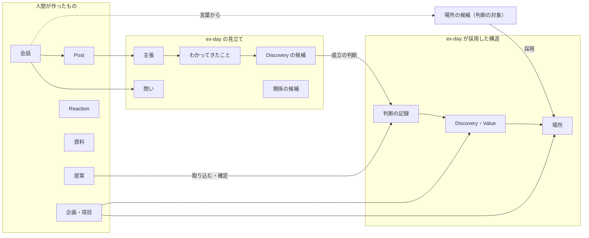
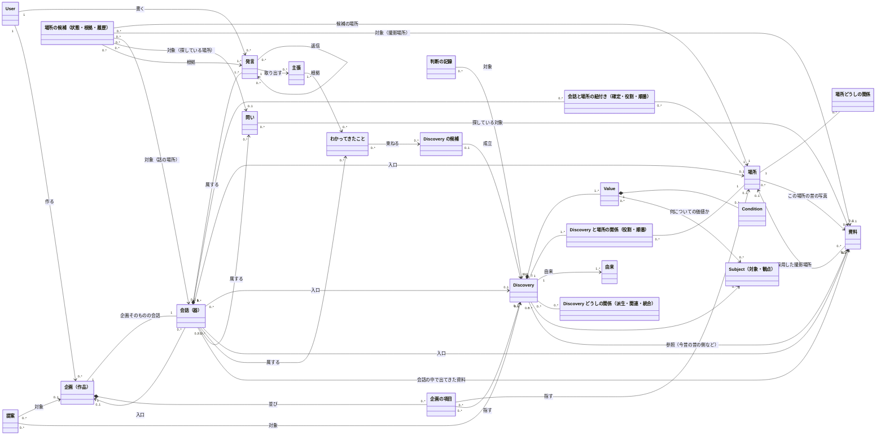

# ex-day ドメイン論理設計書 v0.6

- 作成日：2026-09-13（v0.6：2026-11-05）
- 状態：v0.6（2026-11-14 にレビューを受けて追記）。DEC-0019〜0022（根本整理：一番やりたいこと、場所・会話・Discovery、企画、TOP）と DEC-0015・0018（会話の解析）に合わせて、骨組みから書き直した版。v0.5 までの本文は Git の履歴にある（[Issue #132](https://github.com/ex-day/platform/issues/132)、[Issue #135](https://github.com/ex-day/platform/issues/135)）
- 用途：複数 AI および設計者が、同じ概念・責務・境界を前提に後続設計を行うための共通インプット

## 1. 根拠と本書の位置付け

### 1.1 根拠資料

- **[R] 要求仕様**（`ex-day_requirements.md`）：要求の一次資料。既存の要求参照番号は維持する。本書と食い違うところは、#135 の手順で要求仕様の側を直す
- **DEC**（`docs/decisions/`）：本書が反映している主な決定
  - DEC-0019：一番やりたいこと（地域の細かい発見を集めて体験へつなげる）と体験の構造
  - DEC-0020：場所を先に置き、会話を器にし、Discovery を発見・体験価値で定義する
  - DEC-0021：企画（作品）を置き、Discovery と多対多で関連付ける
  - DEC-0022：TOP と寄り道の入口
  - DEC-0015：会話の解析の構造（Post → 主張 → わかってきたこと、話題を外す、問いを独立させる、除外の規則）
  - DEC-0018：会話の解析の回し方（運用の記録は本書の外。12節）
  - DEC-0004〜0012：Post の独立した価値、発言としての位置付け、責務の分離、3つの層、会話の重複、認証、AI の解析の原則。DEC-0020 で置き換え・読み替えた部分は、各 DEC の Status の下に注記がある
- **[I] Issue の議論**：#132 の骨組みのコメント（2026-11-05）と、そこでの人の判断

### 1.2 確定度の読み方

- **確定（DEC-NNNN）**：DEC で決めたこと
- **確定（#132）**：#132 の骨組みで人が判断したこと
- **案**：本書で置いた案。レビューで確かめる
- **検討中**：後続の設計で決める

本書の確定事項はサービスの概念についてであり、すべてを MVP で作るという意味ではない。DB の物理設計、項目の一覧、データ型、キー、API、画面の配置、アルゴリズムは対象外とする。名前（英語名を含む）は仮称で、最終的な名前は人が確認する（DEC-0009 決定11、#65）。

## 2. ドメイン全体の考え方

### 2.1 一番やりたいことと体験の構造

**確定（DEC-0019）**。ex-day が一番やりたいのは、**Wiki や Google でも見つけにくい、地域の細かい発見を集め、その発見を体験できるところへつなげる**ことである。地元の人にとっての当たり前が、よその人（その分野が好きな人、マニア）から見ると「そうなの？」と驚く発見になる。その出会いを作る。

| 記号 | 体験 |
|---|---|
| A | 地域の記憶・発見に出会う |
| B | 隙間時間で寄り道する（そこで何分過ごせるか） |
| C | 今昔を見比べる |
| D | 記憶・発見を体験しに行く |
| E | 会話で育てる（投稿・返信・解析） |
| F | 問いに答える |

- A や C を集めて D につなげる。その過程が E である
- F は、E の結果として、また E に参加してもらうための入口として、問いを見せるもの
- 初期は A や C のデータがないため、B を中心に、体験できるデータ（場所）を用意する。企画（番付・まとめ・コース）も初期を支える

### 2.2 中核の概念

本書では次を中核の概念とする。

| 概念 | ひとことで |
|---|---|
| User | 参加する人 |
| 場所（Place） | どこか。Discovery や会話がなくても、最初から存在する |
| 会話（Conversation） | 投稿と返信のまとまり。器 |
| 発言（Post） | 会話の中の1つの発言 |
| Discovery | どこで、何を、どう体験できるか（場所や地域に関する具体的な発見・体験価値） |
| 企画（Project） | 作った人の意図と構成を持つ作品（コース・番付・まとめ・記憶） |
| 資料（Media） | 写真・地図・文書など。それ自体に話す理由を持ち、会話の入口になる |
| Reaction | 反応 |

価値の流れ：**場所（いま・ここ）→ 会話 → Discovery → 体験（Action）**。体験から新しい会話が生まれ、別の Discovery へつながる。企画は、場所や Discovery を並べ、会話のきっかけを作る。資料（古写真など）は、それ自体が会話のきっかけになり、今昔（C）の「昔の側」になる。これらはサービス体験の概念であり、同名の保存対象を作るという指示ではない。

### 2.3 3つの層

**確定（DEC-0009 を引き継ぎ、DEC-0015・0020 で中身を更新）**。

| 層 | 含むもの | 性質 |
|---|---|---|
| 人間が作ったもの | 会話、Post、Post 間の参照（返信等）、表示するタグ、Reaction、資料（Media）、企画とその項目、提案 | AI の解釈で書き換えない |
| ex-day の見立て | 主張、わかってきたこと（Finding）、問い、Discovery の候補、関係の候補、内部で持つタグ、検索のための情報 | 新しい Post や再解析で更新・分割・統合・失効してよい（DEC-0012） |
| ex-day が採用した構造 | 場所とその関係、採用した場所（会話と場所の紐付き、資料の撮影場所）、Discovery、Value、Condition、Discovery と場所の関係、由来、Discovery どうしの関係、Subject、判断の記録。**判断の対象**として、提案と**場所の候補**（状態と履歴を残す。5.6・5.7節） | 「確定」は真実の保証ではなく、ex-day のドメインモデルとして採用したことを意味する |

**層をつなぐルール（DEC-0009 を引き継ぐ）**：判断（成立、統合、派生、場所の確定など）の時点で、根拠となった Post と、それを支えたわかってきたこと（その版の内容）を判断の記録の側に写し取って固める。見立ての ID を参照するだけにはしない。見立てが後で組み直されても、判断の理由は失われない。

図は層と概念の読み方を表し、処理の順序・保持の方法を指定しない。

## 3. 中核の概念の定義と責務

### 3.1 User

**確定（v0.5 を引き継ぐ）**。発見し、情報・疑問・資料・証言・記憶を持ち寄り、反応し、企画を作る参加者。質問者・回答者・投稿者を固定された別種の User に分けない。

- 投稿・企画の作成の確定時に認証を求め、匿名での投稿は認めない（DEC-0010 決定2）
- 画面上の表示名は User が決めたニックネームだけ。Post や企画の表示名は表示のたびに今のニックネームを引く（#74・#75）
- User が持つ情報：プロフィール（ニックネーム、興味のある地域、興味。ニックネーム以外は他の人に表示しない）と、ログイン方法（UserIdentity。メールアドレスは持たない。DEC-0016）
- 住んでいる地域・生活圏、年代、性別は持たない（#76）

**検討中**：退会時の投稿・企画の扱い、個人以外の主体（事業者・団体）と User の関係。

### 3.2 UserInterest

**確定（v0.5 を引き継ぐ）**。User と、Theme・Subject・場所・時間等の興味の対象との関係。本人が申告した興味と、利用からシステムが推定した興味を区別して保持し、本人にも見える形で返す。

- 本人の明示的な「興味がある」「興味がない」・訂正を、推定より優先する
- 行動の履歴を長期に保存することを前提にしない。長く使う意味のある結果を UserInterest として保持する
- 興味の単位（Subject の観点の粒度など）は #73 で決める

### 3.3 場所（Place）

**確定（DEC-0020 決定1〜3）**。

**定義**：Discovery・会話・企画・UserInterest が関わる「どこか」。Discovery や会話がなくても、最初から存在する。寄り道の検索・地図・TOP・場所のページの対象になる。

**出どころ**：

- **オープンデータ**（最初からある）：寺社、駅、公園、テーマパーク、坂、国道、航路など。行政区域・町丁・字の境界も
- **会話・投稿から育つ**：今はない場所（昔の跨線橋）、「桜木町周辺」のような会話から生まれるエリア。AI が候補を出し、人が確定する（DEC-0012）

**形**：地点（Point）・エリア（Area）・経路（Route）。経路は、構成する地点と順番を持つ（定期航路、散歩道など）。

**種類**：1つの場所は複数の種類を持てる（小机城址：城跡・公園）。場所の種類（公園、寺、駅など）は場所に持つ（DEC-0007 決定9 の注記）。場所以外の対象の種類（船など）は Subject（対象）の性質とする（6.1節）。

**場所に付く情報**：

- 行き方：代表の駅・入口、駅から先の手段（DEC-0013 決定2・3 の「行き方」は場所に持つ）
- データから計算した推定の値：坂の勾配など（企画の番付に使う。DEC-0021）
- 場所の情報：「桜並木がある」「桜の名所」のような、体験価値の手前の情報（3.6.2節）
- 声の数など、会話・Discovery から算出する情報（永続の状態にはしない）

**全国の受け皿**：粗い場所（都道府県、市区町村、町丁・字）を全国分あらかじめ用意し、どこで話し始めても受け皿があるようにする（DEC-0020 決定3）。会話のない場所は画面に出さない。

**動くものは場所にしない**：船・列車・山車・移動販売などは Subject（対象）として持ち、Discovery は、その対象を体験できる場所に役割つきで紐付ける（6.1節）。動かないもの（係留されている氷川丸など）は場所でよい。

**検討中**：今はない場所・旧地名・境界の時間変化の持ち方、「○○付近」のエリアの作り方（地名の辞書のエリアか、地点と半径か。#82）、場所の重複（「桜木町周辺」と「桜木町駅のあたり」）の扱い、オープンデータの取り込み元とライセンス（Wikidata は CC0、OSM は ODbL で要確認）。

#### 3.3.1 場所どうしの関係

**確定（DEC-0020 決定2）**。場所どうしの関係は、種類の違う複数の関係として持つ。1本の木（親子関係）にしない。

| 関係の種類 | 例 |
|---|---|
| 行政の階層 | 神奈川県 ＞ 横浜市港北区 ＞ 小机町 |
| 地理的な包含・重なり | 小机城址市民の森（エリア）の中に小机城址（地点）。行政の境界をまたぐエリア |
| 観光・生活のエリア | 中華街、元町、「桜木町周辺」 |
| 施設の所属 | 駅の出入口、寺の境内の建物 |
| 経路の構成 | 経路を作る地点とその順番 |

### 3.4 会話（Conversation）

**確定（DEC-0020 決定4、#132）**。

**定義**：投稿と返信のまとまり。**器**であり、Post は会話に属する。最初の Post で生まれる。DEC-0006 決定1（Discovery が器）を置き換える。

**場所との紐付き**：

- 会話は場所と0件以上紐付く。紐付きが1つもない「場所未定」もある
- 紐付きには、**候補**（言葉から読み取った・誰かが挙げた）と、**確定**（採用した）がある。候補は「場所の候補」（5.7節）として、根拠・状態・履歴を持つ。確定は、候補を採用する判断（判断の記録）を経たもので、誰が・どの基準で採用したかを残す。確定は絶対的な真実ではなく、後から取り消し・再判断できる
- 経路の話では、始まり・経由・終わりの役割と順番を持つ
- 話が進むほど紐付く場所が増える（「汽車道経由？」「そう」で汽車道が確定する）
- 紐付きは後から直せる（付け替え、取り消し）
- Post は場所を直接持たない。場所は会話の紐付きを使う（DEC-0005 を引き継ぐ）

**会話の始まり方**（投稿の種類）：

| 投稿の種類 | 例 | 最初の紐付き |
|---|---|---|
| 体験の共有 | 「汽車道を歩いたら気持ちよかった」 | 場所（確定） |
| 今の様子 | 「大岡川の桜、今満開！」 | 場所（確定）＋今という時間（DEC-0002 の現在性） |
| 問い | 「水車のあるそば屋はどこ？」「この段差はなぜ？」 | 場所の候補、または場所未定 |
| 記憶・昔話 | 「昔、駅の外の跨線橋で行商人が魚を売っていた」 | 場所（昔の場所・今の跡地） |
| 資料から始める | 古写真を載せて「この写真の場所はどこ？」 | 入口＝資料。場所の候補、または場所未定 |
| 企画をきっかけにした話 | 「この坂、雪の日はタクシーも上れない」 | 場所（確定）＋入口＝企画 |
| 対象そのものの話 | 「青柳の干物って、どうやって作るの？」 | 場所未定（地域が出れば候補） |

- 種類は会話の型ではない。問いは会話の途中でも生まれ、1つの会話に答えの出た問いとまだの問いが混ざる（4.3節）
- 投稿のときに「どこの話？」を聞くが、任意で、選ばなくてもよい（DEC-0020 決定3）。スマホでは現在地から近い場所を候補に出す

**入口（何をきっかけに始まったか）**（#132、2026-11-14 の人の確認）：

会話は入口を0..1持つ。入口は、場所・Discovery・企画・資料のどれか、またはなし。入口は話し始めたきっかけであり、場所との紐付き（上）とは別に持つ。入口が資料でも、話が進んで場所が分かれば、場所と確定で紐付く。

| 入口 | 話し始めるところ | 会話の居場所（まず出るページ） | ほかに出るところ |
|---|---|---|---|
| 場所 | 場所のページの「話す」、投稿の「どこの話？」 | その場所のページ | 話の中で確定したほかの場所のページ |
| Discovery | Discovery のページの「この発見について話す」（補強・訂正・続き） | その Discovery のページ | Discovery の場所のページ |
| 企画 | 企画のページ（企画そのものの会話／項目の場所の話） | 企画のページ | 項目の場所のページ（企画が閉じても残る） |
| 資料 | 写真・資料を載せて話す（「この写真の場所はどこ？」） | **資料のページ**（3.9節） | 候補の場所のページ（「このあたりの写真を探しています」）。場所が分かったら、その場所のページの「この場所の昔の写真」 |
| なし | 何も選ばずに話す | **会話自身のページ** | 候補の場所のページ（「このあたりで探している人がいます」）、TOP の「探しています」、投稿した人の「自分の話」 |

- **どの会話にも居場所がある**：入口があれば入口のページ、入口がなければ（資料のときは資料のページ、なしのときは会話自身のページ）
- 企画そのものの会話（3.7節）は、入口＝その企画の会話の1つとして扱う

**何にも紐付いていない会話を届ける**：場所未定の会話は、場所のページや地図にそのまま出せない。必ず誰かの目に届く道を用意する。

- 言葉・写真から読み取った**候補の場所**のページに、「このあたりで探している人がいます」と出す。候補の場所の近くを見た人、その地域を興味のある地域にしている人、現在地が近い人に届く
- 手がかりがまったくないときは、TOP の「探しています」に少しずつ出す、写っているもの・話の対象（Subject）から届ける、時間が経ったら手がかりを足してもらう問いを立て直す
- 投稿した人は「自分の話」からいつでも戻れ、返信や答えが来たら知らせる
- 具体的な見せ方（TOP の枠など）は画面の設計で決める（DEC-0022）

**ほかとの関係**：

- 会話から取り出すもの：主張、わかってきたこと、問い、Discovery の候補（4節）
- 会話の中で出てきた資料（返信に添えた写真など）。資料についての会話（入口＝資料）とは別の関係（3.9節）

**公開**：会話は公開状態（公開／非公開）を持つ。

**検討中**：会話の単位（1つの投稿から始まる返信のまとまりを1つの会話とするか）、会話の分割・統合、重複した会話の扱い（DEC-0010 決定1：重複は歓迎し、乱立は避ける。重複した会話を前に出さない）。

### 3.5 発言（Post）

**確定（DEC-0004・0005・0008 を引き継ぐ。DEC-0020 で所属を変更）**。

- 会話の中の発言。新しい話を始める発言も返信も同じ Post として対等に扱う
- **会話に属する（1）**。投稿先の Discovery（器）は持たない（DEC-0009 決定8 の注記）
- 問い・情報・体験・記憶・証言・資料の説明などを持ち寄る単位で、単独でも価値を持つ。「疑問／知識」等の固定的な型を持たない（DEC-0005 決定1）
- 場所・時期・分類・Value を直接持たない。場所は会話の紐付き、価値は会話から取り出した Finding と Discovery の側で扱う
- 投稿の成立と、解析・構造化・Discovery の成立を分ける（DEC-0005 決定7）
- Post 間の参照（返信・メンション・引用。PostReference）を持つ。人が与える強い文脈の情報として解析で優先して使うが、判断の前提にしない（DEC-0007 決定8）
- 表示するタグ（書いたまま）を持てる。必須にしない（DEC-0009 決定10）
- 品質の評価そのものを目的とした投稿（星評価、ランキング、店舗比較、口コミサイト的な評価）は対象にしない。体験・記憶の一部としての主観的な感想は妨げない（v0.5 を引き継ぐ）。ユーザーの企画の番付（DEC-0021）は作品の並びであり、品質評価の投稿とは別に扱う（3.7節）
- 伝聞や曖昧な記憶が集まったことをもって、確定した史実や今の営業情報とみなさない

### 3.6 Discovery

**確定（DEC-0020 決定5・6・9、#132）**。

#### 3.6.1 定義

**Discovery は、場所や地域に関する、具体的な発見・体験価値である。ひとことで言えば「どこで、何を、どう体験できるか」。** 体験できるだけでは Discovery にならず、「どこで」が付いて初めて Discovery になる（#132 の人の整理）。

- どこから生まれたか（会話・投稿・企画・運営）では定義しない（3.6.3節）
- **場所を1つ以上持つ**（#132 の決定）。場所は粗くてよい（町丁・字、市区町村、「東京湾沿岸」のような広いエリア）。細かい場所が分かれば付け替える
- 「何としての話か」は Subject（対象・観点）と Value が表す。場所は「どこか」だけを表す。同じ場所に、観点の違う Discovery が並ぶ
- 時期・時間帯の条件（体験価値の高い時間）は、場所ではなく Value の Condition が持つ
- 成立は、正確性や価値を運営が保証することではない（DEC-0006・0015 を引き継ぐ）
- 疑問から成立する Discovery もある（「身近な高低差に気付き、その理由を一緒に考える」のような疑問起点の Value。v0.5 を引き継ぐ）

#### 3.6.2 線引きの例

| 言葉 | Discovery か | 理由 |
|---|---|---|
| 豪華客船での旅、豪華列車でのクルーズ | ならない | 対象と体験の種類だけで、場所がない |
| 豪華列車で三重を巡る旅 | なる | 場所（運行区間）と体験がある |
| 日の出桟橋から豪華客船で旅に出る | なる | 場所（日の出桟橋、役割＝発着地）と体験がある |
| 大さん橋で、時折立ち寄る豪華客船を見られる | なる | 場所（大さん橋、役割＝見られる場所）、対象（豪華客船という広い種類）、繰り返す時間 |
| ○月○日に客船が大さん橋に寄港する | ならない | 単発の予定。出来事（11節の検討中） |
| 桜木町から汽車道を通って山下公園へ。散歩にちょうどいい | なる | 場所の組み合わせと順番に体験価値がある |
| 桜木町 → 汽車道 → 山下公園（地点を並べただけ） | ならない | 単なる経路。場所（経路）として持つ |
| 大岡川に桜並木がある | ならない | 場所の情報 |
| 大岡川の桜並木を、夜にライトアップされた川沿いで歩く | なる | そこでどう楽しめるかがある |
| 青柳の干し方 | ならない | 場所と関係のない知識。Subject（対象）の知識として持つ |
| 漁師の子どもが、おやつに青柳を干したものを食べていた（生麦） | なる | 地域（役割＝食べられていた地域）と、地域の記憶がある |
| ある日、客船の出港を見送った（1人の思い出） | ならない | 単発の思い出。会話の中の声。積み重なって繰り返しの傾向や場所の昔の姿が分かれば Discovery になり得る |

#### 3.6.3 生まれ方

**確定（DEC-0020 決定5）**。Discovery は会話がなくても成立し得る。

- 投稿の時点で成立する（具体的な発見・体験価値が1つの投稿で分かる）
- 企画の登録の時点で成立する（「三崎でまぐろ料理と港町を楽しむ半日旅行」）
- 会話から取り出される（1つの会話から複数の Discovery が取り出されてよい。小机城址の会話から、空堀の Discovery と桜の Discovery）
- 既存の Discovery から派生する（5.3節）
- 運営が登録する（#57）

どこから成立したかは **由来**（5.4節）として残す。成立後も、会話・資料で補強され、派生し得る。

**Discovery は成立したときに作る**。成立前の状態（`UNESTABLISHED`）は持たない（DEC-0020 決定9。DEC-0006 決定2 を置き換え）。まだ形になっていない話は、会話の中の Finding・問い、または Discovery の候補（4.4節）として持つ。

#### 3.6.4 場所との関係

**確定（DEC-0020 決定6、#132）**。Discovery と場所の関係は、**役割と順番**を持つ。

| 形 | 例 | 関係 |
|---|---|---|
| 1か所 | 小机城址の空堀、鶴見の急坂 | 場所が1つ |
| 役割の違う複数の場所 | 青柳の干物（食べられていた地域＝生麦、体験できる場所＝今も干している漁港・買える店）、跨線橋（記憶の場所＝昔の跨線橋、今の跡地＝川崎駅）、豪華客船（発着地・母港・寄港地・見られる場所） | 場所ごとに役割 |
| 順番のある組み合わせ | 汽車道を通って山下公園への散歩、冬の富士山を楽しむドライブ、豪華列車で三重を巡る旅（運行区間） | 始まり・経由・終わりの順番 |

- 役割の例：記憶の場所、今の跡地、体験できる場所、食べられていた地域、発着地、母港、寄港地、運行区間、見られる場所、始まり、経由、終わり。**役割の種類は、例が出るたびに足せる形にする**
- 単なる地点の羅列や経路は Discovery とは限らない。組み合わせや順序そのものに具体的な発見・体験価値がある場合に、そのコースが Discovery になり得る
- 期間を持つ関係がある（過去の運行区間など）

**表示の決まり**（DEC-0020 決定6）：

- 場所のページ：その場所が関わる Discovery を、役割つきで出す
- Discovery のページ：関わる場所をすべて地図に出す（順番のあるものは線で）
- 一覧・寄り道で数えるとき：1つの Discovery は1回だけ数える。出す位置は、行けば体験できる場所（役割が「体験できる場所」の場所、または始まり）

#### 3.6.5 Discovery 自身の状態と周辺の責務

**確定（DEC-0006 決定3〜11 の原則を引き継ぎ、DEC-0020 決定9 で整理）**。次は別々の判断であり、1つの状態の列に詰め込まない。

| 判断・情報 | 持つところ |
|---|---|
| 発見の成立 | Discovery。成立したときに作る（成立の判断は判断の記録に残す） |
| 公開 | Discovery の公開状態（公開／非公開）。成立とは独立した制御 |
| 解析・関連付けの完了 | 解析の記録（12節） |
| 情報の裏付け | Finding・Evidence の側 |
| 同一性（ほかの Discovery と同じか） | Discovery どうしの関係（統合・関連） |
| 確認・要レビュー | 判断の対象の側（Value・Evidence・関係・資料など）。要レビューは未解決の判断の対象から導く |
| 安全性 | Post・資料などの側（モデレーション） |
| 知識の状況（答えが出ていない、説が複数ある） | Finding・問いから解析・要約される情報。永続の状態にしない |
| 推薦 | Value・Condition と一回の Context から都度算出する。保存しない（6.4節） |
| 活発度・新しさ・現在性 | 会話・Reaction・日時・Condition から算出する |

ドメインの状態と画面の表示を一対一にしない（DEC-0006 決定11）。

#### 3.6.6 Value

**確定（v0.5 を引き継ぐ）**。Discovery で知る・見る・体験することのできる価値・魅力。Discovery は Value を1件以上持つ。

- 異なる Value があるだけで Discovery を分割しない
- Value は、会話から取り出したわかってきたこと（Finding）のうち種類が価値のものや、投稿・企画の登録で示された体験価値が、判断を経て採用されたもの
- Value は Subject（対象・観点）によって「何についての価値か」を意味付けられる
- 疑問起点の Value を持てる。答えや原因が確定した価値としては扱わない
- Post が単独で価値を持つことと、Value であることは区別する

#### 3.6.7 Condition

**確定（v0.5 を引き継ぐ）**。Value ごとに0件以上持つ、その価値が成立する・利用できる・推薦の価値が高まる条件（時期・季節・時間帯・曜日・繰り返し・期間など）。

- ある軸の Condition がないことは、その軸に依存しないという意味であり、「いつでも成立する」という積極的な主張とは異なる
- 歴史的な時代（「中世」）は話題の意味を説明する時間であり、Condition の時期とは区別する（6.3節）
- 単発の予定（特定の日だけ）は Condition にせず、出来事として扱う（11節）

### 3.7 企画（Project）

**確定（DEC-0021、#132）**。

**定義**：作った人（運営 または ユーザー）の意図と構成を持つ**作品**。運営の「いま募集中」のお題も、ユーザーの作ったコースやまとめも、企画として表す。作品専用の別のドメインは作らない。作者ごとに独立した作品として持つ。MVP に、運営の企画とユーザーの企画の両方を入れる。

**型**：

| 型 | 並び | 例 |
|---|---|---|
| コース | 順番がある | おすすめの散歩、富士山の見えるドライブ、三崎のまぐろ半日旅行 |
| 番付 | 順位がある | 鶴見の急坂、短い国道 |
| まとめ | 順位なし（条件で集める） | ゆっくり花見ができる場所 |
| 記憶 | 一覧より声が中心 | 地元のおやつの記憶 |

**持つもの**：

- 作った人、型、呼びかけ（「みんなの知ってる急坂はどこ？」）、説明、状態（募集中・閉じた）
- **企画の項目（ProjectItem）**：並び・組み合わせの1つ。**場所 または Discovery を指す**。順番・順位、作った人の説明を持つ。番付の候補はまだ Discovery のない場所のことが多い。価値ある組み合わせのコースは Discovery を指す
- **企画そのものの会話（1）**：企画について話す場所（並びへの意見、提案のもと）。企画が閉じたら読むだけ（#132 の決定）
- 並びの変わった履歴

**ほかとの関係**：

- **企画をきっかけにした会話（0..*）**：中身は場所の会話。会話の入口＝この企画として紐付く（3.4節）。企画が閉じても、場所の会話として残る。企画のページからは「この企画から始まった会話」としてたどれる
- **企画と Discovery は多対多**：企画の項目として Discovery を並べる場合と、企画の登録の時点で成立した Discovery（由来＝企画）の場合がある。同じ Discovery を、別の作品の項目が指してよい。企画は場所や Discovery の持ち主にはならない
- **企画（作品）と Discovery は同一視しない**。作品は作者の意図・構成の単位、Discovery は発見・体験価値の単位。番付・まとめの並びそのものは Discovery にしない。コース型の作品そのものが Discovery になるとは限らない（3.6.4節）
- 企画に関わる Discovery が時期の条件を持つと、企画とは関係なく TOP の「いま、この時期」に出る（DEC-0022）

**並びの直し方**：作った人以外は並びを直接書き換えない。提案（5.6節）し、作った人が取り込む。

**番付の順位**（#132 の決定）：並べるのは作った人。根拠（推定の値、声の数）は横に添えて見せる。データから作る番付は、推定の値の順を最初の並びにし、作った人が直せる。人気投票で順位を決めない。

**過信しないための歯止め**（DEC-0021 決定5）：作った人を出し、ex-day の認定に見せない。根拠と並べる。人気投票だけで順位を決めない。作るにはログインが要り、1人が作れる数に上限を設ける。通報と、暫定公開＋事後チェック（案D）の対象にする。似た企画は作る前に案内する。作った人がいなくなったら、企画は閉じる。MVP ではフォロー・メッセージなどのソーシャルの機能を持たない。

**検討中**：運営のお題にユーザーの作品が応える形（お題と作品を同じ企画で表すか、企画どうしの関係として表すか）、企画の公開範囲、作れる数の上限の値、提案の取り込みを作った人以外が行えるか、Theme（6.2節）を企画の器に使えるか。

### 3.8 Reaction

**確定（DEC-0009 決定9 を引き継ぐ）**。User から対象への簡単な反応。意味は対象によって異なる。

| 対象 | 意味 | 注意 |
|---|---|---|
| Post | 発言への共感 | ― |
| Discovery・Value・わかってきたこと（価値） | 「わかる」「行ってみたい」 | 確からしさ・推薦の材料 |
| わかってきたこと（裏付けのない説） | 「そうかも」 | 正しさの証拠にしない |
| わかってきたこと（裏付けのある知識） | 付けない | 確からしさは資料・出典で決まる |
| 問い | 「自分も気になる」 | **案**：問いを独立させたので、問いの Post ではなく問いに付ける |
| Subject・Condition 単独 | 付けない | 意味をなさない |

- 品質評価そのものを目的とした反応（星評価、ランキング）を対象にしない
- Reaction の数を事実の正しさに置き換えない

**検討中**：反応の種類、企画・企画の項目を対象に足すか（番付の根拠の「声の数」と混ぜない）。

### 3.9 資料（Media）

**確定（#132、2026-11-14 の人の確認）**。v0.5 では資料を Discovery への提供物として扱った。v0.6 の最初の版では提供先を会話にする案を置いたが、**資料を独立した中核の概念**とした。

**定義**：写真・地図・文書・音声などのデジタル資産と、それを説明する情報。

**独立させる理由**：

- 資料は、それ自体に話す理由を持つ（古写真の「どこ？」「いつ？」「何が写っている？」）
- 1つの資料が、複数の会話・Discovery・場所に関わる（場所を探す会話、今昔の Discovery の昔の側、場所のページの「この場所の昔の写真」）
- 資料だけが持つ情報がある（撮影場所、撮影時期、提供者、出典、権利）
- ex-day のもとの構想（古い写真・地図と今の風景を比べる）と、今昔（C）の入口になる

**持つもの**：

- **撮影場所**（または資料が表す場所）：**候補**は「場所の候補」（5.7節。対象＝この資料、何の場所か＝撮影場所）として、複数の説と根拠・状態・履歴を持つ。**採用した撮影場所**は、候補を採用する判断を経て、資料の側に別に持つ（候補の上書きではない）。分からなければ持たない。投稿した人の現在地を撮影場所とみなさない
- **撮影時期**（作成時期）：不明・推定を含む。話題の時代や体験の時期と混同しない（6.3節）
- **写っているもの**：Subject（対象）の候補・確定
- **提供者・出典・権利**：資料自体に持ち、統合などで失われないようにする。写っている人（肖像）や、他人が撮った写真の権利の扱いは、モデレーションの対象としてはっきり持つ

**関係**：

| 関係 | 例 |
|---|---|
| 資料についての会話（会話の入口＝資料） | 「この写真の場所ってどこか分かります？」。居場所は資料のページ |
| 会話の中で出てきた資料 | 返信に「昔はこうだった」と写真を添える。ともに出された Post をたどれる |
| Discovery から参照 | 今昔の Discovery の「昔の側」、Discovery の説明の写真 |
| 場所から参照 | 撮影場所を採用した資料は、その場所のページの「この場所の昔の写真」に出る |
| 根拠（Evidence） | 主張・わかってきたことを支持・反証する資料（7節） |

**資料のページ**：入口が資料の会話の居場所。資料を大きく出し、分からないこと（撮影場所・時期）は分からないと出す。会話から取り出した問い（「この写真の場所はどこ？」）と場所の候補（「ここかも」「違うと思う」）、会話を並べる。

**検討中**：外部の URL だけの資料を持つか、同じ資料の重複（同じ写真が別々に上げられる）の扱い、資料の差し替え・版、肖像・権利の確認の手順。

## 4. ex-day の見立て

**確定（DEC-0009・0012・0015・0020）**。以下は ex-day の見立ての層の概念である。中核の概念でも採用した構造でもない。新しい Post や再解析で更新・分割・統合・失効してよい。どの解析の版で作られたかをたどれるようにする（12節）。

### 4.1 主張（Claim）

**確定（DEC-0015 決定1・2・6）**。Post から取り出した1つの主張。根拠の Post を持つ。除外の状態と理由を持つ（除外の規則。除外は「後から直す」扱いにしない例外。DEC-0012・0015）。

### 4.2 わかってきたこと（Finding）

**確定（DEC-0015 決定1・4、DEC-0020 で所属を変更）**。

- 種類は説・価値の2つ（観察は説に含める）
- **会話に属する**（「Discovery／話題に属する」から変更）
- 根拠の主張（とその Post）、未確認の状態、関連する場所、解析の版を持つ
- 版の履歴を持ち、Reaction はどの版に付いたかを保持して引き継ぐ
- Finding は ex-day の事実認定ではない（「寄せられている情報・説・価値」）

### 4.3 問い（OpenQuestion）

**確定（DEC-0015 決定5、#132）**。まだわかっていないこと。

- **会話に属する**。会話の途中でも生まれ、1つの会話に複数の問いがあってよい
- 問いの Post（人が書いたもの）と、問い（ex-day が「まだわかっていない」と見立てたもの）を分ける。「？」がある Post がそのまま問いになるとは限らない。投稿にない問いを、会話の中身から取り出すこともある（「この坂の名前の由来は分かっていない」）
- 場所がなくても存在できる。わかってきたこと・Discovery と関係を持てる
- **何を探している問いか**を持つ（例：「この資料の撮影場所はどこか」＝対象はこの資料の撮影場所。「水車のあるそば屋はどこか」＝対象はこの問いが探す場所）。**問いは場所の候補を自分では持たない**。候補は、探している対象の「場所の候補」（5.7節）が正本で、問いはそれを参照する
- 回答の状態（まだ／答えが出た）と、答えになった Post を持てる。場所を探す問いの「答えが出た」は、対象の場所の候補が採用されたことから導く（取り消されたら「まだ」に戻る）
- 場所の候補がある問いは、候補の場所のページに「このあたりで探している人がいます」として届ける（3.4節）
- 種類の例：場所を探す問い（「どこ？」）、理由を探す問い（「なぜ？」）、正体を探す問い（「これは何？」）
- 企画の「みんなの知ってる急坂はどこ？」や、運営の「この場所の昔を、知っていますか？」は、問いではなく**呼びかけ**として、企画や画面の文言に持つ

### 4.4 Discovery の候補（DiscoveryCandidate）

**確定（DEC-0020 決定9）**。わかってきたことの束（や、1つの投稿・企画の内容）から、「これは Discovery になりそう」という候補。v0.5 の「発見の仮説（DiscoveryHypothesis）」を改名し、役割を整理した。

- 場所の候補、Subject の候補、価値の候補を持つ
- 成立の判断（5.1節）を経て Discovery を作る。作ったあとは、由来（5.4節）として残る
- 既存の Discovery との突き合わせ（同一・関連・派生）の単位にもなる（関係の候補。4.6節）

### 4.5 場所の読み取り

**確定（DEC-0020 決定3・4）**。会話・資料の言葉や写っているもの（地名、目印、看板）から、場所を読み取る。読み取った結果は、見立てのまま置かず、「場所の候補」（5.7節。判断の対象）として登録する。地名の辞書と位置の判定（#82）が入力になる。

### 4.6 関係の候補

**確定（DEC-0020 決定7・8、DEC-0009・0015 の注記）**。Discovery の候補と既存の Discovery、または Discovery どうしについての、同一・関連・派生の候補。

- 判断の基準（体験価値・成立条件・由来・既存の Discovery との関係）は、AI の今の精度と切り離して後続の設計で先に定める
- AI に候補の提示だけを任せるか、自動の確定まで許すかは、評価の結果に応じて、精度・閾値とともに決める
- 「1人の1つの発言だけでは候補にしない」という制約は、Discovery の成立条件には適用しない

### 4.7 タグ

**確定（DEC-0009 決定10 を引き継ぐ）**。表示するタグ（Post に付く。書いたまま）と、内部で持つタグ（表記の揺れを吸収し Subject に対応付けたもの。見立て）に分ける。必須にしない。

### 4.8 検索のための情報（SearchProfile）

**確定（DEC-0020 決定8）**。Discovery・場所・企画から、登録時やバッチで取り出す Subject・Value・場所・時間・体験の条件（とベクトル）。検索のときに LLM を使うことを前提にしない。SQL・ベクトル検索で使う。**検索の単位（比べる・まとめて見せる単位）は、Discovery の単位と一致しなくてよい**。

## 5. 判断と関係

### 5.1 成立の判断

**確定（DEC-0006 決定3 の原則を引き継ぎ、DEC-0020 で整理）**。

- Discovery として成立させる（作る）判断は、記録に残す（判断の記録。5.8節）
- ユーザーに成立の判断の責任を負わせない。投稿・Reaction は判断の材料であり、判断そのものではない
- 投稿・企画の登録・会話からの取り出し・派生・運営の登録のどれでも、同じ基準（場所や地域に関する具体的な発見・体験価値か）で判断する
- 成立の前に、既存の Discovery との関係（同一・関連・派生）を確かめる（5.2節）

**検討中**：成立の判断の主体と基準（投稿の時点で成立とみなす条件、AI の役割、人の確認）。

### 5.2 同一性と統合

**確定（DEC-0020 決定8・10、DEC-0007 決定4 を引き継ぐ）**。

- テーマ・場所・経路が一致するだけで統合しない。判断の材料は、体験価値と成立条件（時期・時間帯・誰向けか等）の違い
  - 例：同じ三崎でも「まぐろ料理と港町」と「旬の野菜と海の景色」は別の体験価値になり得る
  - 例：同じ豪華列車でも、北海道の区間と四国の区間は別の Discovery
- 同じかどうか分からないものは、独立した Discovery（の候補）として関連付けておく
- 統合は可逆にし、もとの Discovery と会話へのたどり方を残す（DEC-0005 決定5：探索の過程を消さない）
- 会話の重複は歓迎し、Discovery の乱立は避ける（DEC-0010 決定1）

### 5.3 派生

**確定（DEC-0020 決定7、DEC-0007 の注記）**。既存の Discovery から、別の意味の Discovery が生まれた関係。会話からの取り出し（由来）とは別の関係として持つ。

- 派生先から、派生の根拠となったわかってきたこと・主張・Post の集まりを参照する。Post はコピーせず、元の会話に残して参照する（DEC-0015 決定8）
- 会話を分割しない（DEC-0007 決定5）
- 自動で確定しなくてよい

### 5.4 由来（DiscoveryOrigin）

**確定（DEC-0020 決定5・7）**。Discovery がどこから成立したか。複数持てる。

| 由来 | たどれるもの |
|---|---|
| 会話 | 根拠のわかってきたこと・主張・Post（判断の時点の版を判断の記録に固める） |
| 1つの投稿 | その Post |
| 企画 | その企画（と項目） |
| 派生 | 派生元の Discovery（5.3節） |
| 運営の登録 | 登録の記録 |

### 5.5 Discovery どうしの関係（DiscoveryRelation）

**確定（DEC-0020 決定7・8）**。Discovery どうしに明示的に持つ関係：派生、関連（似ている、同じ場所の別の観点など）、統合（可逆）。Subject を介して都度導ける意味の関連（6.1節の横断の探索）を、すべて保存するためのものではない。

### 5.6 提案（Proposal）

**確定（DEC-0009 決定7 を引き継ぎ、対象を広げる）**。

- 対象の側が状態（提案中 → 取り込み・確定／却下／失効）を持つ。確定・却下は判断の記録に残す。却下は、同じ提案を繰り返さない関門として残る
- 対象：
  - Discovery への提案：補完、新しい Value の追加、関連、統合、派生
  - **企画への提案**（DEC-0021 決定4）：「この坂も入れて」「順番はこっちが上では？」。作った人が取り込む。企画そのものの会話から生まれることが多い
  - 場所の情報の訂正（**案**）。場所の確定・付け替えは、場所の候補（5.7節）として扱う

### 5.7 場所の候補（場所の説）と採用

**確定（#132、PR #138 のレビュー 2026-11-13）**。「どこか」について出された説を、上書きせずに残し、探索の過程と、採用されなかった説を失わないようにする。提案（5.6節）と同じく、判断の対象として状態と履歴を持つ。

**1件の場所の候補が持つもの**：

| 項目 | 内容 |
|---|---|
| 対象と、何の場所か | 資料の撮影場所、会話の話の場所、問いが探している場所（そば屋の店など） |
| 候補の場所 | 場所（Place）。まだ場所がなければ、会話から育つ場所として足す（3.3節） |
| 根拠 | 根拠となった Post・主張・わかってきたこと（複数）。AI が読み取ったものか、人が挙げたものか |
| 支持・反対の声 | 「ここかも」「違うと思う」（人間が作ったもの。判断の材料であり、判断そのものではない） |
| 状態 | **検討中**／**採用**／**不採用**／**取り消し**。AI が読み取っただけで誰も触れていない候補は、失効してよい |
| 状態の履歴 | いつ・誰が（どの基準で）・なぜ状態を変えたか。判断の記録（5.8節）につなぐ |

**正本**：場所の候補は、**対象ごとに1か所**に持つ（対象＝資料なら資料の撮影場所の候補、対象＝会話なら話の場所の候補、対象＝問いなら問いが探す場所の候補）。会話・問い・資料に同じ候補を複製しない。

- 問い「この資料の撮影場所はどこか」は、資料の撮影場所の候補を参照する（自分では持たない）
- 会話は、その会話の中で出された候補を、根拠の Post からたどって見せる
- 同じ場所が別の人から再び挙げられたら、新しい候補を作らず、同じ候補に根拠と声を足す

**採用**：

- 採用は、判断の記録（判断の主体・基準・根拠）を経て行う。採用した場所は、**採用した構造として別に持つ**（資料の採用した撮影場所、会話と場所の確定の紐付き）。候補の状態の上書きではない
- 採用は絶対的な真実ではなく、ex-day が今採用した構造である。後から取り消し・再判断できる（5.9節）。別の候補を採用し直したら、前の採用は「取り消し」として履歴に残る
- 採用から導くもの：資料の撮影場所を採用すると、その資料についての会話も、その場所と確定で紐付く（紐付きの根拠＝この採用。候補は複製しない）。問いは「答えが出た」になる

**責務の分け方**：

| 概念 | 責務 |
|---|---|
| 会話 | 調べていく過程の器 |
| 問い | 何を探しているか（「この資料の撮影場所はどこか」） |
| 場所の候補 | 複数の説と、それぞれの根拠・状態・履歴 |
| 採用した場所 | ex-day が今採用した構造（資料の撮影場所、会話の確定の紐付き） |

**例**：提供者が「横濱橋商店街だと思う」と投稿し、別の人が「近くの別の商店街では」と返し、さらに「写っている [○○] 店が今もある」という根拠が加わって別の商店街に決まる場合（9.8節）。横濱橋商店街の候補は上書きされず「不採用」として残り、なぜ不採用になったか（別の候補の根拠）とともにたどれる。

### 5.8 判断の記録（DiscoveryDecision）

**確定（DEC-0006・0009 を引き継ぎ、対象を変更）**。成立・統合・派生・関連・場所の確定・提案の確定と却下などの判断と根拠を残す。判断の方式（自動／人）、主体、時点、対象（会話・候補・Discovery・企画・場所の紐付き）、比べた既存の Discovery、結果、理由。判断の時点で根拠の Post と Finding（その版）を固める。自動の判定に架空の User を求めない。

### 5.9 後から直せること

**確定（DEC-0020 決定10、DEC-0012）**。成立、場所の紐付き・場所の候補の採用、由来・関連・派生、統合は、どれも後から直せる。誤判定を前提に、判断の記録、再評価、人による訂正、統合の取り消しをできるようにする。誤判定の率の監視、再評価のきっかけ、訂正・取り消しの手順は後続の設計の対象とする（DEC-0009・0015 の注記）。モデルを変えてもドメイン上の意味を保つ。

## 6. Subject・Theme・Time・Context

### 6.1 Subject（対象・観点）

**確定（v0.5・DEC-0007 を引き継ぎ、#132 で補足）**。

- Subject は、Discovery・会話・UserInterest が「何について」かを捉え、横断して同じ意味を指す、統制された共通の意味の概念
- **対象**（話題の対象となるもの：氷川丸、汽車道、青柳の干物、豪華客船）と、**観点**（何についての話か：歴史、景観、散歩、食文化、季節の楽しみ）に分ける
- 対象は、特定のもの（ある客船）でも、広い種類（豪華客船）でもよい。粒度は #73 と合わせて決める
- **動くもの**（船、列車、山車、移動販売）は対象として持つ。Discovery は、その対象を体験できる場所に、役割（発着地、母港、寄港地、運行区間、見られる場所）と期間つきで紐付ける
- **場所と関係のない知識**（「青柳の干し方」）は、Subject（対象）の知識として持つ。関わる Discovery から参照する。どこで食べられていたかが付けば、場所・地域の Discovery になる
- 場所の種類（公園、寺、駅）は Subject ではなく場所に持つ（3.3節）。場所以外の対象の種類（船など）は対象の性質とする
- Post に Subject を直接持たせない（DEC-0009 決定5）。Subject の候補は、Discovery の候補・内部で持つタグから出る
- Subject の体系を事前に作り切らない。既存に対応しないものは ex-day 独自の Subject の候補として、投稿の蓄積から育てる。外部の知識ベース（Wikidata 等）の利用は候補にとどめる（DEC-0007 決定9）
- AI は語を抽出し言い換えを束ねるが、対象の中身（地域・時期・内容）を推測・創作して確定させない
- Subject の確信度と、内容が事実である信頼度を分ける

**対象のページ**：「この列車の話を全部見たい」には、対象（Subject）のページで応える。同じ対象の Discovery（北海道の区間、四国の区間、今度の区間）を、時期と一緒に並べる（DEC-0020、#132）。

**横断の探索**（v0.5 5.8節を引き継ぐ）：Discovery の一部に興味を持ったとき、その意味に対応する Subject を軸に、同じ・近い Subject を持つ別の Discovery を関連の候補として出せる。新しい Discovery の形成や分割を前提にしない。Subject による関連は、史実の裏付けや今の体験の可能性を保証しない。

### 6.2 Theme

**確定（v0.5 を引き継ぐ）**。ユーザーが理解・選択しやすい粗い興味の入口（「歴史」「食文化」「鉄道・交通」）。Subject を置き換える精密な体系にしない。Theme と Subject を固定の一対多の木にしない。企画の器に Theme を使えるかは検討中（3.7節）。

### 6.3 Time

**確定（v0.5 を引き継ぐ）**。

- **歴史的な時間**：時点・期間・年代・時代・推定・不明。話題や記憶の時代（「中世」「昭和[〇]年代ごろ」）を説明する
- **季節・繰り返しの時間**：季節・旬・曜日・時間帯・毎年の開催期。「いつ体験できるか」を説明する（Value の Condition）
- **期間**：場所や役割の有効な期間（過去の運行区間、今はない場所）
- 資料の撮影・作成の時点は資料自体の情報として持ち、話題の時代や体験の時期と混同しない
- 歴史的な時間から今の営業・訪問の可能性を推定しない

### 6.4 SearchContext と推薦

**確定（v0.5 を引き継ぐ）**。

- SearchContext は一回の探索の条件（場所、時間、興味、状況）を組み立てる一時のモデルであり、永続の Entity にしない
- 推薦は、Value の Condition と一回の Context から都度算出する結果であり、保存しない

### 6.5 寄り道

**確定（DEC-0013・0014・0020 決定11・0022）**。

- 寄り道の条件は、起点・使える時間・終点（なし＝片道／起点に戻る＝往復／別の場所＝帰り道）で表す。時刻では聞かない（時刻での検索はしない。DEC-0014）
- 寄り道の対象は、場所と、その上の Discovery。Discovery のない場所も「声のない場所」として出す
- 寄れる時間 ＝ 使える時間 −（起点からそこまで）−（そこから終点まで）。地図の色は「そこで何分過ごせるか」
- 寄り道先のまとまり（「○○のあたり」）は、場所のエリアで表す
- 順番のある Discovery（コース）は、移動時間が分かる場合に限り、「始まりまで ＋ コースの時間 ＋ 終わりから」で収まるかを出す。移動時間は常に計算できるとは限らない
- 到達圏の計算（駅、表定速度、待ち時間）は場所と鉄道のデータで行い、ドメインの概念にしない（論理設計・物理設計で扱う）

## 7. 資料・出所・根拠・安全

**仮定義（v0.5 を引き継ぐ。資料は 3.9節）**。属性・関係の最終形は論理設計で決める。

- **資料（Media）**：3.9節で中核の概念とした。根拠（Evidence）として主張を支持・反証する資料にもなる
- **出典（Source）**：書籍、Web ページ、公文書、聞き取り、所蔵資料などの参照元
- **根拠（Evidence）**：主張・わかってきたこと・Discovery の説明を、資料・出典・別の Post で支持または反証する関係。事実の信頼度を Reaction の数や Subject の確信度から切り離す
- **通報（ContentReport）**：User が、会話・Post・Discovery・企画・資料・Reaction などの問題を運営へ通報する記録。**案**：対象に企画を足す（DEC-0021 決定5）

資料はファイル、出典は情報の由来、根拠は主張との関係、通報は安全・運用上の申告であり、互いに代用しない。わかってきたことの出所（根拠の主張・Post）は、どの会話から分かったかを表す見立ての関係であり、根拠（Evidence）や出典（Source）とは別とする。

## 8. 関係図

図は概念の関係を表し、物理のテーブルやキーを指定しない。多重度は論理設計で確かめる。

## 9. 代表シナリオ

### 9.1 桜木町からの散歩（順番のある組み合わせ）

1. 「桜木町から山下公園まで散歩したよ！」と投稿する。投稿のときに「どこの話？」で桜木町（地区）を選ぶ。会話が生まれ、桜木町と確定で紐付く。山下公園は言葉から候補として紐付く
2. 別の人が「汽車道経由で行ったんですか？」、投稿者が「そう、天気もよかったし散歩にちょうどよかった」と返す。汽車道が確定し、山下公園も確定する。経路の話として、始まり（桜木町）・経由（汽車道）・終わり（山下公園）の順番を持つ
3. 会話から「汽車道を通ると、散歩にちょうどいい」という価値のわかってきたことが取り出される
4. Discovery「桜木町から汽車道を通って山下公園へ。散歩にちょうどいい」が成立する。場所は順番つき（始まり・経由・終わり）、由来はこの会話、Subject は散歩（観点）・汽車道（対象）
5. 汽車道・山下公園の場所のページにも「このコースの経由地・終わり」として出る。寄り道では、移動時間が分かれば「始まりまで ＋ コースの時間 ＋ 終わりから」で収まるかを出す

### 9.2 小机城址（1か所に、観点の違う発見）

1. 場所「小机城址」はオープンデータから最初からある（種類：城跡・公園。エリア「小机城址市民の森」に含まれる）
2. 「小机城址の話」として会話が始まり、空堀の話・桜の話・竹林の話が出る
3. 1つの会話から、Discovery「空堀に立つと、中世の城の大きさが分かる」（Subject：城郭・歴史。時代：中世）と、Discovery「春は地元の人しか来ない桜の穴場」（Subject：桜・季節の楽しみ。Condition：例年3月下旬〜4月上旬）が取り出される。どちらも場所は小机城址、由来はこの会話
4. 場所のページでは、観点ごとに並ぶ（歴史・季節の楽しみ）。春には TOP の「いま、この時期」に桜の Discovery が出る

### 9.3 川崎駅の跨線橋（今昔）

1. 「昔、駅の外に跨線橋があって、行商人が魚とか売ってたよ」と、川崎駅の話として投稿する
2. 今はない跨線橋が、会話から育つ場所（今はない場所。期間つき）として足される（AI が候補を出し、人が確定する）
3. Discovery「駅の外の跨線橋で、行商人が魚を売っていた」が成立する。場所は、記憶の場所＝昔の跨線橋、今の跡地＝川崎駅。時代は [いつごろの話か]
4. 川崎駅の場所のページで、今の駅と並べて見比べられる（C）

### 9.4 生麦の青柳の干物（記憶から体験へ）

1. 「漁師の子どもが、おやつに青柳を干したものを食べていた」と、生麦（町丁・字）の話として投稿する
2. Discovery「漁師の子のおやつだった、青柳の干物」が成立する。場所は、食べられていた地域＝生麦
3. 会話で「今も干している漁港がある」「ここで買える」と分かると、体験できる場所（漁港・店）が足される
4. 一覧や寄り道では、体験できる場所のあたりに出す（D）。「青柳の干し方」のような場所と関係のない知識は、Subject（青柳の干物）の知識として持つ

### 9.5 鶴見の急坂と、雪の日のタクシー（企画と記憶）

1. 運営、またはユーザーが、企画「鶴見の急坂番付（推定）」（型＝番付）を作る。項目は、標高データ × 道路から計算した勾配の順に並んだ坂（場所。推定の値を持つ）
2. 企画そのものの会話で「この坂も入れて」と提案があり、作った人が取り込む。並びの履歴が残る
3. 企画をきっかけに、[坂B] の会話が始まる：「雪の日、足元が濡れたくなくてタクシーに乗ったのに、坂を上れないと坂の下で下ろされた」。会話は [坂B] と確定で紐付き、きっかけはこの企画
4. Discovery「雪の日はタクシーでも上れない坂」が成立する。場所は [坂B]、由来はこの会話。企画の項目からも指せる
5. 企画が閉じても、[坂B] の会話と Discovery は残る

### 9.6 水車のあるそば屋（場所を探す問い）

1. 「昔松本に旅行に行ったとき、安曇野に向かう途中かな？川沿いの水車のあるそば屋に連れて行ってもらった。また行きたいけど場所が分からない。誰か知っている人いますか？」と、場所を選ばずに投稿する
2. 会話の話の場所の候補「松本」「安曇野」「松本から安曇野へ向かう途中の川沿い」が付く（対象＝会話。どれも検討中）。問い「水車のあるそば屋はどこ？」（場所を探す問い。対象＝この問いが探す場所）が取り出される
3. 松本・安曇野の場所のページに「このあたりで探している人がいます」と問いが出る
4. 誰かが「それは [○○] では？」と答える。問いが探す場所の候補として [○○]（店）が付く（根拠＝その返信）。本人が「そこだ」と認めると、候補が採用され、店が会話の話の場所として確定で紐付く。問いは「答えが出た」になる。ほかに挙がった店の候補は「不採用」として残る
5. Discovery「安曇野の川沿いで、水車を眺めながら蕎麦を食べられる店」が成立し得る（由来＝この会話）。評価ではなく体験の発見として扱う

### 9.7 大さん橋と豪華客船、豪華列車（動くもの）

1. Subject（対象）「豪華客船」（広い種類）、場所「大さん橋」
2. Discovery「大さん橋で、時折立ち寄る豪華客船を見られる」：場所＝大さん橋（役割＝見られる場所）、対象＝豪華客船、Condition＝時折（繰り返す）
3. 「○月○日に客船が寄港する」は単発の予定なので Discovery にしない（出来事。11節の検討中）。「ある日、出港を見送った」は単発の思い出なので会話の中の声
4. 豪華列車は Subject（対象）。運行ごと・地域ごとに、Discovery「豪華列車で [三重] を巡る旅」（場所＝運行区間、期間つき）を持つ。過去の運行（北海道、四国）は期間つきの記憶の Discovery にもなる。「この列車の話を全部見たい」は対象のページで応える

### 9.8 古写真の場所を探す（資料から始まる会話）

1. 実家のアルバムにあった写真を載せて、「この写真の場所ってどこか分かります？ 横濱橋商店街だと思うんですが…」と投稿する。資料が独立した概念として登録され（提供者・出典・権利を持つ）、会話の入口＝この資料になる。会話の居場所は資料のページ
2. 問い「この写真の撮影場所はどこ？」（対象＝この資料の撮影場所）が取り出される。資料の撮影場所の候補「横濱橋商店街」が付く（根拠＝提供者の投稿。状態＝検討中）
3. 別の人が「看板の字体からすると、近くの [□□] 商店街では」と返す。候補「[□□] 商店街」が付く（根拠＝その返信）。どちらの候補の場所のページにも「このあたりの写真を探しています」と出る
4. さらに「写っている [○○] 店が今も [□□] 商店街にある」という根拠が加わり、[□□] 商店街の候補に根拠と「ここかも」の声が足される
5. 提供した人が「[□□] 商店街だ」と認め、採用の判断を記録する。資料の採用した撮影場所＝[□□] 商店街。会話もその場所と確定で紐付く（根拠＝この採用）。問いは「答えが出た」になる
6. 横濱橋商店街の候補は上書きされず「不採用」として残り、提供者の最初の説と、不採用になった理由（[○○] 店の根拠）をたどれる。後で別の根拠が出たら、採用を取り消して再判断できる
7. 資料は [□□] 商店街のページの「この場所の昔の写真」に出る。「昔はここに [○○] があった」と分かれば、今昔の Discovery が成立し得る（場所＝[□□] 商店街、資料＝昔の側、由来＝この会話）

## 10. 後続の設計で維持する確定事項

1. 一番やりたいことは、地域の細かい発見を集めて体験へつなげること。A・C を集めて D へ、その過程が E、F は E の入口、初期は B と場所で支える（DEC-0019）
2. 場所は Discovery と独立して最初から存在する。出どころはオープンデータと会話・投稿。形は地点・エリア・経路。複数の種類を持てる。場所どうしの関係は1つの親子関係に固定しない（DEC-0020）
3. 会話は独立した器であり、Post は会話に属する。会話は場所と0件以上紐付く（確定の紐付きは、場所の候補を採用する判断を経る）。場所未定の会話もある（DEC-0020、#132）
4. Post は場所・時期・分類・Value を直接持たない。投稿の成立と解析・Discovery の成立を分ける（DEC-0004・0005）
5. Discovery は、場所や地域に関する具体的な発見・体験価値（どこで、何を、どう体験できるか）。生成経路で定義しない。会話がなくても成立し得る（DEC-0020）
6. Discovery は場所を1つ以上持つ。場所は粗くてよい（#132）
7. Discovery は成立したときに作り、成立前の状態を持たない。成立・公開・解析・裏付け・同一性・確認・安全性・知識の状況・推薦・活発度を1つの状態に詰め込まない（DEC-0006・0020）
8. Discovery と場所の関係は役割と順番を持つ。単なる経路は Discovery ではなく、組み合わせや順序に体験価値がある場合にコースが Discovery になり得る（DEC-0020）
9. 会話からの抽出（由来）と Discovery 間の派生は別の関係。統合はテーマ・場所・経路の一致だけでせず、体験価値と成立条件で判断し、可逆にする（DEC-0020）
10. 成立・場所の紐付き・由来・関連・派生・統合は後から直せる。判断の時点で根拠の Post と Finding を判断の記録に固める（DEC-0009・0012・0020）
11. 企画（作品）は独立し、作った人（運営・ユーザー）を持つ。型はコース・番付・まとめ・記憶。企画は自分の会話を持つ。企画と Discovery は多対多で、同一視しない。並びは提案で直し、作った人が取り込む（DEC-0021、#132）
12. 会話の解析は Post → 主張 → わかってきたこと。話題（Topic）は持たない。問いは独立した見立てで、会話に属する（DEC-0015、#132）
13. 動くものは Subject（対象）として持ち、Discovery は体験できる場所に役割と期間つきで紐付ける。場所と関係のない知識は Subject の知識として持つ（#132）
14. Subject は対象と観点に分ける。Post に Subject を直接持たせない。Subject の確信度と事実の信頼度を分ける（DEC-0007・0009）
15. Reaction の数を事実の正しさに置き換えない。品質評価そのものを目的とした投稿・反応を対象にしない（v0.5）
16. 検索のための情報は登録時・バッチで取り出す。検索の単位は Discovery の単位と一致しなくてよい（DEC-0020）
17. 資料は独立した中核の概念。撮影場所（場所の候補と、採用した撮影場所）・撮影時期・写っているもの・提供者・出典・権利を持ち、会話・Discovery・場所から参照される（#132）
18. 会話は入口（場所・Discovery・企画・資料・なし）を0..1持つ。どの会話にも居場所（入口のページ、または資料・会話自身のページ）がある。何にも紐付いていない会話も、候補の場所・TOP・自分の話の道で必ず誰かに届ける（#132）
19. 場所の候補（場所の説）は、対象ごとに1か所を正本とし、根拠・支持と反対の声・状態（検討中／採用／不採用／取り消し）・履歴を持つ。上書きせず、採用されなかった説も残す。採用した場所は採用した構造として別に持ち、取り消し・再判断できる。会話・問い・資料に候補を複製しない（#132、PR #138 のレビュー）

## 11. 検討中の事項

- 成立の判断の主体と基準（投稿の時点で成立とみなす条件、AI の役割、人の確認）
- 派生・統合の判断の基準と、AI に任せる範囲（候補の提示か、自動の確定か）、誤判定の監視と訂正・取り消しの手順
- 会話の単位、会話の分割・統合、重複した会話の扱い
- 今はない場所・旧地名・境界の時間変化、「○○付近」のエリアの作り方（#82）、場所の重複
- Subject の観点の単位・対象の粒度（#73）
- 資料の重複・差し替え、外部の URL だけの資料、肖像・権利の確認の手順
- 何にも紐付いていない会話・問いの TOP での見せ方（DEC-0022 の枠との関係）
- 運営のお題とユーザーの作品の関係、企画の上限・公開範囲、Theme を企画に使うか
- 問いへの Reaction の付け先
- **出来事**：豪華客船の寄港の予定、豪華列車の運行の予定、祭りの開催日など、単発・期間の出来事を Discovery とは別に持つか（Subject と場所に紐付き、TOP の「いま、この時期」や寄り道に使える可能性）。予定の取り込みと保守。MVP に入れるかを含めて検討（DEC-0022 の Deferred と同じ論点）
- 出来事・思い出を、対象のページ・出来事の一覧など Discovery とは別の枠組みでまとめる方法
- 予定の保存・共有（DEC-0019）、誘い・募集（MVP では扱わない）

## 12. 論理設計の外（運用・実装の記録）

**確定（DEC-0018、#132）**。次は運用・実装の記録として物理設計で扱い、ドメインの概念にしない。ドメインの見立てからは「どの解析の版で作られたか」だけをたどれるようにする。

- 解析の実行の記録（モデルの版、推論の設定、指示の版、トークン数、費用）
- バッチの依頼の状態（依頼を送る・結果を取りに行く）
- 予算の台帳（使った額・送って結果待ちの額・精算で戻った額、枠ごと、料金の条件の版）、予約のロック、段階とその変化の記録、先送りした処理（DEC-0018 決定4。単位は会話）
- やり直しの重複防止のキー、バッチの依頼ごとの id、1回の依頼・1つのバッチの上限
- 設定の変更の記録、関所の判定（保留・結果・理由）、縮退で反映が遅れていることの持ち方（C25 の表示用）

## 13. 改訂履歴

### v0.6（2026-11-05）

DEC-0019〜0022（#135 の根本整理）と DEC-0015・0018（会話の解析）に合わせて、骨組みから書き直した（#132）。

- 中核の概念を User／Discovery／Post／Reaction から、User／場所／会話／Post／Discovery／企画／Reaction にした
- 場所を Discovery の属性から独立した概念にした（出どころ、形、種類、場所どうしの関係、全国の受け皿）
- 会話を器にし、Post は会話に属するとした（DEC-0006 決定1 の「Thread Entity は導入しない」を置き換え）
- Discovery を「場所や地域に関する具体的な発見・体験価値」と定義し直し、成立前の状態（`UNESTABLISHED`）を外した。場所を1つ以上持つとした
- Discovery と場所の関係に役割と順番を持たせた。由来を足し、抽出と派生を分けた。統合を可逆にした
- 企画（作品）・企画の項目・企画の会話を足した
- 話題（Topic）を外し、主張・問いを足した。発見の仮説を Discovery の候補に改名した。場所の候補・関係の候補・検索のための情報を足した
- 動くもの・広い種類の対象・場所と関係のない知識の扱いと、線引きの例を足した
- 代表シナリオを、散歩・小机城址・跨線橋・青柳・急坂と企画・水車のそば屋・大さん橋と豪華客船・豪華列車に入れ替えた（v0.5 の生麦の派生型・浜松町などは、9.3〜9.6 に読み替えて引き継いだ）
- DEC-0018 の運用の記録を、論理設計の外（12節）に分けた
- （レビューで追加。2026-11-14）場所の候補（場所の説）を、状態（検討中／採用／不採用／取り消し）・根拠・履歴を持つ判断の対象にし、正本を対象ごとに1か所とした。採用した場所を別に持つ（5.7節）
- （レビューで追加。2026-11-14）資料を独立した中核の概念にした（3.9節）。会話に入口（場所・Discovery・企画・資料・なし）と居場所を持たせ、何にも紐付いていない会話の届け方を書いた。代表シナリオに古写真の場所を探す（9.8節）を足した

v0.5 までの改訂履歴と本文は、Git の履歴（このファイルの以前の版）を参照する。
