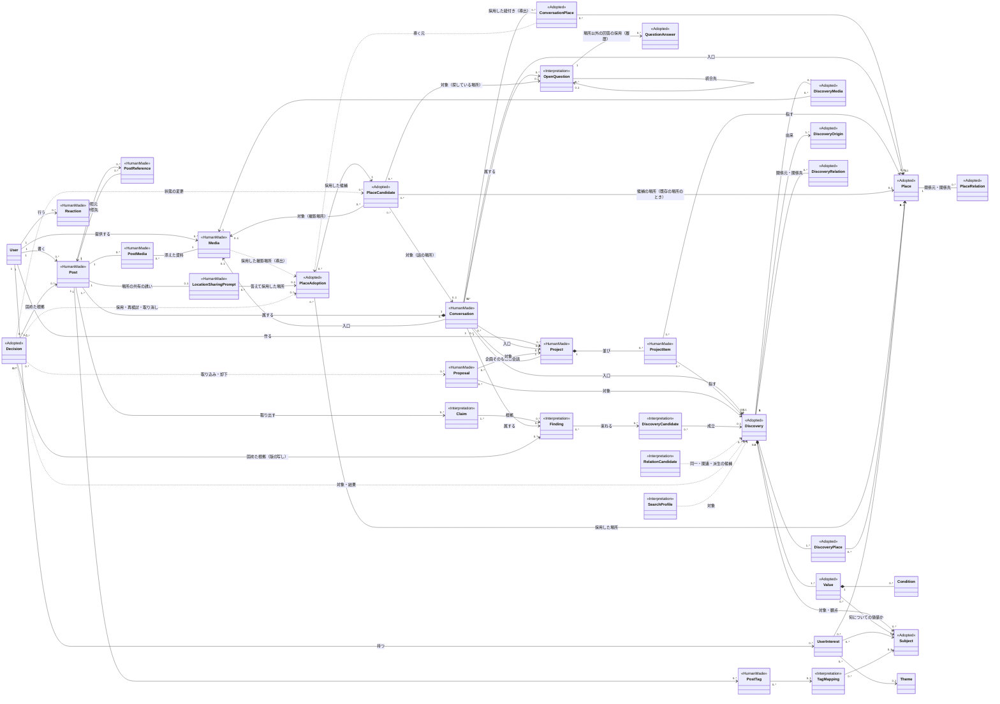

# ex-day 論理エンティティ設計書 v0.2

- 作成日：2026-09-15（v0.2：2026-11-14）
- 状態：v0.2。[ドメイン論理設計書 v0.6](ex-day_domain_model.md)（DEC-0019〜0022・DEC-0015・0018 の反映）に合わせて、骨組みから書き直した版。v0.1 までの本文と追補の履歴は Git の履歴にある（[Issue #132](https://github.com/ex-day/platform/issues/132)、[Issue #135](https://github.com/ex-day/platform/issues/135)）
- 対象：論理属性、責務、関係、多重度、代表シナリオによる整合性の確認
- 対象外：物理 DB、識別子の形式、FK、index、PostGIS、pgvector、API、画面、具体的な推定・判定のアルゴリズム、運用の記録（14節）

## 1. 目的と根拠

本書は、ドメイン論理設計書 v0.6（以下「ドメイン設計」）の概念を、論理 Entity・関連・値へ写し、後続の要求仕様・MVP の範囲・画面・API・物理設計が同じ概念の境界から始められるようにする。

根拠の優先順位は次のとおりとする。

1. DEC（`docs/decisions/`）。特に DEC-0019〜0023（根本整理。DEC-0023 は本書と同じ PR #139 で Proposed）、DEC-0015・0018（会話の解析）、DEC-0016（認証）。DEC-0020 と食い違う古い DEC の部分は、各 DEC の Status の下の注記に従う
2. ドメイン設計 v0.6。概念の定義・責務は**ドメイン設計を正**とし、本書は Entity・属性・多重度に写す
3. #132・#135 の Issue の議論と、そこでの人の判断
4. `ex-day_requirements.md`、`ex-day_mvp_scope.md`。本書と食い違うところは、#135 の手順で要求仕様・MVP の範囲の側を直す

### 1.1 確定度と「採用」

- **確定**：DEC・ドメイン設計・#132 で決めたことを Entity に写したもの。論理モデルとしての採用であり、MVP で作ることの確定ではない
- **案**：本書で置いた写し方。レビューで確かめる
- **要検討**：後続の設計で決める。本書では勝手に決めない

サービスの中で、議論の結果として場所・回答・説を選ぶことは「確定」ではなく「**採用**」と呼ぶ（ドメイン設計 1.2節）。採用は、議論の結果その説を今採用している状態であり、正しさの保証ではない。新しい情報で再検討・取り消し・採用し直しができる。本書で「採用した〜」と書くものは、どれもこの意味である。

Entity 名（英語名を含む）は仮称であり、最終的な名前は人が確認する（DEC-0009 決定11、[#65](https://github.com/ex-day/platform/issues/65)）。

### 1.2 v0.1 からの主な変更

| v0.1 | v0.2 | 根拠 |
|---|---|---|
| 中核は User／Discovery／Post／Reaction | User／場所／会話／Post／Discovery／企画／資料／Reaction | DEC-0020・0021、#132 |
| Discovery が会話の器。成立状態 `UNESTABLISHED`／`ESTABLISHED` | 会話（Conversation）が器。Discovery は成立したときに作り、成立前の状態を持たない | DEC-0020 決定4・9 |
| Post は投稿先 Discovery（器）を1つ持つ | Post は会話に1つ属する | DEC-0020 決定4 |
| Place は Discovery に関わる参照 | Place は最初から存在する独立の Entity。場所どうしの関係を種類ごとに持つ | DEC-0020 決定1〜3 |
| Discovery と Place は多対多 | Discovery は場所を1つ以上持ち、関係に役割・順番・期間を持つ（DiscoveryPlace） | DEC-0020 決定6、#132 |
| Topic（話題）・DiscoveryHypothesis（発見の仮説） | 話題を外し、Post → 主張（Claim）→ わかってきたこと（Finding）。発見の仮説を Discovery の候補（DiscoveryCandidate）に改名 | DEC-0015、DEC-0020 決定9 |
| 問いは Post（問いを起点とした成立前 Discovery） | 問い（OpenQuestion）を独立した見立てにし、回答を「採用」として持つ | DEC-0015 決定5、#132 |
| ― | 企画（Project）・企画の項目・企画の会話・並びの履歴 | DEC-0021 |
| Media は Discovery へ提供される資料 | Media は独立した中核の Entity。撮影場所の候補と採用した撮影場所を持つ | #132 |
| ― | 場所の候補（PlaceCandidate）：状態・根拠・声・履歴を持つ判断の対象。場所の採用（PlaceAdoption）を正本にし、会話・資料・問いの採用した場所を導く | #132、PR #138・#139 のレビュー |
| 投稿のときに「どこの話？」を聞く（DEC-0020 決定3） | 投稿した人に場所の入力を求めず、場所が分からないときは共有を誘う（LocationSharingPrompt） | DEC-0023（Proposed） |
| ― | 由来（DiscoveryOrigin）。抽出と派生を分ける。統合は可逆 | DEC-0020 決定5・7・10 |
| ― | 検索のための情報（SearchProfile） | DEC-0020 決定8 |

## 2. 設計原則

1. 中核は User／場所（Place）／会話（Conversation）／発言（Post）／Discovery／企画（Project）／資料（Media）／Reaction とする（ドメイン設計 2.2節）。
2. 場所は Discovery・会話がなくても最初から存在する。出どころはオープンデータと会話・投稿。形は地点・エリア・経路。場所どうしの関係を1本の木にしない。
3. 会話は器であり、Post は会話に1つだけ属する。Post は場所・時期・分類・Value・Subject を直接持たない。場所は会話の紐付き、価値は会話から取り出した Finding と Discovery の側で扱う。
4. 投稿の成立と、解析・場所の採用・Discovery の成立を分ける。場所・時期・関連先が分からなくても投稿でき、場所未定の会話も正常な状態とする。参加の入り口を軽くするため、投稿した人に場所の入力を求めず、場所が分からないときは共有を誘うだけにする（DEC-0023、ドメイン設計 3.4節）。
5. Discovery は「どこで、何を、どう体験できるか」。場所を1つ以上持ち、成立したときに作る。どこから生まれたか（会話・投稿・企画・派生・運営）では定義せず、由来として残す。
6. Discovery 自身が永続の状態として持つのは公開状態だけとする。成立・解析・裏付け・同一性・確認・安全性・知識の状況・推薦・活発度を1つの状態の列に詰め込まない（ドメイン設計 3.6.5節）。
7. 企画（作品）は作った人の意図と構成の単位であり、Discovery と同一視しない。企画と Discovery は多対多。並びは作った人だけが直し、ほかの人は提案する。
8. 資料は独立した中核の Entity であり、会話・Discovery・場所から参照される。撮影時期を話題の時代や体験の時期と混同しない。
9. 各 Entity を「人間が作ったもの」「ex-day の見立て」「ex-day が採用した構造（判断の対象を含む）」のいずれかの層に置く（3節の表）。人間が作ったものを AI の解釈で書き換えない。見立ては更新・分割・統合・失効してよい。
10. 判断（成立、統合、派生、場所や回答の採用、提案の取り込み等）の時点で、根拠の Post と、それを支えた主張・わかってきたこと（その版の内容）を判断の記録の側に写し取って固める。見立ての ID を参照するだけにはしない。
11. 「どこか」についての説（場所の候補）は上書きしない。対象ごとに1か所を正本とし、状態・根拠・声・履歴を持つ。採用は場所の採用（PlaceAdoption）の1か所を正本とし、会話・資料・問いの採用した場所はそこから導く。採用されるまでは Place を作らない。
12. 採用は真実の保証ではない。新しい異論・反証の候補が寄せられても、採用中のものを自動で取り消さず、「再検討中」にして判断し直す。どちらの結果も履歴に残す。
13. 成立・場所の紐付き・場所の候補の採用・由来・関連・派生・統合は、どれも後から直せる。統合は可逆にし、もとの Discovery と会話へのたどり方を残す。
14. Subject は対象と観点に分け、横断して同じ意味を指す統制された概念とする。動くもの（船・列車等）は場所にせず Subject（対象）とする。場所の種類は場所に持つ。
15. Theme は粗い興味の入口、Subject は精密な意味の概念とし、Theme と Subject を固定の木にしない。
16. UserInterest は自己申告とシステム推定を区別し、本人の明示的な意思を推定より優先する。行動の履歴を長期に保存することを前提にしない。
17. Value は Discovery ごとの価値であり、Time／Season 等は原則として各 Value の Condition とする。ある軸の Condition がないことは、その軸に依存しないことを意味する。
18. Season は「例年なら今が関係する時期」として浮上させるきっかけであり、今年・今日の実状ではない。現在性（Freshness）は直近の Post・Reaction から導き、固定の属性として断定しない。
19. 推薦（Recommendation）・SearchContext・寄り道の条件は一回の探索の一時モデルであり、永続の Entity にしない。検索のための情報（SearchProfile）は登録時・バッチで作り直せる見立てとし、検索の単位は Discovery の単位と一致しなくてよい。
20. 情報の出所、根拠（Evidence）、意味の確信度、事実の信頼度、人気を混同しない。Reaction・タグ・声の数・言及の多さを事実の正しさに置き換えない。
21. 品質の評価そのものを目的とした投稿・反応（星評価、ランキング、口コミ）を扱わない。ユーザーの企画の番付は作品の並びであり、品質評価とは別に扱う。
22. 位置の座標を URL に出さない。場所・Discovery・企画・資料・会話は、画面・URL に出すための識別子で指す（DEC-0022）。識別子の形式は物理設計で決める。
23. 運用の記録（解析の実行、バッチ、予算の台帳等。DEC-0018）は論理 Entity にしない。見立てからは「どの解析の版で作られたか」だけをたどれるようにする（14節）。

## 3. 全体関係図

図は概念の関係と多重度を表し、物理のテーブル・キー・保持の方法を指定しない。Reaction の対象、Evidence、Source、ContentReport、TimeExpression、Theme と Subject の関係は図を読みやすくするため省き、各節で書く。

注記は3つの層を表す。`<<HumanMade>>` は人間が作ったもの、`<<Interpretation>>` は ex-day の見立て、`<<Adopted>>` は ex-day が採用した構造（判断の対象を含む）である（Mermaid の注記に日本語を使えないため英語で書く）。

| 層 | Entity | 性質 |
|---|---|---|
| 人間が作ったもの | Conversation、Post、PostReference、PostTag、PostMedia、LocationSharingPrompt、Project、ProjectItem（と並びの履歴）、Proposal、Media、Reaction、場所の候補への声（PlaceCandidateVoice） | AI の解釈で書き換えない |
| ex-day の見立て | Claim、Finding、OpenQuestion、DiscoveryCandidate、RelationCandidate、TagMapping、SearchProfile | 新しい Post や再解析で更新・分割・統合・失効してよい。どの解析の版で作られたかをたどれるようにする |
| ex-day が採用した構造 | Place、PlaceRelation、Discovery、DiscoveryPlace、DiscoveryMedia、Value、Condition、DiscoveryOrigin、DiscoveryRelation、Subject、対象と Subject の関連、Decision。**判断の対象**として PlaceCandidate、PlaceAdoption（場所の採用の正本）、QuestionAnswer、Proposal の状態。ConversationPlace と Media の採用した撮影場所は PlaceAdoption から導く | 「採用」は正しさの保証ではない。判断の対象は状態と履歴を持ち、再解析で消えない |

- 場所の採用の正本は PlaceAdoption（6.2節）の1つだけとする。Media の採用した撮影場所、会話と場所の採用した紐付き（ConversationPlace）、場所を探す問いの回答、候補の表示の「採用」「取り消し」は、どれも PlaceAdoption から導く
- Proposal の中身（誰が何を提案したか）は人間が作ったもの、状態（提案中・取り込み・却下・失効）は判断の対象である
- OpenQuestion（問い）は見立てだが、回答の採用（場所は PlaceAdoption、場所以外は QuestionAnswer）は判断の対象の層に持つ。判断の対象が付いた問いは、再解析で消したり作り直したりせず、統合先をたどれるようにする（5.3節）
- 層の注記がない User、UserInterest、Theme、TimeExpression、Source、Evidence、ContentReport の層の位置付けは、DEC-0009 の対象外であり、本書では定めない

図中で同じ Entity から複数の `0..1` が出ている関係（会話の入口、ProjectItem の指す先、Proposal の対象、PlaceCandidate の対象。PlaceCandidate の候補の場所は「既存の Place」か「新しい場所の案」のどちらか）は、「いずれか1種類をちょうど1つ指す」という論理制約を表す（会話の入口だけは「なし」も許す）。汎用参照、継承、種別ごとの関連のどれで実装するかは物理設計で比べる。

## 4. 中核 Entity

### 4.1 User

**種別**：永続 Entity（確定。v0.1 を引き継ぐ）

**責務**：発見し、Post・資料・企画を持ち寄り、Reaction を行い、自身の UserInterest を確認・訂正する主体を表す。質問者・回答者・投稿者・企画の作者等の固定ロールを持たせない。

**主要論理属性**：識別子（内部の連番。画面・URL に出さない）、状態（有効／退会）、作成・更新時点。ログイン方法ごとの識別子は UserIdentity、ニックネーム・興味は UserProfile に分けて持つ（[#76](https://github.com/ex-day/platform/issues/76)）。

- ユーザー名（重複不可の識別用の名前）は持たない。公開用の ID は MVP では持たず、他人のプロフィールページ等が必要になった時点で、推測できないランダムな ID を連番とは別に足す（#74）
- Post・企画の表示名は、表示のたびに User の今のニックネーム（UserProfile）を引いて求め、投稿時の名前を保存しない（#74）
- 認証プロバイダから受け取る名前・顔写真は持たない（#75）。メールアドレスは ex-day に保存しない。持つのは認証サービス（Cognito）だけ（DEC-0016）
- 住んでいる地域・生活圏、年代、性別、プロフィール説明は持たない（#76）

**User・UserIdentity・UserProfile**（#76 で決定）：

| Entity | 持つもの | 多重度 |
|---|---|---|
| User | 識別子、状態（有効／退会）、作成・更新時点 | ― |
| UserIdentity | 認証サービス（Cognito）の識別子（発行元と `sub`。ログインのときはこれで引く）、ログイン方法の種類（Google・メール等）、上流の識別子（Google の `sub` 等）、つないだ時点。プロバイダの名前・顔写真・メールアドレスは持たない。同じメールアドレスでも自動ではつながず、本人の操作でつなぐ（DEC-0016） | User 1 : UserIdentity 1..* |
| UserProfile | ニックネーム（必須・重複可）、興味のある地域、興味。興味のある地域・興味は UserInterest（由来：自己申告）として持ち、UserProfile の項目として扱う。ニックネーム以外は他の人に表示しない | User 1 : UserProfile 1 |
| ニックネームの変更履歴（監査） | 変更前後のニックネームと変更日時。運営だけが閲覧できる（#74・#35） | User 1 : 0..* |

- 「Account」という名前は使わない（認証ライブラリの「ログイン方法ごとのつながり」と混同するため。#76）
- 投稿・企画の作成の確定時に認証を求め、匿名での投稿は認めない（DEC-0010 決定2）

**主な関係**：UserInterest 0..*、Post 0..*、Project 0..*（作った人）、Media 0..*（提供者）、Reaction 0..*、PlaceCandidateVoice 0..*、Proposal 0..*（提案した人）、ContentReport 0..*。

**要検討**：未登録の閲覧者、個人以外の活動主体（事業者・団体）、代理投稿、運営の権限、退会時の Post・企画・資料の表示と出所の保持（退会した人の企画は閉じる。DEC-0021 決定5）、ニックネームの変更履歴の保持期間と Entity 名。

### 4.2 Place（場所）

**種別**：永続 Entity（確定。DEC-0020 決定1〜3。層：採用した構造）

**責務**：Discovery・会話・企画・資料・UserInterest が関わる「どこか」を表す。Discovery や会話がなくても最初から存在し、寄り道の検索・地図・TOP・場所のページの対象になる。

**主要論理属性**：

| 属性 | 内容 |
|---|---|
| 識別子 | 画面・URL に出す識別子を含む（座標を URL に出さない。DEC-0022） |
| 名称 | 表示名、別名・旧称（時代つき） |
| 形（Spatial Type） | 地点（`Point`）・エリア（`Area`）・経路（`Route`）。DEC-0007 決定2 |
| 位置・範囲 | 地点の位置、エリアの範囲、経路の形。経路を構成する地点と順番は PlaceRelation（経路の構成）で表す |
| 種類 | 0..*。城跡・公園・寺・駅・坂・国道・航路・行政区域等。1つの場所が複数の種類を持てる（小机城址：城跡・公園）。DEC-0007 決定9 の注記 |
| 出どころ | オープンデータ（取り込み元・ライセンス・取り込み時点）／会話・投稿から育つ（足した根拠の会話・判断の記録）／運営 |
| 存在した期間 | 今はない場所（昔の跨線橋）の期間。分からなければ持たない |
| 状態 | 有効／統合済み／廃止。統合・廃止は判断の記録を伴う。採用されていない場所は Place にしない（下記） |
| 行き方 | 代表の駅・入口、駅から先の手段（DEC-0013 決定2・3 の「行き方」） |
| 推定の値 | データから計算した値（坂の勾配等）と、その計算の出どころ・版。企画の番付の根拠に使う（DEC-0021） |
| 場所の情報 | 「桜並木がある」のような、体験価値の手前の情報（ドメイン設計 3.6.2節）。**要検討**：持ち方（場所の属性か、Finding・Subject からの参照か）と出所 |
| 作成・更新時点 | ― |

- 全国の受け皿として、粗い場所（都道府県、市区町村、町丁・字）を全国分あらかじめ用意する（DEC-0020 決定3）。会話のない場所を画面に出すかは画面の設計で決める（ドメイン設計は「会話のない場所は画面に出さない」。寄り道の「声のない場所」は別。ドメイン設計 6.5節）
- 会話から育つ場所（「桜木町周辺」、今はない跨線橋）は、AI が候補を出し、人が採用する（DEC-0012）。**採用されるまでは Place を作らない**。名称・おおよその位置などは「新しい場所の案」として場所の候補（6.1節）に持ち、採用の判断で Place を作る（出どころ＝会話・投稿、根拠＝その判断の記録）。未採用の名称・位置は、場所の検索・PlaceRelation・UserInterest・寄り道・地図に混ぜない
- 声の数、関わる Discovery の数、活発度は会話・Discovery から算出し、Place の永続の状態にしない
- 動くもの（船・列車・山車・移動販売）は Place にしない。Subject（対象）として持つ（7.2節）。動かないもの（係留されている氷川丸）は Place でよい

**主な関係**：PlaceRelation 0..*（関係元・関係先）、PlaceAdoption の採用した場所として 0..*（ConversationPlace・Media の採用した撮影場所はここから導く）、Conversation の入口として 0..*、DiscoveryPlace 0..*、ProjectItem 0..*、PlaceCandidate の候補の場所として 0..*、UserInterest 0..*。

**論理制約**：場所はどこかだけを表し、「何としての話か」は Subject・Value が表す。同じ場所に観点の違う Discovery が並ぶ。投稿した人の現在地を、会話の場所や資料の撮影場所とみなさない。

**要検討**：今はない場所・旧地名・境界の時間変化の持ち方、「○○付近」のエリアの作り方（地名の辞書のエリアか、地点と半径か。#82）、場所の重複（「桜木町周辺」と「桜木町駅のあたり」）と統合、種類の一覧と管理（マスタにするか）、新しい場所の案を採用して Place を作る判断の主体（問いを立てた人の採用だけで共有の Place を作ってよいか、名称・位置・重複の確認を別に行うか）、オープンデータの取り込み元とライセンス（Wikidata は CC0、OSM は ODbL で要確認）、場所の情報の持ち方、場所の情報の訂正の提案（6.3節）。

#### 4.2.1 PlaceRelation（場所どうしの関係）

**種別**：永続関連 Entity（確定。DEC-0020 決定2）

**責務**：場所どうしの関係を、種類の違う複数の関係として表す。1本の木（親子関係）にしない。

**主要論理属性**：関係元の場所、関係先の場所、関係の種類、順番（経路の構成のとき）、期間（任意）、出どころ（オープンデータ／会話から／運営）、作成・更新時点。

| 関係の種類 | 例 |
|---|---|
| 行政の階層 | 神奈川県 ＞ 横浜市港北区 ＞ 小机町 |
| 地理的な包含・重なり | 小机城址市民の森（エリア）の中に小机城址（地点）。行政の境界をまたぐエリア |
| 観光・生活のエリア | 中華街、元町、「桜木町周辺」 |
| 施設の所属 | 駅の出入口、寺の境内の建物 |
| 経路の構成 | 経路を作る地点とその順番 |

**多重度**：Place 1 : PlaceRelation 0..*（関係元・関係先の両側）。同じ2つの場所の間に、種類の違う関係を複数持てる。

**論理制約**：寄り道先のまとまり（「○○のあたり」）は、観光・生活のエリアで表す（ドメイン設計 6.5節）。位置から計算で導ける包含（地点がエリアの範囲に入る）を、すべて保存することを前提にしない。

**要検討**：計算で導く包含と保存する包含の分け方、関係の種類の追加、期間の表し方。

### 4.3 Conversation（会話）

**種別**：永続 Entity（確定。DEC-0020 決定4、#132。層：人間が作ったもの）

**責務**：投稿と返信のまとまりを表す器。Post は会話に属する。最初の Post で生まれる。DEC-0006 決定1（Discovery が器、Thread Entity を導入しない）を置き換える。

**主要論理属性**：識別子（画面・URL に出す識別子を含む）、入口の種類（場所／Discovery／企画／資料／なし）と入口の対象（0..1）、企画そのものの会話かどうか（**案**：Project 側の関係から導いてもよい）、公開状態（公開／非公開）、作成時点（最初の Post の時点）、作成・更新時点。

- 始めた人・最終の発言時点・返信の数は、属する Post から導く
- **居場所**（まず出るページ）は入口から導き、属性として持たない：入口があれば入口のページ、入口が資料なら資料のページ、入口がなければ会話自身のページ（ドメイン設計 3.4節）
- 会話の始まり方（体験の共有、今の様子、問い、記憶・昔話、資料から、企画をきっかけに、対象そのものの話）は会話の型ではない。属性として持たない

**主な関係**：Post 1..*、ConversationPlace 0..*（採用した紐付き。PlaceAdoption から導く）、PlaceAdoption（対象＝この会話）0..*、PlaceCandidate 0..*（対象＝この会話の話の場所）、入口の Place・Discovery・Project・Media 0..1、Project 0..1（企画そのものの会話のとき）、Claim は Post を介して、Finding 0..*、OpenQuestion 0..*、DiscoveryOrigin（由来＝会話）から 0..*、ContentReport の対象。

**論理制約**：

- 入口と場所の紐付きは別に持つ。入口が資料でも、話が進んで場所が分かれば、ConversationPlace を持つ
- **入口から場所が決まる会話も、ConversationPlace を入口から直接導かない**（正本を増やさないため）。場所を決められる入口から会話が始まった時点で、その場所の PlaceCandidate（対象＝この会話、出され方＝入口）と PlaceAdoption（主体＝投稿した人、根拠＝入口）を、1つの判断の記録で作る（4.3.1節）。後で別の場所の話だと分かれば、ふつうの採用し直し・取り消しで直す。場所を決められる入口は、場所のページ、場所を指す企画の項目、Discovery のページ（**案**：その Discovery の出す位置の場所。4.5節）、Discovery を指す企画の項目（同じ）とする
- 場所未定の会話（ConversationPlace が0件）を正常な状態とする。場所未定の会話を、候補の場所のページ（「このあたりで探している人がいます」）、TOP の「探しています」、投稿した人の「自分の話」から必ず誰かに届けられるよう、検討中の PlaceCandidate・OpenQuestion・Post から導けるようにする。届け方そのもの（どの枠に、何件、どの順で）は画面の設計で決める（DEC-0022）
- 企画そのものの会話は、入口＝その企画の会話の1つとして扱う。企画が閉じたら読むだけにする（ドメイン設計 3.7節、#132）
- 公開は会話の公開状態に従う。Post・資料の個別の非公開・削除（安全性）は Post・資料の側で持つ

**要検討**：会話の単位（1つの投稿から始まる返信のまとまりを1つの会話とするか）、会話の分割・統合、重複した会話の扱い（DEC-0010 決定1：重複は歓迎し、乱立は避ける）、会話の表題を持つか、企画が閉じたときの「読むだけ」の表し方（Project の状態から導くか）。

#### 4.3.1 ConversationPlace（会話と場所の採用した紐付き。導出）

**種別**：導出される関係（確定。正本は PlaceAdoption（6.2節）。層：採用した構造）

**責務**：会話が、どの場所についての話かとして**採用されている**紐付きを表す。正本は場所の採用（PlaceAdoption）であり、本関係はそこから導く。候補（言葉から読み取った・誰かが挙げた）は PlaceCandidate（6.1節）に持つ。

| 導く元（採用中・再検討中の PlaceAdoption） | 例 |
|---|---|
| 対象＝この会話（入口から決まった場所） | 小机城址の場所のページの「話す」から始めた会話は、始まりの時点で小机城址の採用が作られる |
| 対象＝この会話（話の場所） | 「汽車道経由？」「そう」で汽車道が採用される（10.1節のシナリオ） |
| 対象＝この会話の入口の資料（撮影場所） | 入口＝資料の会話は、資料の撮影場所が採用されると、その場所と紐付く |
| 対象＝この会話に属する問い（探している場所） | 「水車のあるそば屋はどこ？」の回答として店が採用されると、会話もその店と紐付く |

**論理要素**：会話、場所、役割・順番（対象＝会話の採用が持つ。話の場所／始まり／経由／終わり等）、導いた元の PlaceAdoption。

**多重度**：Conversation 1 : ConversationPlace 0..*。ConversationPlace 0..* : Place 1。

**論理制約**：

- 会話の「場所未定」は、導かれる紐付きが0件であることを表す。場所未定を会話の属性として別に持たない
- 物理設計で写し（キャッシュ）を持つ場合も、正本の PlaceAdoption を作り・変え・取り消す判断の記録の中で一緒に更新し、正本と食い違わせない
- もとの採用が取り消されたら、紐付きもなくなる。履歴は PlaceAdoption と判断の記録に残る
- 投稿した人に場所の入力を求めない（DEC-0023）。場所の共有の誘いとその答えは LocationSharingPrompt（4.4.4節）に持ち、答えて選んだ場所も PlaceAdoption を通して紐付く
- Post は場所を直接持たない。場所は会話の紐付きを使う（DEC-0005 を引き継ぐ）

**要検討**：役割の一覧、写しを持つか（物理設計）、取り消された紐付きの表示。

### 4.4 Post（発言）

**種別**：永続 Entity（確定。DEC-0004・0005・0008 を引き継ぎ、DEC-0020 で所属を変更。層：人間が作ったもの）

**責務**：会話の中の1つの発言を、原文と出所を保って表す。新しい話を始める発言も返信も、同じ Post として対等に扱う。問い・情報・体験・記憶・証言・資料の説明等を持ち寄る単位であり、単独でも成立し価値を持つ。「疑問／知識」等の固定的な型を持たない（DEC-0005 決定1）。

**主要論理属性**：識別子、書いた User、属する会話（1）、本文（原文）、公開状態、投稿・公開時点、更新時点、推定・不確実性に関する表示情報。

次は Post に持たせない。

- **投稿先の Discovery（器）**：持たない。Post は会話に属する（DEC-0009 決定8 の注記）
- **場所**：会話の紐付き（ConversationPlace）と場所の候補（PlaceCandidate）で扱う
- **Subject・内容の分類**：持たない（DEC-0009 決定5）。何について話しているかは、主張・わかってきたこと・Discovery の候補（5節）として見立ての層で扱う。Post 単位の埋め込み・語の抽出は、解析の内部データとして持ってよい
- **時間に関わる値**（対象の時点・期間、告知の開始、事象の開始・終了、繰り返し、終了未定、数量・残量）：Post から取り出した主張・わかってきたことの手がかりとして見立てで扱い、採用されたら Discovery の Value の Condition、Discovery・場所の時間（TimeExpression）、現在状態を導く材料になる。投稿・公開時点は Post に持ち、手がかりの基準の時点として参照できるようにする（DEC-0005 決定8）
- **写真・資料**：Media（4.8節）として独立に持ち、Post とは PostMedia（添えた資料）でつなぐ

**主な関係**：User 1、Conversation 1、PostReference（参照元・参照先として 0..*）、PostTag 0..*、PostMedia 0..*、LocationSharingPrompt 0..1、Claim 0..*（取り出した主張）、PlaceCandidate の根拠として 0..*、PlaceCandidateVoice 0..1（声を述べた Post）、Decision の固めた根拠として 0..*、DiscoveryOrigin（由来＝1つの投稿）から 0..*、Source 0..*、Reaction 0..*、Evidence の根拠になり得る、ContentReport の対象。

**投稿・保持の論理制約**：

- 場所・時間・関連先・問いの答え等の不明な情報の入力を、投稿の成立条件にしない。解析の未完了・失敗、候補がないことを理由に、成立した Post を失わせない（DEC-0005 決定7）
- AI が不足情報を推測・創作して成立へ寄せない。提供された情報と推定の候補を区別する
- Post が単独で価値を持つことと、Discovery の Value であることを区別する。Post をそのまま Value に置き換えない
- 相反する Post を、一方の上書きで消さない。伝聞や曖昧な記憶が集まったことを、確定した史実や今の営業情報とみなさない
- 品質の評価そのものを目的とした投稿（星評価、ランキング、店舗比較）にしない。体験・記憶の一部としての主観的な感想は妨げない
- 現在性が変わる内容（「今満開」「本日から直売」）を伝える Post は、そこから取り出した手がかりの Freshness が下がっても削除せず、過去の記録として保持する。開始・告知の開始は速やかに現在状態へ反映できるようにし、終了期限・数量・残量は投稿時点の申告として、実状と異なる可能性を示す（DEC-0002 を引き継ぐ）

**要検討**：一投稿の単位、編集・訂正の履歴、外部情報の Post 化、自由文と Reaction の境界、Post から取り出す時間の手がかりの構造、現在性の減衰・失効の規則、どの会話の Post が Discovery の現在状態の材料になるか（入口＝その Discovery の会話、由来の会話、同じ場所の会話等。4.5節）。

#### 4.4.1 PostReference（Post 間の参照）

**種別**：永続関連 Entity（確定。v0.1 を引き継ぐ。層：人間が作ったもの）

**責務**：返信・メンション・引用等、Post が別の Post を受けて書かれたことを表す。人が与える強い文脈の情報として、解析で優先して使う（DEC-0007 決定8）。

**主要論理属性**：参照元の Post、参照先の Post、参照の種類（返信・メンション・引用等）、作成時点。

**多重度**：Post 1 : PostReference 0..*（参照元・参照先の両側）。

**論理制約**：参照の存在を解析・判断の前提にせず、参照を使わない Post も扱えるようにする。AI の解釈で参照を足したり変えたりしない。参照元と参照先は同じ会話に属することを基本とする（**案**。別の会話の Post を引用する場合の扱いは要検討）。「出所」を広い意味で使わず、出典（Source）、わかってきたことの根拠（Claim・Post）、投稿のきっかけ（PostReference、会話の入口）を区別する。

**要検討**：参照の種類の一覧、別の会話の Post の引用、参照先が非公開・削除された場合の扱い。

#### 4.4.2 PostTag（表示するタグ）

**種別**：永続 Entity または値（確定。v0.1 を引き継ぐ。層：人間が作ったもの）

**責務**：ユーザーが Post に付けたタグを、書いたまま表す（DEC-0009 決定10）。探すためのキーワード、解析の手がかり、Subject の候補の入口として使う。

**主要論理属性**：Post、表記（書いたまま）、作成時点。

**多重度**：Post 1 : PostTag 0..*。PostTag 0..* : TagMapping 0..1（5.6節）。

**論理制約**：必須にしない。判断ではなく、重み付けされた入力として扱う。入力は Post と同じ欄で行い、専用の入力欄を設けない。タグの数を事実の正しさや品質の評価に置き換えない。

**要検討**：本文から抽出する規則、編集・削除、スパム・不適切なタグへの対策（#35）、MVP での扱い（DEC-0009 Deferred）、タグで見せる単位（v0.1 では Discovery。会話・場所を単位にするかは画面の設計で決める）。

#### 4.4.3 PostMedia（Post に添えた資料）

**種別**：永続関連 Entity（**案**。層：人間が作ったもの）

**責務**：Post とともに出された資料を表す（返信に「昔はこうだった」と写真を添える、資料を載せて会話を始める）。会話の中で出てきた資料（ドメイン設計 3.9節）は、属する Post の会話から導く。

**主要論理属性**：Post、Media、Post の中の並び順、作成時点。

**多重度**：Post 1 : PostMedia 0..*。PostMedia 0..* : Media 1。1つの資料を、別の Post・会話で再び示してよい。

**論理制約**：資料を最初に提供した Post は Media の「提供時の Post」（4.8節）として別に持つ。資料についての会話（入口＝資料）と、会話の中で出てきた資料は別の関係である。

**要検討**：すでにある資料を別の Post で示すときの UI と権利の確認、Post を消したときの資料の扱い。

#### 4.4.4 LocationSharingPrompt（場所の共有の誘い）

**種別**：永続 Entity（**案**。DEC-0023、PR #139 のレビュー。層：人間が作ったもの）

**責務**：投稿した人への場所の共有の誘いと、その答えを、Post ごとに表す。「1つの投稿につき1回まで」の正本になる。

**主要論理属性**：Post（1）、状態（出した／答えた／断った／あとで）、出した時点、答えた時点、答えて作った場所の採用（PlaceAdoption 0..1）。

**多重度**：Post 1 : LocationSharingPrompt 0..1。

**論理制約**：

- **誘う条件**：会話を始めた時点で、採用中の PlaceAdoption（対象＝この会話）がないときに出す。場所を決められる入口から始めた会話は、始まりの時点で PlaceAdoption が作られる（4.3節）ので、誘わない。次の会話にも誘わない：入口＝資料の会話（場所は資料の撮影場所の問いで扱う）、企画そのものの会話（企画についての話であり、場所の話ではない）。誘うのは会話を始めた Post（最初の Post）に対してだけとする（**案**。返信の扱いは DEC-0023 の Deferred）
- **答え方**：投稿の直後の照合（#82）などで場所の候補があれば、候補を並べてワンタップで確かめる（既存の候補を採用する）。候補がなければ、地図で指す・現在地の近くから選ぶ（新しく候補を作って採用する）。どちらも文字を打たせない
- 1つの Post に誘いは1件まで。断った・あとでの Post に、同じ誘いを画面で再び出さない。「あとで」は「自分の話」に置いておき、そこから答えられる
- 答えて確かめた・選んだ場所は、その候補に、投稿した人を主体とする PlaceAdoption を、同じ判断の記録で作る
- 会話の「場所未定」は本 Entity ではなく ConversationPlace（PlaceAdoption）から導く。誘いに答えなくても投稿は通り、会話は場所未定のまま正常に持つ

**要検討**：返信で場所が分かった場合の扱い、「あとで」の Post に解析で候補が付いたときに知らせるか、保持期間（画面の都合の情報として物理設計で決めてよい部分）。

### 4.5 Discovery

**種別**：永続 Entity（確定。DEC-0020 決定5・6・9、#132。層：採用した構造）

**責務**：場所や地域に関する、具体的な発見・体験価値を表す。ひとことで言えば「どこで、何を、どう体験できるか」。体験できるだけでは Discovery にならず、「どこで」が付いて初めて Discovery になる（ドメイン設計 3.6.1節）。

**主要論理属性**：識別子（画面・URL に出す識別子を含む）、ユーザー向けの表題、現在の要約、公開状態（公開／非公開）、成立時点、作成・更新時点。

- **成立状態を持たない**。Discovery は成立したときに作る（DEC-0020 決定9。DEC-0006 決定2 の `UNESTABLISHED`／`ESTABLISHED` を置き換え）。まだ形になっていない話は、会話の中の Finding・問い、または Discovery の候補（5.4節）として持つ
- 知識の状況（答えが出ていない、説が複数ある）、推薦、活発度・新しさ・現在性、要レビューは属性として固定せず、Finding・問い・Evidence・Reaction・会話等から解析・要約・算出する（ドメイン設計 3.6.5節）
- 統合された側であることは、DiscoveryRelation（統合）から導く（6.7節）

**主な関係**：DiscoveryPlace 1..*（場所を1つ以上）、Value 1..*、Subject 0..*（対象・観点）、TimeExpression 0..*（話題・記憶の時代）、DiscoveryOrigin 1..*、DiscoveryRelation 0..*、DiscoveryMedia 0..*、ProjectItem から 0..*、Conversation の入口として 0..*、Proposal の対象として 0..*、Reaction 0..*、Decision 0..*、SearchProfile 0..*、ContentReport の対象。

**論理制約**：

- どこから生まれたか（会話・投稿・企画・運営）では定義しない。投稿・企画の登録・会話からの取り出し・派生・運営の登録のどれでも、同じ基準（場所や地域に関する具体的な発見・体験価値か）で成立を判断し、由来を残す（6.6節）
- 場所を1つ以上持つ。場所は粗くてよい（町丁・字、市区町村、広いエリア）。細かい場所が分かれば付け替える
- 「何としての話か」は Subject と Value が表す。時期・時間帯の条件は場所ではなく Value の Condition が持つ
- 成立は、正確性や価値を運営が保証することではない。疑問から成立する Discovery もある（疑問起点の Value）
- Subject の追加、見る人の興味の違い、異なる Value があることだけでは分割・派生させない
- テーマ・場所・経路が一致するだけで統合しない。体験価値と成立条件で判断する（6.7節）
- 公開状態は成立と独立した制御とする。施設の閉園・閉店、季節外等を公開状態で表さない
- 企画（作品）と同一視しない。番付・まとめの並びそのものを Discovery にしない
- Discovery の現在状態（「開催予定／開催中らしい／今シーズンの情報あり」）は、該当 Value の Season 等と、関わる会話の直近の Post・Reaction から導く。古い現在性が失効しても Discovery は残る。Season の一致だけを「今年も始まった」として表示しない

**表示に使う導出**（ドメイン設計 3.6.4節。保持しない）：

- 場所のページ：その場所が関わる Discovery を、DiscoveryPlace の役割つきで出す
- Discovery のページ：関わる場所をすべて地図に出す（順番のあるものは線で）
- 一覧・寄り道で数えるとき：1つの Discovery は1回だけ数え、行けば体験できる場所（役割が「体験できる場所」、または始まり）に出す

**要検討**：成立の判断の主体と基準（投稿の時点で成立とみなす条件、AI の役割、人の確認）、成立の取り消しの表し方（公開状態で隠すか、別の状態を持つか）、要約の履歴、作成・編集の権限、どの会話の Post・Reaction を現在状態の材料にするか、出す位置となる役割がない Discovery の扱い、出来事（単発の予定）との関係（11節）。

#### 4.5.1 DiscoveryPlace（Discovery と場所の関係）

**種別**：永続関連 Entity（確定。DEC-0020 決定6、#132。層：採用した構造）

**責務**：Discovery がどの場所に、どんな役割で、どの順番で関わるかを表す。

**主要論理属性**：Discovery、場所、役割、順番（順番のある組み合わせのとき）、期間（任意。過去の運行区間等）、説明、採用の判断の記録、作成・更新時点。

| 形 | 例 | 持ち方 |
|---|---|---|
| 1か所 | 小机城址の空堀、鶴見の急坂 | 1件 |
| 役割の違う複数の場所 | 青柳の干物（食べられていた地域＝生麦、体験できる場所＝漁港・店）、跨線橋（記憶の場所＝昔の跨線橋、今の跡地＝川崎駅）、豪華客船（発着地・母港・寄港地・見られる場所） | 場所ごとに役割 |
| 順番のある組み合わせ | 汽車道を通って山下公園への散歩、豪華列車で三重を巡る旅（運行区間） | 始まり・経由・終わりと順番 |

- 役割の例：記憶の場所、今の跡地、体験できる場所、食べられていた地域、発着地、母港、寄港地、運行区間、見られる場所、始まり、経由、終わり。**役割の種類は例が出るたびに足せる形にする**（固定の列挙にしない）

**多重度**：Discovery 1 : DiscoveryPlace 1..*。DiscoveryPlace 0..* : Place 1。同じ場所が、同じ Discovery に別の役割で関わってよい。

**論理制約**：単なる地点の羅列や経路は Discovery とは限らない。組み合わせや順序そのものに体験価値がある場合に、そのコースが Discovery になり得る。付け替え・取り消しは判断の記録を伴う。場所を1つも持たない状態にする変更はできない（付け替えは新しい場所を足してから古い場所を外す）。

**要検討**：役割の一覧と管理、コースの所要時間を持つか（寄り道の「始まりまで ＋ コースの時間 ＋ 終わりから」。ドメイン設計 6.5節）、期間の表し方。

#### 4.5.2 Value

**種別**：Discovery に属する論理 Entity（概念と多重度は確定。v0.1 を引き継ぐ。層：採用した構造）

**責務**：Discovery で知る・見る・体験することのできる個々の価値・魅力を表し、その価値に固有の Condition を持てるようにする。

**主要論理属性候補**：価値の説明、確認・根拠に関する状態、採用の判断の記録、作成・更新時点。

**主な関係**：Discovery 1 : Value 1..*。Value 1 : Condition 0..*。Value 0..* : Subject 0..*（何についての価値か）。Reaction 0..*。

**論理制約**：

- Value は、会話から取り出した Finding のうち種類が価値のもの、または投稿・企画の登録で示された体験価値が、判断を経て採用されたもの。採用時の根拠の Post と Finding の版は判断の記録に固める
- 採用前の価値の候補（価値の Finding）を Value として保持しない
- 疑問起点の Value を持てる。答えや原因が確定した価値としては扱わない
- Condition のない Value も検索・推薦の候補になり得る。Value に付く Season は例年の旬等を表し、今年・今日の実状を保証しない

**要検討**：Value と Subject の対応と Discovery の Subject との導出・更新の関係、Value の識別・編集の単位、表示用の要約との関係、信頼性の評価。

#### 4.5.3 Condition

**種別**：Value に属する論理的な条件（概念と多重度は確定。v0.1 を引き継ぐ。物理表現は要検討）

**責務**：Value が成立する・利用できる・推薦の価値が高まる条件（時期・季節・時間帯・曜日・繰り返し・期間等）を表す。

**主要論理属性候補**：条件の軸、条件の内容、適用期間、例外、説明。時間・季節の表現には TimeExpression（7.6節）を使う。

**論理制約**：

- ある軸の Condition がないことは、その Value がその軸に依存しないことを意味し、検索の対象から除外しない。「いつでも成立する」という積極的な主張とは区別する
- 「通年」は、時間の成立条件が常に成り立つことを表す。条件なし・不明・通年を意味の上で区別する
- 歴史的な時代（「中世」）は話題の意味を説明する時間であり、Condition と混同しない
- 単発の予定（特定の日だけ）は Condition にせず、出来事として扱う（11節）

**要検討**：条件の軸の範囲、同じ軸に複数の条件がある場合の解釈、条件の組み合わせ、条件なしの物理表現（NULL、行を持たない、ANY 等の明示値）。

#### 4.5.4 Recommendation（推薦）

**種別**：非永続の評価結果（一時モデル。確定。v0.1 を引き継ぐ）

**責務**：Value の Condition と一回の探索の Context（7.7節）を、Discovery の公開状態・現在性等の導出情報も参照して評価した結果を表す。対象の Value とおすすめの理由をたどれるようにする。

**論理制約**：永続の Entity にしない。Discovery に固定の推薦可否の状態を設けない。成立条件の評価と順位付けを区別する。条件のない軸だけを理由に候補から外さない。情報不足による評価不能を成立・不成立と推測しない。Season の一致だけで営業・在庫等を保証しない。

**要検討**：結果の属性、Context が指定されないときの基準、評価不能の表現、順位付けの構成、非公開の Discovery を対象から外す具体的な適用。

### 4.6 Project（企画）

**種別**：永続 Entity（確定。DEC-0021、#132。層：人間が作ったもの）

**責務**：作った人（運営 または ユーザー）の意図と構成を持つ作品を表す。運営の「いま募集中」のお題も、ユーザーの作ったコース・番付・まとめも、企画として表す。作品専用の別のドメインは作らない。

**主要論理属性**：識別子（画面・URL に出す識別子を含む）、作った人の種類（運営／ユーザー）と作った User（ユーザーのとき）、型（コース／番付／まとめ／記憶）、表題、呼びかけ（「みんなの知ってる急坂はどこ？」）、説明、状態（募集中／閉じた）、公開状態、作成・更新時点、閉じた時点。

| 型 | 並び | 例 |
|---|---|---|
| コース | 順番がある | おすすめの散歩、富士山の見えるドライブ |
| 番付 | 順位がある | 鶴見の急坂、短い国道 |
| まとめ | 順位なし（条件で集める） | ゆっくり花見ができる場所 |
| 記憶 | 一覧より声が中心 | 地元のおやつの記憶 |

**主な関係**：ProjectItem 0..*、企画そのものの会話 1、企画をきっかけにした会話（入口＝この企画）0..*、並びの履歴 0..*、Proposal の対象として 0..*、DiscoveryOrigin（由来＝企画）から 0..*、ContentReport の対象（**案**。DEC-0021 決定5）。

**論理制約**：

- 作者ごとに独立した作品として持つ。企画は場所や Discovery の持ち主にならない
- 企画（作品）と Discovery を同一視しない。番付・まとめの並びそのものを Discovery にしない。コース型の作品そのものが Discovery になるとは限らない。価値ある組み合わせのコースが成立したら、それは別の Discovery（由来＝企画）として持ち、企画の項目から指す
- 企画をきっかけにした会話は、中身は場所の会話であり、企画が閉じても場所の会話として残る
- 企画に関わる Discovery が時期の Condition を持つと、企画とは関係なく TOP の「いま、この時期」に出る（DEC-0022）。これは導出であり、企画の属性ではない
- **過信しないための歯止め**（DEC-0021 決定5）：作った人を出し、ex-day の認定に見せない。根拠と並べる。人気投票だけで順位を決めない。作るにはログインが要り、1人が作れる数に上限を設ける。通報と、暫定公開＋事後チェックの対象にする。似た企画は作る前に案内する。作った人がいなくなったら、企画は閉じる
- MVP ではフォロー・メッセージ等のソーシャルの機能を持たない

**要検討**：運営のお題にユーザーの作品が応える形（同じ企画で表すか、企画どうしの関係か）、企画の公開範囲、作れる数の上限の値、提案の取り込みを作った人以外が行えるか、Theme を企画の器に使えるか、企画・項目への Reaction（番付の根拠の「声の数」と混ぜない）。

#### 4.6.1 ProjectItem（企画の項目）

**種別**：永続 Entity（確定。DEC-0021、#132。層：人間が作ったもの）

**責務**：企画の並び・組み合わせの1つを表す。場所 または Discovery を指す。

**主要論理属性**：企画、指す先（場所 または Discovery。ちょうど1つ）、順番・順位（コース・番付のとき）、作った人の説明、追加の根拠（作った人が足した／取り込んだ提案）、作成・更新時点。

**多重度**：Project 1 : ProjectItem 0..*。ProjectItem 0..* : Place 0..1、ProjectItem 0..* : Discovery 0..1（どちらか一方）。同じ Discovery・場所を、別の企画の項目が指してよい。

**論理制約**：

- 番付の候補は、まだ Discovery のない場所のことが多い。価値ある組み合わせのコースは Discovery を指す
- 番付の順位は作った人が並べる。根拠（場所の推定の値、声の数）は項目の属性として保存せず、場所・会話から導いて横に添える。データから作る番付は、推定の値の順を最初の並びにし、作った人が直せる（#132）
- 作った人以外は並びを直接書き換えない。Proposal（6.3節）を通し、作った人が取り込む

**要検討**：指していた Discovery が統合・取り消しになったときの項目の扱い、項目ごとの写真。

#### 4.6.2 並びの履歴（ProjectArrangementHistory）

**種別**：永続 Entity（**案**。層：人間が作ったもの）

**責務**：企画の並びが変わった履歴を表す。

**主要論理属性**：企画、変更後の並び（項目と順番の写し）、変更した人、取り込んだ提案（0..1）、変更時点。

**論理制約**：並びを直したら、変更前に戻れる・たどれるようにする。提案を取り込んだ変更は、その提案と判断の記録からたどれる。

**要検討**：写しで持つか差分で持つか（物理設計）、保持期間。

### 4.7 Reaction

**種別**：永続 Entity（確定。DEC-0009 決定9 を引き継ぐ。層：人間が作ったもの）

**責務**：User から対象への簡単な反応を表す。意味は対象によって異なる（ドメイン設計 3.8節）。

| 対象 | 意味 | 注意 |
|---|---|---|
| Post | 発言への共感 | ― |
| Discovery・Value・Finding（価値） | 「わかる」「行ってみたい」 | 確からしさ・推薦の材料 |
| Finding（裏付けのない説） | 「そうかも」 | 正しさの証拠にしない |
| Finding（裏付けのある知識） | 付けない | 確からしさは資料・出典で決まる |
| OpenQuestion（問い） | 「自分も気になる」 | **案**。問いの Post ではなく問いに付ける（下記） |
| Subject・Condition 単独 | 付けない | 意味をなさない |

**主要論理属性**：識別子、User、対象、対象の版（対象が Finding のとき）、反応の種類、状態、作成・変更時点。

**多重度**：User 1 : Reaction 0..*。対象は Post・Discovery・Value・Finding・OpenQuestion のいずれか1。

**論理制約**：

- 1つの Reaction が同時に複数の対象を持たない。Reaction の数を事実の信頼度にしない。票の多い説を正解のように扱わない
- Finding への Reaction は、Finding の同一性の規則に従って、更新のときに引き継ぎ、統合のときに合算して同じ User の重複を1つにまとめ、分割のときに元の方に残す（5.2節）
- 問いは見立てなので、問いへの Reaction を、問いが組み直されたときに引き継ぐ規則が要る（**案**：Finding と同じ規則を使う）
- 場所の候補への「ここかも」「違うと思う」は、Reaction ではなく場所の候補への声（6.1節）として持つ（**案**。判断の材料として根拠の Post とともに残すため）
- 「行ってきた」「買えた」等を Freshness の補強に使う場合も、営業中・開催中・在庫あり等の保証に置き換えない
- 品質の評価そのものを目的とした反応（星評価、ランキング）を対象にしない

**要検討**：反応の種類、取り消し・変更、企画・企画の項目を対象に足すか、問いへの Reaction の付け先の確定、どの反応を Freshness の補強に使うか、UserInterest の推定への利用規則、不正・重複への対策。

### 4.8 Media（資料）

**種別**：永続 Entity（確定。#132。層：人間が作ったもの。採用した撮影場所は PlaceAdoption から導く）

**責務**：写真・地図・文書・音声等のデジタル資産と、それを説明する情報を表す。資料はそれ自体に話す理由を持ち（古写真の「どこ？」「いつ？」「何が写っている？」）、複数の会話・Discovery・場所に関わる。今昔（C）の「昔の側」の入口になる。

**主要論理属性**：

| 属性 | 内容 |
|---|---|
| 識別子 | 画面・URL に出す識別子を含む |
| 媒体の種類 | 写真・地図・文書・音声等 |
| ファイル | 資産の参照（保存の方法は物理設計） |
| 説明 | 提供した人の説明 |
| 提供者・提供時点 | 提供した User と時点 |
| 提供時の Post | 0..1。最初に資料とともに出された Post |
| 出典 | Source 0..1 |
| 権利・利用条件 | 撮影者・権利者、利用の条件。写っている人（肖像）・他人が撮った写真の扱いの確認の状態 |
| 撮影時期（作成時期） | TimeExpression。不明・推定を含む。分からなければ持たない |
| 採用した撮影場所 | 導出（Place 0..1。または資料が表す場所）。正本は対象＝この資料の撮影場所の PlaceAdoption（6.2節）。Media 自身には正本を持たない |
| 公開・管理の状態 | 公開／非公開、モデレーションの状態 |
| 作成・更新時点 | ― |

**主な関係**：User 1（提供者）、提供時の Post 0..1、PostMedia 0..*、Conversation の入口として 0..*、PlaceCandidate（対象＝撮影場所）0..*、PlaceAdoption（対象＝撮影場所。採用した撮影場所はここから導く）0..*、DiscoveryMedia 0..*、写っているもの（対象と Subject の関連。7.3節）、Source 0..1、Evidence 0..*、OpenQuestion（探している対象）0..*、ContentReport の対象。

**論理制約**：

- 出典・提供者・権利は資料自体に持ち、統合等で失われないようにする
- 投稿した人の現在地を撮影場所とみなさない。撮影場所が分からなければ持たない
- 撮影時期を、話題の時代や体験の時期と混同しない（7.6節）
- 撮影場所を採用した資料は、その場所のページの「この場所の昔の写真」に出る（Place と Media の関係は、採用した撮影場所から導き、別には持たない）
- 資料についての会話（入口＝資料）の居場所は資料のページ。資料を大きく出し、分からないこと（撮影場所・時期）は分からないと出す

**要検討**：外部の URL だけの資料を持つか、同じ資料の重複（同じ写真が別々に上げられる）、差し替え・版、派生物（切り抜き・補正）、肖像・権利の確認の手順、削除時の参照の保持。

#### 4.8.1 DiscoveryMedia（Discovery から資料への参照）

**種別**：永続関連 Entity（確定。層：採用した構造）

**責務**：Discovery が資料を参照することを表す（今昔の Discovery の「昔の側」、Discovery の説明の写真）。

**主要論理属性**：Discovery、資料、役割（昔の側／説明の写真等）、並び順、採用の判断の記録、作成・更新時点。

**多重度**：Discovery 1 : DiscoveryMedia 0..*。DiscoveryMedia 0..* : Media 1。1つの資料を複数の Discovery が参照してよい。

**論理制約**：資料の提供先を Discovery に限らない（v0.1 の「提供先 Discovery 1」を置き換え）。参照を外しても資料は残る。

**要検討**：役割の一覧、代表画像の選び方。

## 5. ex-day の見立て

本節の Entity は ex-day の見立ての層に属する（DEC-0009・0012・0015・0020）。新しい Post や再解析で更新・分割・統合・失効してよく、組み直しの記録は要らない。どの解析の版で作られたかをたどれるようにする（解析の版の記録そのものは運用の記録。14節）。判断に使う場合は、判断の記録（6.5節）に根拠を固める。ドメイン上の定義はドメイン設計 4節を正とする。

v0.1 の Topic（話題）は外した（DEC-0015）。DiscoveryHypothesis（発見の仮説）は DiscoveryCandidate（5.4節）に改名し、役割を整理した。

### 5.1 Claim（主張）

**種別**：永続 Entity（確定。DEC-0015 決定1・2・6）

**責務**：Post から取り出した1つの主張を表す。わかってきたことの根拠になる。

**主要論理属性**：識別子、根拠の Post（1）、内容（表現）、除外の状態と理由、解析の版、作成・更新時点。

**多重度**：Post 1 : Claim 0..*。Claim 1..* : Finding 0..*（多対多）。

**論理制約**：

- 1つの Post から複数の主張を取り出してよい。主張は Post の原文を書き換えない
- 除外の規則（DEC-0015）で外した主張は、消さずに除外の状態と理由を持つ。除外は「後から直す」扱いにしない例外とする（DEC-0012・0015）
- 場所の手がかり（地名・目印）を含む主張は、場所の読み取り（5.8節）を経て場所の候補の根拠になり得る

**要検討**：主張の粒度、除外の理由の一覧、Evidence（8.2節）の対象としての主張との関係（Evidence の対象を Claim にするか）。

### 5.2 Finding（わかってきたこと）

**種別**：永続 Entity（確定。DEC-0015 決定1・4、DEC-0020 で所属を変更）

**責務**：会話から「何がわかってきたか」を表す。ユーザーに見せる（「寄せられている情報・説・価値」）。Finding は ex-day の事実認定ではない。

**主要論理属性**：識別子、属する会話（1）、種類（説／価値。観察は説に含める）、内容（表現）、裏付けの有無（説のとき。資料・出典の裏付けがあるものを知識として扱う）、未確認の状態、関連する場所（0..*。**案**：会話の採用した場所、または場所の候補を参照）、状態（有効／統合済み／分割済み／失効）、版の履歴、根拠の Claim（1..*）、解析の版、作成・更新時点。

**多重度**：Conversation 1 : Finding 0..*。Finding 0..* : Claim 1..*。Finding 0..* : DiscoveryCandidate 0..*。Finding 1 : Reaction 0..*（Reaction は対象の版を持つ）。Decision から根拠として版の写しで参照される。

**論理制約**：問いは Finding に含めない（OpenQuestion。5.3節）。Finding の根拠（Claim・Post）は、どの会話から分かったかを表す見立ての関係であり、Evidence・Source と混同しない。再解析で表現が変わったときは、「すでに反応した人が、変わった後の文を見ても同じ反応をするか」で同一性を判断する。

| 変化 | 扱い |
|---|---|
| 言い換え、詳しくなる、条件が絞られる | 更新（新しい版。Reaction を引き継ぐ） |
| 主張が変わる、対立する説が出る | 別の新しい Finding。元の説も残して並べる |
| 同じものだと分かる | 統合（Reaction を合算し、同じ User の重複は1つにまとめる） |
| 2つの主張が混ざっていた | 分割（元の方に Reaction を残す） |
| 支えがなくなった | 失効（消さずに残す） |

- 場所と関係のない知識（「青柳の干し方」）を表す Finding は、Subject（対象）の知識として、関わる Subject から参照できるようにする（**案**。7.2節）

**要検討**：版の保持の方法、会話をまたぐ同じ Finding の扱い、関連する場所の持ち方、Subject の知識としての採用の形。

### 5.3 OpenQuestion（問い）

**種別**：永続 Entity（確定。DEC-0015 決定5、#132。層：見立て。回答の採用は、場所なら PlaceAdoption、場所以外なら QuestionAnswer として判断の対象の層に持つ）

**責務**：まだわかっていないことを表す。会話の途中でも生まれ、1つの会話に複数の問いがあってよい。

**主要論理属性**：識別子、属する会話（1）、内容（表現）、問いの種類（場所を探す「どこ？」／理由を探す「なぜ？」／正体を探す「これは何？」等）、問いの Post（0..*。人が書いた問いの Post）、問いを立てた User（0..1。ユーザーが明示的に尋ねたとき）、探している対象（この資料の撮影場所／この問いが探す場所／理由等）、探している資料（Media 0..1）、関連する Finding・Discovery、引き続き募集するか（下記）、状態（有効／統合済み／失効）、統合先（OpenQuestion 0..1）、解析の版、作成・更新時点。

**多重度**：Conversation 1 : OpenQuestion 0..*。OpenQuestion 1 : PlaceCandidate 0..*（対象＝この問いが探す場所）。OpenQuestion 1 : PlaceAdoption 0..*、QuestionAnswer 0..*（回答の採用の履歴）。OpenQuestion 0..* : Media 0..1（探している対象）。OpenQuestion 0..* : OpenQuestion 0..1（統合先）。

**論理制約**：

- 問いの Post（人が書いたもの）と、問い（ex-day が「まだわかっていない」と見立てたもの）を分ける。「？」がある Post がそのまま問いになるとは限らない。投稿にない問いを、会話の中身から取り出すこともある
- 場所がなくても存在できる
- **問いは場所の候補を自分では持たない**。候補の正本は、探している対象の場所の候補（6.1節）である。対象が資料の撮影場所なら資料を対象とする候補を参照し、問いが探す場所（そば屋の店）なら問いを対象とする候補を持つ（PlaceCandidate の対象＝この問い）
- 問いを立てた人がいる問いと、いない問い（ex-day が取り出した問い）を分ける。回答を採用するのは、前者は問いを立てた人、後者は ex-day の規則・運営（6.4節）
- 固定的な「解決済み」の状態を持たない。回答の状態は、探している対象の PlaceAdoption（場所を探す問い）、または QuestionAnswer（6.4節。場所以外の問い）から導く。資料の撮影場所を探す問いは、対象＝その資料の PlaceAdoption から導く
- 採用の時点の問いの内容は、判断の記録に写して固める

**判断の対象が付いた問いの組み直し**（PR #139 のレビュー）：問いは見立てだが、場所の候補・場所の採用・回答の採用・Reaction のどれかが付いた問いは、次に従う。

- 再解析で消したり作り直したりしない。統合・失効は判断の記録を伴い、統合された問いは状態＝統合済みと統合先を持つ（後継をたどれる）
- 問いを立てた人が異なる問いどうしは統合しない（採用の主体が違うため）。関連にとどめる。ただし資料の撮影場所を探す問いは資料ごとに1つなので、2つ目を立てない（6.2節）
- 統合は1つの判断の記録で行い、その中で次をまとめて行う：統合元を対象とする場所の候補を統合先へ移す（同じ場所の候補は1つにまとめ、根拠・声・状態の履歴を合わせ、移したことを履歴に残す）。統合元の採用中・再検討中の回答（PlaceAdoption・QuestionAnswer）を「取り消し（理由＝統合で引き継いだ）」にし、統合先に、同じ回答・同じ状態・引き継ぎ元つきで作り直す
- 統合元どうしで採用中の回答が食い違う（別の場所・別の回答）ときは、自動では統合しない。先にどちらの回答を採るかを判断するか、関連にとどめる
- 問いを立てた人がいる問いは、問いの Post（人間が作ったもの）からたどれるようにし、再解析でその結び付きを失わない
- 場所の候補がある問いは、候補の場所のページに「このあたりで探している人がいます」として届ける（導出）
- 企画の呼びかけ（「みんなの知ってる急坂はどこ？」）や運営の呼びかけは、問いではなく企画・画面の文言に持つ

**「引き続き募集するか」の持ち方（要検討）**：問いを立てた人が決める意思であり、人間が作ったものに当たる。見立ての問いの属性に持つと、再解析で失われるおそれがある。**案A**：問いを立てた人の意思を、問いとは別の人間が作ったもの（問いへの本人の設定）として持ち、問いの統合のときに引き継ぐ。**案B**：回答の採用（PlaceAdoption・QuestionAnswer）の側（採用中の回答に対して「まだ募集する」）に持つ。回答がまだない問いの募集を表せないため、案A を推す。

**要検討**：問いの単位、問いの統合・分割の規則、問いを立てた人と問いの Post の書き手が異なる場合、問いの種類の一覧、時間が経った問いを立て直す（手がかりを足してもらう）ときの扱い。

### 5.4 DiscoveryCandidate（Discovery の候補）

**種別**：永続 Entity（確定。DEC-0020 決定9。v0.1 の DiscoveryHypothesis を改名）

**責務**：わかってきたことの束（や、1つの投稿・企画の内容）から、「これは Discovery になりそう」という候補を表す。成立の判断と、既存の Discovery との突き合わせの単位になる。

**主要論理属性候補**：識別子、出どころ（会話（Finding の束）／1つの投稿／企画の登録）、束ねた Finding（0..*）、場所の候補（Place と役割・順番。0..*）、Subject の候補（対象・観点）、価値の候補（価値の Finding）、時間（話題の時期・Condition の候補）、確からしさ、状態（有効／成立済み／失効）、成立した Discovery（0..1）、解析の版、作成・更新時点。

**多重度**：DiscoveryCandidate 0..* : Finding 0..*。DiscoveryCandidate 0..* : Discovery 0..1（成立した、または既存と同一と判断した Discovery）。DiscoveryCandidate 0..* : RelationCandidate 0..*。

**論理制約**：

- 1つの会話から複数の候補を出してよい（小机城址の会話から、空堀と桜）。1つの候補に、解釈の違う複数の案を並べてよい（DEC-0005 決定9）。確からしさの高いものから数個に絞り、支えを失った候補は失効する
- 候補の場所・Subject は候補であり、採用した構造としての関係ではない。成立の判断で DiscoveryPlace・Discovery の Subject として採用する
- Discovery の候補の場所は、会話の採用した場所を優先して使う。場所の候補（6.1節）とは別に持つ（場所の候補の対象は資料・会話・問いに限る。ドメイン設計 5.7節）
- 成立したら、DiscoveryOrigin（6.6節）と判断の記録が成立の経緯を残す。候補そのものは見立てなので、後で失効・削除されてもよい
- 「1人の1つの発言だけでは候補にしない」という制約（DEC-0009 決定7）は、Discovery の成立条件には適用しない（DEC-0020 決定7。1つの投稿で成立する Discovery がある）

**要検討**：候補の数・閾値、突き合わせの頻度とコスト、解析の方式（#61）。

### 5.5 RelationCandidate（関係の候補）

**種別**：永続 Entity または DiscoveryCandidate に属する値（確定。DEC-0020 決定7・8）

**責務**：Discovery の候補と既存の Discovery、または Discovery どうしについての、同一・関連・派生の候補を表す。

**主要論理属性候補**：対象（Discovery の候補と Discovery、または Discovery の組）、候補の種類（同一／関連／派生／補完／新しい Value の追加）、理由、確からしさ、状態（有効／判断済み／失効）、解析の版、作成時点。

**論理制約**：

- 判断の基準（体験価値・成立条件・由来・既存との関係）は、AI の今の精度と切り離して後続の設計で先に定める（DEC-0020 決定8）
- AI に候補の提示だけを任せるか、自動の確定まで許すかは、評価の結果に応じて、精度・閾値とともに決める
- 関係の候補を採用・却下したら、判断の記録に、対象（Discovery の組、または候補が成立した Discovery）と結果を残す。却下は組についての記録として残り、関係の候補が組み直されても同じ候補を繰り返し出さない関門になる
- ユーザーからの提案（6.3節）とは別に持つ。ユーザーの「関連ない」「一緒では？」というフィードバックの表し方は要検討

**要検討**：Entity にするか値にするか、ユーザーのフィードバックの表し方（DEC-0007 決定10）、失効の条件。

### 5.6 TagMapping（内部で持つタグ）

**種別**：永続 Entity（確定。v0.1 を引き継ぐ）

**責務**：表示するタグ（PostTag）の表記の揺れを吸収し、Subject に対応付けたものを表す（DEC-0009 決定10）。解析と Subject の候補の入口に使う。

**主要論理属性**：識別子、正規化した表記、対応する Subject（0..1。対応しない場合は ex-day 独自の Subject の候補の入口とし得る）、作成・更新時点。

**多重度**：PostTag 0..* : TagMapping 0..1。TagMapping 0..* : Subject 0..1。

**論理制約**：ユーザーが書いたままの表示するタグを書き換えない。対応付けは見立てであり、更新してよい。

**要検討**：正規化の規則、運営が付けるタグの持ち方（v0.1 の「運営が登録した Discovery のタグ」。#57）、スパム・表記の揺れへの対策。

### 5.7 SearchProfile（検索のための情報）

**種別**：永続 Entity（確定。DEC-0020 決定8。作り直せる見立て）

**責務**：Discovery・場所・企画から、登録時やバッチで取り出した Subject・Value・場所・時間・体験の条件（とベクトル）を表す。検索のときに LLM を使うことを前提にせず、SQL・ベクトル検索で使う。

**主要論理属性候補**：対象（Discovery／場所／企画）、取り出した Subject・Value の要約・場所・時間・体験の条件、ベクトル（必要に応じて）、作った解析の版、作成時点。

**多重度**：Discovery・Place・Project 1 : SearchProfile 0..*。

**論理制約**：検索の単位（比べる・まとめて見せる単位）は、Discovery の単位と一致しなくてよい。SearchProfile は採用した構造を置き換えない（検索で見つけたものを表示するときは、Discovery・場所・企画そのものを引く）。作り直しても採用した構造に影響しない。

**要検討**：対象の範囲（会話を含めるか）、作り直しのきっかけ、ベクトルの単位と次元（物理設計）。

### 5.8 場所の読み取り

**種別**：処理（Entity にしない。確定。DEC-0020 決定3・4）

会話・資料の言葉や写っているもの（地名、目印、看板）から場所を読み取る。読み取った結果は見立てのまま置かず、場所の候補（6.1節。判断の対象）として登録する。地名の辞書と位置の判定（#82）が入力になる。読み取りの途中の結果（地名の候補の一覧等）は解析の内部データとして持ってよい。

## 6. 判断と関係（採用した構造・判断の対象）

### 6.1 PlaceCandidate（場所の候補）

**種別**：永続 Entity（確定。#132、PR #138・#139 のレビュー。層：判断の対象）

**責務**：「どこか」について出された説を、上書きせずに残す。探索の過程と、採用されなかった説を失わないようにする。採用そのものは PlaceAdoption（6.2節）に持つ。

**主要論理属性**：

| 属性 | 内容 |
|---|---|
| 識別子 | ― |
| 対象と、何の場所か | 次のちょうど1つ：資料（の撮影場所）／会話（の話の場所）／問い（が探している場所） |
| 候補の場所 | 次のちょうど一方：**既存の場所**（Place 1）／**新しい場所の案**（名称、形、おおよその位置・範囲、種類、存在した期間。値として持つ）。新しい場所の案は Place ではない。採用されたときに Place を作り、その Place を候補からたどれるようにする（4.2節） |
| 出され方 | AI が読み取った／人が挙げた／入口（場所を決められる入口から会話が始まった）。最初に出したもの。根拠ごとにも持つ |
| 状態 | 検討中／不採用／失効（**案**：AI が読み取っただけで誰も触れていない候補）。**「採用」「取り消し」は候補に保存せず、PlaceAdoption から導く** |
| 作成・更新時点 | ― |

**関連する Entity**：

- **根拠（PlaceCandidateBasis）**：根拠となった Post・Claim・Finding（1件以上）、AI が読み取ったものか人が挙げたものか、加わった時点
- **声（PlaceCandidateVoice）**：「ここかも」（支持）・「違うと思う」（反対）。User、向き、声を述べた Post（0..1）、時点。人間が作ったものであり、判断の材料であって判断そのものではない
- **状態の履歴（PlaceCandidateStateChange）**：変更前・変更後の状態（検討中・不採用・失効の間の変化と、統合で移されたこと）、いつ、誰が（どの基準で）、なぜ、判断の記録（0..1）。採用・再検討・取り消しの履歴は PlaceAdoption の側にある

**表示する状態の導き方**：

| 表示 | 導き方 |
|---|---|
| 採用 | この候補を採用した PlaceAdoption が「採用中」または「再検討中」 |
| 取り消し | この候補を採用した PlaceAdoption があったが、今は採用中・再検討中のものがない |
| 検討中・不採用・失効 | 候補の状態 |

**多重度**：PlaceCandidate 0..* : Place 0..1（既存の場所のとき）。PlaceCandidate 0..* : 対象（Media／Conversation／OpenQuestion のいずれか）1。PlaceCandidate 1 : 根拠 1..*、声 0..*、状態の履歴 1..*、PlaceAdoption 0..*。

**正本**：場所の候補は**対象ごとに1か所**に持つ。会話・問い・資料に同じ候補を複製しない。

- 同じ対象について、同じ場所が別の人から再び挙げられたら、新しい候補を作らず、同じ候補に根拠と声を足す（論理上の一意性：対象 × 候補の場所。新しい場所の案どうしが同じかは、名称と位置で判断する。要検討）
- 問い「この資料の撮影場所はどこか」は、資料の撮影場所の候補を参照する（問いを対象とする候補を作らない）
- 会話は、その会話の中で出された候補を、根拠の Post からたどって見せる（会話を対象とする候補とは別に、資料・問いを対象とする候補も、根拠の Post の会話から導いて見せられる）
- 「このあたりで探している人がいます」は、検討中の候補から導く。既存の場所の候補はその場所のページに、新しい場所の案はおおよその位置を含む既存の場所（町丁・字など）のページに出す

**論理制約**：不採用・取り消しの候補も消さず、なぜそうなったか（別の候補の根拠）とともにたどれるようにする。新しい場所の案の名称・位置を、採用前に場所の検索・地図・PlaceRelation・UserInterest に出さない。AI が読み取っただけの候補を、人が触れないまま採用しない（**案**：AI の自動の採用を許すかは、関係の候補と同じく評価の結果で決める）。

**要検討**：失効の条件、会話を対象とする候補の役割・順番の持ち方、場所の候補への声を Reaction で表すか（4.7節）、候補の場所の粒度が違う場合（「安曇野」と「安曇野の [○○] 店」）の関係、新しい場所の案の同一性の判定、通知のきっかけ（新しい情報が寄せられた出来事。通知の実装は別）。

### 6.2 PlaceAdoption（場所の採用）

**種別**：永続 Entity（**案**。PR #139 のレビュー。層：判断の対象）

**責務**：ある対象について、ある場所の候補を採用していることを表す。**場所の採用の唯一の正本**とする。

**主要論理属性**：

| 属性 | 内容 |
|---|---|
| 識別子 | ― |
| 対象 | 採用した候補と同じ対象（資料の撮影場所／会話の話の場所／問いが探している場所） |
| 採用した候補 | PlaceCandidate 1 |
| 採用した場所 | Place 1。新しい場所の案を採用したときは、この採用の判断で作った Place |
| 役割・順番 | 対象が会話のとき（話の場所／始まり／経由／終わり等） |
| 回答した問い | OpenQuestion 0..1。この採用を、どの問いへの回答として行ったか。対象が問いのときはその問い。対象が資料で、撮影場所を探す問いに答えたときはその問い |
| 採用した主体の種類 | 問いを立てた人（「投稿者が採用した回答」）／投稿した人（場所を決められる入口から話した、または場所の共有の誘いに答えた）／ex-day の規則・運営（「現在有力」） |
| 状態 | 採用中／再検討中／取り消し |
| 取り消しの理由 | 別の候補を採用し直した／採用をやめた／問いの統合で引き継いだ |
| 引き継ぎ元 | PlaceAdoption 0..1（問いの統合で引き継いだとき） |
| 問いを立てた人の納得 | 納得している／未確認。対象が問い、または問いを立てた人がいる資料のとき |
| 判断の記録 | 作った・再検討中にした・取り消した Decision |
| 採用・更新・取り消しの時点 | ― |

**導くもの**（正本はこの Entity だけ。どれも別には保存しない）：

| 導くもの | 導き方 |
|---|---|
| 資料の採用した撮影場所（4.8節） | 対象＝その資料の、採用中・再検討中の採用の場所 |
| 会話と場所の採用した紐付き（4.3.1節） | 対象＝その会話、その会話の入口の資料、その会話に属する問いの、採用中・再検討中の採用の場所 |
| 場所を探す問いの回答 | 回答した問い＝その問いの、採用中・再検討中の採用。資料の撮影場所を探す問いでは、対象＝その資料の採用（下記の制約により、資料ごとに問いは1つ） |
| 候補の表示の「採用」「取り消し」（6.1節） | その候補を採用した採用の状態 |
| 場所のページの「この場所の昔の写真」 | 対象が資料で、採用中の採用の場所がその場所 |

**不変条件**：

- 対象が資料・問いのとき、「採用中」または「再検討中」の採用は同時に1件まで。対象が会話のときは複数を持ってよいが、同じ候補については1件まで
- 採用・採用し直し・再検討中にする・保つ・取り消しは、どれも1つの判断の記録で行う。採用し直しは、同じ判断の記録の中で、前の採用を「取り消し（理由＝別の候補を採用し直した）」にし、新しい採用を作る。途中の状態（どちらも採用中、どちらも取り消し）を作らない
- 行を消さない。取り消した採用も、理由と判断の記録とともに残る
- 物理設計で、導くもの（資料の撮影場所、会話の紐付き等）の写しを持つ場合も、同じ判断の記録の中で一緒に更新し、正本と食い違わせない

**論理制約**：

- 採用中の場所に、新しい異論・反証の候補（別の候補の根拠、「違うと思う」の声、移転等の情報）が寄せられても、自動で取り消さない。「再検討中」にし、採用し直すか保つかを判断する。どちらも判断の記録に残す
- **資料の撮影場所を探す問いは、資料ごとに1つ**とする（撮影場所は資料についての1つの事実であり、問いごとに別々の採用を持たないため）。ほかの User が同じことを知りたいときは、新しい問いを立てず、その問いに「自分も気になる」で加わる。資料の採用した撮影場所と、その問いの回答は、同じ1つの PlaceAdoption（回答した問い＝その問い）から導く
- 誰が採用するか：問いを立てた人がいる場合（資料を提供して「どこ？」と尋ねた人等）はその人。場所を決められる入口から話した場合と、場所の共有の誘いに答えた場合は投稿した人。それ以外は ex-day の規則・運営（「現在有力」）。どれも判断の記録に残す
- 採用は絶対的な真実ではなく、ex-day が今採用した構造である。後から取り消し・再判断できる

**要検討**：Entity 名、問いを立てた人の納得を確かめる手順、新しい場所の案を採用して Place を作るときの確認（4.2節）、「再検討中」を状態に含める形でよいか、資料の提供者と撮影場所を探す問いを立てた人が異なる場合の採用の主体。

**まとめ**（ドメイン設計 5.7節の責務の分け方との対応）：

| 概念 | Entity | 責務 |
|---|---|---|
| 会話 | Conversation | 調べていく過程の器 |
| 問い | OpenQuestion | 何を探しているか |
| 場所の候補 | PlaceCandidate（＋根拠・声・状態の履歴） | 複数の説と、それぞれの根拠・状態・履歴 |
| 採用した場所 | PlaceAdoption（正本）。資料の採用した撮影場所・ConversationPlace・問いの回答はここから導く | ex-day が今採用した構造 |
| 判断 | Decision | 誰が・いつ・どの基準と根拠で採用・不採用・取り消しをしたか |

### 6.3 Proposal（提案）

**種別**：永続 Entity（確定。DEC-0009 決定7 を引き継ぎ、対象を広げる。中身は人間が作ったもの、状態は判断の対象）

**責務**：ユーザーが Discovery・企画に対して出した提案と、その状態を表す。

**主要論理属性**：識別子、対象（Discovery または 企画。ちょうど1つ）、提案の種類、提案した User、提案の内容、もとの Post（0..1。企画そのものの会話の Post 等）、状態（提案中／取り込み・採用／却下／失効）、提案時点、判断の記録（0..*）、失効時点。

| 対象 | 提案の種類 |
|---|---|
| Discovery | 補完、新しい Value の追加、関連、統合、派生 |
| 企画（DEC-0021 決定4） | 項目の追加（「この坂も入れて」）、並べ替え（「順番はこっちが上では？」）、項目を外す |
| 場所（**案**） | 場所の情報の訂正。場所の採用・付け替えは場所の候補（6.1節）として扱い、提案にしない |

**多重度**：Proposal 0..* : Discovery 0..1、Proposal 0..* : Project 0..1（どちらか一方）。Proposal 0..* : Decision 0..*。

**論理制約**：

- 企画への提案は、作った人が取り込む。取り込んだら並びの履歴（4.6.2節）に残す
- 採用・却下は判断の記録に残す。却下は、同じ提案を繰り返さない関門として残る。失効した提案は、条件が再び満たされれば出し直せる
- AI が出す関係の候補（5.5節）は Proposal にせず、関係の候補として判断する（v0.1 では見立てからの提案を Proposal に入れていたが、DEC-0020 で関係の候補を見立てに置いた）

**要検討**：提案の種類の確定一覧、失効の条件、提案の取り込みを作った人以外が行えるか（DEC-0021）、Discovery への提案を誰が判断するか。

### 6.4 QuestionAnswer（場所以外の回答の採用）

**種別**：永続 Entity（**案**。#132、PR #138・#139 のレビュー。層：判断の対象）

**責務**：理由を探す問い（「なぜ？」）・正体を探す問い（「これは何？」）等、**場所以外の問い**に対して、ある回答を採用したことを表す。場所を探す問いの回答は PlaceAdoption（6.2節）を正本とし、本 Entity には持たない（正本を2つにしないため）。問いは固定的な「解決済み」を持たず、回答の採用を履歴として重ねる（ドメイン設計 4.3節）。

**主要論理属性**：

| 属性 | 内容 |
|---|---|
| 問い | OpenQuestion 1。採用の時点の問いの内容は判断の記録に写す |
| 採用した回答 | 回答の Finding（版の写し）または回答の Post |
| 採用した主体の種類 | 問いを立てた人（「投稿者が採用した回答」）／ex-day の規則・運営（「現在有力な回答」） |
| 状態 | 採用中／再検討中／取り消し |
| 取り消しの理由・引き継ぎ元 | PlaceAdoption と同じ（6.2節） |
| 問いを立てた人の納得 | 納得している／未確認。問いを立てた人がいない問いでは持たない |
| 判断の記録 | 採用・再検討・取り消しの Decision |
| 採用・更新・取り消しの時点 | ― |

**多重度**：OpenQuestion 1 : QuestionAnswer 0..*。同じ問いで「採用中」または「再検討中」の QuestionAnswer は同時に1件まで。

**論理制約**：

- 不変条件（1つの判断の記録で採用し直す、行を消さない、自動で取り消さず再検討中にする）は PlaceAdoption と同じとする
- 表示の言い方は、回答の採用（PlaceAdoption・QuestionAnswer）の状態と主体から導く：「投稿者が採用した回答あり」「現在の回答あり」「新しい情報が寄せられ、再検討中」「引き続き募集中」（具体的な文言は画面の設計）。「答えが出た」「解決済み」と言わない
- 回答がまだない問いは、回答の採用を持たない

**要検討**：Entity 名、PlaceAdoption と1つの Entity（回答の採用）にまとめるか、問いを立てた人の納得を確かめる手順。

### 6.5 Decision（判断の記録。旧 DiscoveryDecision）

**種別**：永続 Entity（確定。DEC-0006・0009 を引き継ぎ、対象を広げる。層：採用した構造）

**責務**：成立・統合・派生・関連・場所の候補の採用・回答の採用・提案の取り込みと却下等の判断と、その根拠を残す。自動の判定と人による判断の両方を追跡できるようにする。

**主要論理属性**：

| 属性 | 内容 |
|---|---|
| 識別子 | ― |
| 判断の種類 | 成立、成立の取り消し、統合、統合の取り消し、派生、関連、Discovery と場所・Value・資料の付け替え、場所の候補の不採用・失効、場所の採用・採用し直し・再検討・取り消し（PlaceAdoption。新しい場所の案から Place を作ることを含む）、場所以外の回答の採用・再検討・取り消し、問いの統合、提案の取り込み・却下、関係の候補の却下等 |
| 対象 | 会話、Discovery の候補、関係の候補（の組）、Discovery、場所の候補、場所の採用、問い、提案、企画等（0..*） |
| 比べた既存の Discovery | 0..* |
| 結果 | 作った・変えた Entity（成立した Discovery、場所の採用、作った Place 等） |
| 理由・基準 | 適用した規則とその版を含む |
| 方式 | 自動／人 |
| 主体 | システム／運営／User（問いを立てた人、企画の作った人等） |
| 固めた根拠 | 判断の時点の根拠の Post（参照）、Claim・Finding・問いの内容（版の写し） |
| 判断の時点 | ― |

**多重度**：Decision 0..* : 対象 0..*。Decision 0..* : 固めた根拠の Post 0..*、Finding（版の写し）0..*。

**根拠を固めるルール**（DEC-0009 決定1 を引き継ぐ）：判断の時点で、根拠となった Post と、それを支えた主張・わかってきたこと・問いの内容を、判断の記録の側に写し取って固める。見立ての ID を参照するだけにはしない。Post は人間が作ったものであり参照で固めてよいが、見立ては版の内容を写す。見立てが後で組み直されても、判断の理由を失わない。

**論理制約**：

- 自動の判定ではシステムを主体として識別する。架空の User や運営の承認者を求めない
- **成立**の判断の主体はシステムまたは運営とし、ユーザーに成立の判断の責任を負わせない。投稿・Reaction・声は判断の材料である（ドメイン設計 5.1節）
- **場所の採用・回答の採用**は、問いを立てた人がいる場合はその User が、場所を決められる入口から話した場合と、場所の共有の誘いに答えた場合は投稿した人が主体になる。**企画への提案の取り込み**は作った人が主体になる。これらはユーザーが主体になる判断であり、成立の判断とは分ける
- 判断は事実の認定ではない。運営による全件の手動承認を、投稿の成立条件にしない
- 後から直す（取り消し・再判断）ときも、新しい Decision を足し、前の Decision を書き換えない
- 1つの Decision で行う変更（採用し直しでの前の採用の取り消しと新しい採用の作成、問いの統合での候補の移動と回答の引き継ぎ等）は、まとめて行い、途中の状態を残さない

**要検討**：Entity 名（Decision とするか DiscoveryDecision を残すか。#65）、判断の種類の確定一覧、主体のモデル（運営の担当者を識別するか）、成立・統合・派生の判断の基準と閾値（#46）、適用した規則の版の持ち方。

### 6.6 DiscoveryOrigin（由来）

**種別**：永続 Entity（確定。DEC-0020 決定5・7。層：採用した構造）

**責務**：Discovery がどこから成立したかを表す。成立後も、会話・資料で補強され、派生し得る。

**主要論理属性**：Discovery、由来の種類、由来の対象、成立の判断の記録（1）、作成時点。

| 由来の種類 | 由来の対象 | たどれるもの |
|---|---|---|
| 会話 | Conversation | 根拠の Finding・Claim・Post（判断の時点の版を判断の記録に固める） |
| 1つの投稿 | Post | その Post |
| 企画 | Project（と ProjectItem） | 企画の登録の時点で成立した Discovery |
| 派生 | Discovery（派生元） | 派生元の Discovery と、派生の根拠（6.7節） |
| 運営の登録 | なし（判断の記録） | 登録の記録 |

**多重度**：Discovery 1 : DiscoveryOrigin 1..*。1つの会話から複数の Discovery が取り出されてよい（Conversation 1 : DiscoveryOrigin 0..*）。

**論理制約**：会話からの取り出し（由来＝会話）と、Discovery 間の派生（由来＝派生、DiscoveryRelation＝派生）を別の関係として持つ。成立の後で別の会話から補強されたことは由来にしない（補強は Value の採用・DiscoveryPlace の追加の判断の記録で残す）。

**要検討**：補強の経緯を Discovery のページでどう見せるか、由来の会話が非公開・削除されたときの扱い。

### 6.7 DiscoveryRelation（Discovery どうしの関係）

**種別**：永続関連 Entity（確定。DEC-0020 決定7・8・10。層：採用した構造）

**責務**：Discovery どうしに明示的に持つ関係（派生、関連、統合）を表す。Subject を介して都度導ける意味の関連（7.2節の横断の探索）を、すべて保存するためのものではない。

**主要論理属性**：関係元の Discovery、関係先の Discovery、関係の種類（派生／関連／統合）、方向、説明、状態（有効／取り消し）、判断の記録、作成・更新時点。

**多重度**：Discovery 1 : DiscoveryRelation 0..*（関係元・関係先の両側）。

**論理制約**：

- **派生**：既存の Discovery から、別の意味の Discovery が生まれた関係。派生先から、派生の根拠となった Finding・Claim・Post の集まりを、判断の記録の固めた根拠でたどる。Post はコピーせず、元の会話に残して参照する（DEC-0015 決定8）。会話を分割しない（DEC-0007 決定5）。自動で確定しなくてよい
- **統合**：可逆にする。統合された側の Discovery を消さず、統合先へ案内できるようにし、もとの Discovery と会話へのたどり方を残す（DEC-0005 決定5）。統合の取り消しは、関係を「取り消し」にし、判断の記録を足す。統合された側の Value・DiscoveryPlace・資料の参照・企画の項目・会話の入口をどう見せるかは要検討
- **関連**：同じかどうか分からないものは、独立した Discovery として関連付けておく（ドメイン設計 5.2節）
- テーマ・場所・経路が一致するだけで統合しない。判断の材料は体験価値と成立条件（時期・時間帯・誰向けか等）の違い
- 共通の Subject だけから派生関係を推定しない

**要検討**：関係の種類の追加、対称性、循環、統合された側の Discovery への参照（企画の項目・会話の入口）の付け替えか案内か、派生元を複数持つ条件。

## 7. Subject・Theme・興味・時間・探索

### 7.1 Theme

**種別**：永続参照 Entity／管理された分類マスタ（確定。v0.1 を引き継ぐ）

**責務**：ユーザーが理解・選択しやすい粗い興味の入口（「歴史」「食文化」「鉄道・交通」）を表す。

**主要論理属性**：識別子、表示名、説明、表示状態、表示順。

**主な関係**：UserInterest 0..*。Subject と多対多になり得る。

**論理制約**：Subject の上位に固定された一対多の木にしない。精密な意味の記述や Discovery の分割の基準にしない。

**要検討**：Discovery への直接の付与、Subject との対応、Theme を企画の器に使えるか（DEC-0021）。

### 7.2 Subject（対象・観点）

**種別**：永続参照 Entity（確定。v0.1・DEC-0007 を引き継ぎ、#132 で補足。層：採用した構造）

**責務**：Discovery・会話・資料・UserInterest が「何について」かを捉え、横断して同じ意味を指す統制された共通の意味の概念を表す。

**主要論理属性**：識別子、代表表記、説明、同義の表現、区分（対象／観点）、対象の粒度（特定のもの／広い種類）、管理状態（ex-day 独自の Subject の候補／採用済み等）、作成・更新時点。

- **対象**：話題の対象となるもの（氷川丸、汽車道、青柳の干物、豪華客船）。特定のもの（ある客船）でも、広い種類（豪華客船）でもよい
- **観点**：何についての話か（歴史、景観、散歩、食文化、季節の楽しみ）

**主な関係**：Discovery・Value・Media（写っているもの）・UserInterest と多対多相当（対象と Subject の関連。7.3節）。Discovery の候補から候補として参照され、TagMapping から対応付けられる。Subject どうしに同義・上位下位・近似等の関係を持ち得る。Theme と多対多になり得る。Post との直接の関係は持たない（DEC-0009 決定5）。

**論理制約**：

- **動くもの**（船、列車、山車、移動販売）は対象として持つ。Discovery は、その対象を体験できる場所に、DiscoveryPlace の役割（発着地、母港、寄港地、運行区間、見られる場所）と期間つきで紐付ける
- **場所と関係のない知識**（「青柳の干し方」）は、Subject（対象）の知識として持ち、関わる Discovery から参照する（**案**：Subject から Finding を参照する。5.2節）。どこで食べられていたかが付けば、場所・地域の Discovery になる
- 場所の種類（公園、寺、駅）は Subject ではなく Place に持つ。場所以外の対象の種類（船など）は対象の性質とする
- ユーザーの自由入力をそのまま新しい Subject にしない。既存に対応付けるか、ex-day 独自の Subject の候補として持ち、投稿の蓄積から育てる。外部の知識ベース（Wikidata 等）の利用は候補にとどめる（DEC-0007 決定9）
- AI は語を抽出し言い換えを束ねるが、対象の中身（地域・時期・内容）を推測・創作して確定させない
- Subject の確信度と、内容が事実である信頼度を分ける
- **対象のページ**：「この列車の話を全部見たい」には、対象（Subject）のページで応える。同じ対象の Discovery（北海道の区間、四国の区間）を、時期と一緒に並べる（導出）

**要検討**：Subject どうしの関係の独立 Entity 化、同一性の判定、表記の揺れ、候補の承認の主体、観点の単位・対象の粒度（#73）、場所と関係のない知識の持ち方、外部の知識ベースへの対応付け（#61 の結果による）。

### 7.3 対象と Subject の関連

**種別**：永続関連（確定。独立した関連 Entity にするかは要検討。層：採用した構造）

**責務**：Discovery・Value・Media（写っているもの）等の対象と、Subject の関係を表す。

**主要論理属性候補**：対象、Subject、関連の上の役割、Subject である確信度、付与元（本人・運営・システムの推定等）、確認の状態、根拠、作成・更新時点。

**論理制約**：Subject である確信度と、内容が事実である信頼度を分ける。個々の Post の語やタグの単純な集計を、Discovery の Subject にしない。Discovery の候補の Subject の候補は見立てであり、成立の判断で採用された時点で Discovery の Subject になる。資料の写っているものは、候補（見立て）と採用したものを分ける。

**要検討**：役割の分類、確信度の尺度、推定の履歴、ユーザーによる訂正、会話を対象に含めるか。

### 7.4 UserInterest

**種別**：永続 Entity（確定。v0.1 を引き継ぐ）

**責務**：User と、Theme・Subject・場所・時間等の興味の対象との関係を表し、自己申告、システムの推定、本人の確認・訂正・否定を区別する。

**主要論理属性**：識別子、User、興味の対象の種類と対象、由来（自己申告／システムの推定）、意思（興味あり／興味なし等）、推定の確信度、強さ、状態（候補／提示済み／本人確認済み等）、推定の理由の説明、初回・最終の更新時点。

**主な関係**：User 1、興味の対象は Theme・Subject・Place・TimeExpression 等のいずれか1。

**論理制約**：自己申告と推定を失わない。本人の明示的な意思を推定より優先する。明示的な「興味なし」は再推定の抑止に使える。興味の対象と由来・理由を本人に見えるようにし、訂正・否定できるようにする。興味のある地域（UserProfile）は、興味の対象が Place の自己申告の UserInterest として持つ（4.1節）。

**要検討**：同じ対象に複数の行を持つか履歴にするか、尺度、減衰、抑止の期限、近い Subject への影響、興味の単位（#73）。

### 7.5 行動の入力と保持の境界

検索、閲覧、滞在、Reaction、Post 等は UserInterest の推定の入力になり得る。しかし、これらをすべて長期のドメインの Entity として保存することは前提にしない。一時的な行動のイベントを保持する場合の目的・期間・同意・匿名化・削除は要検討とする。長く使う推定の結果は UserInterest へ反映し、本人へ説明できるようにする。

### 7.6 TimeExpression（時間）

**種別**：値（Value Object）を基本とする論理概念（区分は確定。v0.1 を引き継ぐ。永続の形は要検討）

**責務**：Discovery・Value の Condition・場所・資料・UserInterest が関わる時間を表す。

| 区分 | 内容 | 使うところ |
|---|---|---|
| 歴史的な時間 | 時点・期間・年代・時代、開始・終了の表現、精度、推定・不明、表示文 | Discovery の話題・記憶の時代（「中世」「昭和[〇]年代ごろ」） |
| 季節・繰り返しの時間 | 季節、旬、曜日、月日の範囲、時間帯、繰り返しの規則、適用期間、例外、表示文 | Value の Condition（「いつ体験できるか」） |
| 期間 | 開始・終了（不明を含む） | 場所の存在した期間、DiscoveryPlace の期間（過去の運行区間）、場所の名称の時代 |
| 資料の時点 | 撮影・作成の時点（不明・推定） | Media の撮影時期 |

**論理制約**：

- 歴史的な時間から、今の営業・訪問の可能性を推定しない
- 資料の撮影・作成の時点を、話題の時代や体験の時期と混同しない
- Season は TimeExpression の季節・繰り返しの区分の役割名として扱い、独立した中核の Entity にしない。Season の一致は「例年なら今が関係する時期」であり、今年の開始・当日の開催・営業・在庫を意味しない
- Post の投稿・公開時点と、Post から取り出した対象の期間、Freshness の失効を、同じ日時にまとめない。事前の告知は公開時点から参照でき、対象の開始前は「開催予定」、開始後は直近のシグナルに基づく現在状態として扱える。終了日時や「なくなり次第終了」、数量・残量は投稿時点の申告として扱う（DEC-0002）

**要検討**：時代のマスタ、曖昧さ・複数の説、暦、タイムゾーン、繰り返しの規則、Season の実装の形、告知・対象の期間・Freshness の値の表現と、見立て（Finding）・採用した構造（Condition、Discovery の現在状態）のどちらに持つか。

### 7.7 SearchContext（一回の探索の条件）

**種別**：非永続の値／一時モデル（確定。v0.1 を引き継ぐ）

**責務**：一回の検索・探索における場所、時間、使える時間、明示的な条件、状況、必要に応じた UserInterest の参照をまとめる。

**論理制約**：永続の UserInterest と同一視しない。「今・ここ」と、指定されない興味からも組み立てられる。SearchContext と各 Value の Condition を照らし合わせ、成立条件の評価と順位付けを区別して Recommendation（4.5.4節）を作る。評価不能を不成立と同一視しない。Condition のない Value は、その軸に依存せず、候補から外さない。明示的に指定された条件は、推薦の順位付けとは別に絞り込みとして扱う場合がある。その場合も、Condition がないことだけを理由に外さない（条件なしを NULL で表す場合の概念の例：`season = :season OR season IS NULL`。NULL の採用は確定しない）。

**要検討**：UserInterest との重み付け、知らない興味を残す探索の戦略、イベントのログを残す場合の方針。

### 7.8 寄り道の条件（DetourQuery）

**種別**：非永続の値／一時モデル（確定。DEC-0013・0014・0020 決定11・0022）

**責務**：寄り道の一回の探索の条件と結果を表す。

**主要論理属性**：起点（場所）、使える時間、終点（なし＝片道／起点に戻る＝往復／別の場所＝帰り道）。時刻では聞かない（DEC-0014）。URL は `/detour?from=<場所の識別子>&to=<場所の識別子>&t=<分>`。`to` を省くと往復、`to=none` で片道（DEC-0022）。座標を URL に出さない。

**結果の論理要素**：寄り道の対象（場所と、その上の Discovery。Discovery のない場所も「声のない場所」として出す）、寄れる時間（＝使える時間 −（起点からそこまで）−（そこから終点まで）。地図の色は「そこで何分過ごせるか」）、寄り道先のまとまり（観光・生活のエリア。4.2.1節）。順番のある Discovery（コース）は、移動時間が分かる場合に限り、「始まりまで ＋ コースの時間 ＋ 終わりから」で収まるかを出す。移動時間は常に計算できるとは限らない。

**論理制約**：永続の Entity にしない。到達圏の計算（駅、表定速度、待ち時間、乗り換え）は場所と鉄道のデータで行う実装の手段であり、ドメインの概念にしない（データの持ち方は物理設計。poc の reach を参照）。

**要検討**：速達列車の扱い（poc#44）、駅以外の起点、寄れる時間の下限。

## 8. 出所・根拠・安全

**仮定義（v0.1 を引き継ぐ。資料は 4.8節で中核の Entity にした）**。資料はファイル、出典は情報の由来、根拠は主張との関係、通報は安全・運用上の申告であり、互いに代用しない。わかってきたことの根拠（主張・Post）は、どの会話から分かったかを表す見立ての関係であり、Evidence・Source とは別とする。

### 8.1 Source（出典）

**種別**：永続 Entity（仮定義）

**責務**：書籍、Web ページ、公文書、聞き取り、所蔵資料等、情報の参照元を識別・説明する。

**主要論理属性候補**：識別子、種類、名称・書誌、作成者・発行者、公開・作成時点、参照先、取得時点、説明、管理状態。

**主な関係**：Post と多対多、Media 0..*（資料の出典）、Evidence 0..*。

**要検討**：原資料と複製、版、Web の更新、聞き取りの相手、外部情報の Post 化、権利・引用の情報の分担、オープンデータの取り込み元（Place の出どころ）との関係。

### 8.2 Evidence（根拠）

**種別**：永続関連 Entity の候補（仮定義）

**責務**：主張（Claim）・わかってきたこと（Finding）・Discovery の説明を、資料・出典・別の Post が支持・反証する関係として表す。事実の信頼度を Reaction の数や Subject の確信度から切り離す。

**主要論理属性候補**：対象（Claim／Finding／Discovery の説明）、根拠の対象（Media／Source／Post）、向き（支持／反証／関連等）、説明、評価の主体、確認の状態、作成・更新時点。

**論理制約**：Evidence があること、Reaction の数、Subject の確信度を、自動の事実認定に置き換えない。場所の候補の根拠（6.1節）は「どこか」についての説の根拠であり、Evidence とは別に持つ（**案**。同じ資料・Post が両方の根拠になってよい）。

**要検討**：対象の粒度（Claim を対象にするか）、Finding の「裏付けの有無」との関係、支持・反証以外の区分、信頼度の評価、異説の表示。

### 8.3 ContentReport（通報）

**種別**：永続 Entity（確定。対象の範囲は要検討）

**責務**：User が、コンテンツの安全・権利・誤情報・不適切等の問題を運営へ伝え、対応の状況を追跡する。

**主要論理属性候補**：識別子、通報した User、対象、理由の分類、説明、状態、受付・更新・解決の時点、対応の記録。

**主な関係**：User 1。対象は会話・Post・Discovery・企画（**案**。DEC-0021 決定5）・資料・Reaction 等のいずれか1。

**論理制約**：資料の肖像・権利の問題（写っている人、他人が撮った写真）を、理由の分類としてはっきり持つ。

**要検討**：対象の範囲、匿名の通報、理由の分類、状態の遷移、異議の申し立て、非公開・削除との連携、企画の暫定公開＋事後チェックとの関係。

## 9. 関係・多重度の補足

- User は UserInterest・Post・企画・資料・Reaction を0件以上持つ。興味が指定されなくても探索できる
- 場所は Discovery・会話がなくても存在する。場所どうしの関係は種類ごとに持ち、1本の木にしない
- 会話は Post を1件以上持ち、Post は会話に1つだけ属する。会話は採用した場所の紐付き（ConversationPlace。PlaceAdoption から導く）を0件以上持つ。0件（場所未定）も正常である。会話を始めた Post は、場所の共有の誘い（LocationSharingPrompt）を0..1持つ。会話は入口（場所・Discovery・企画・資料のどれか）を0..1持つ
- 企画は、企画そのものの会話をちょうど1つ持つ。企画をきっかけにした会話（入口＝企画）は0件以上
- Post は場所・時期・分類・Value・Subject を直接持たない。Post から主張（Claim）を取り出し、主張がわかってきたこと（Finding）の根拠になる。Finding と問いは会話に属する
- Discovery は場所を1つ以上（DiscoveryPlace。役割・順番・期間つき）、Value を1件以上、由来を1件以上持つ。成立前の状態を持たない
- 各 Value は Condition を0件以上持てる。Condition がない軸には依存しない
- 企画の項目は、場所または Discovery のどちらか1つを指す。企画と Discovery は多対多（項目として指す／由来＝企画）で、同一視しない
- 資料は独立して存在し、Post（添えた資料）、会話（入口）、Discovery（DiscoveryMedia）、場所（採用した撮影場所から導く）から参照される
- 場所の候補は、資料・会話・問いのどれか1つを対象とし、対象ごとに1か所を正本とする。候補の場所は既存の Place か新しい場所の案のどちらか。根拠を1件以上、声・状態の履歴を持つ
- 場所の採用は PlaceAdoption だけを正本とし、資料の採用した撮影場所、会話の採用した紐付き、場所を探す問いの回答はそこから導く。対象が資料・問いなら採用中・再検討中は同時に1件まで。採用し直しは1つの判断の記録で行う
- 場所以外の問いは、回答の採用（QuestionAnswer）を履歴として0件以上持ち、採用中または再検討中は同時に1件まで。判断の対象が付いた問いの統合は、統合先をたどれるようにし、候補と回答を同じ判断の記録で引き継ぐ
- Reaction は Post・Discovery・Value・Finding（版つき）・問い（案）のいずれか1つを対象とする。場所の候補への声は Reaction と分ける（案）
- Discovery と Subject、Value と Subject、資料と Subject（写っているもの）は多対多。Post と Subject の直接の関係は持たない
- Discovery どうしの関係（派生・関連・統合）は判断を経た明示的な関係だけを持ち、Subject を介した意味の関連とは分ける。統合は可逆
- 判断の記録は、自動の判定または人による判断の結果・根拠を持ち、判断の時点の根拠の Post と見立て（Finding・Claim・問い）の版を固める。比べた既存の Discovery が0件でも正常である
- Discovery の現在状態は、該当 Value の Season 等と、関わる会話の直近の Post・Reaction から導く。Discovery の恒常的な意味とは別である
- Post の投稿・公開時点と、Post から取り出した対象の期間、Freshness は別の概念である

## 10. 代表シナリオによるモデルの確認

ドメイン設計 9節のシナリオを、本書の Entity で確かめる。

### 10.1 桜木町からの散歩（順番のある組み合わせ）

1. 「桜木町から山下公園まで散歩したよ！」の Post で Conversation が生まれる。投稿の直後の地名の照合で「桜木町」「山下公園」が PlaceCandidate（対象＝会話、検討中）になる。場所の共有の誘い（LocationSharingPrompt）で投稿した人が桜木町をワンタップで確かめると、PlaceAdoption（主体＝投稿した人）ができ、ConversationPlace（話の場所）が導かれる。山下公園は検討中のまま
2. 「汽車道経由？」「そう」の Post が PlaceCandidate（汽車道）の根拠になり、汽車道・山下公園の PlaceAdoption が作られる（Decision）。導かれる ConversationPlace は始まり（桜木町）・経由（汽車道）・終わり（山下公園）と順番を持つ
3. Post から Claim、Claim から Finding（価値）「汽車道を通ると、散歩にちょうどいい」が取り出され、DiscoveryCandidate が束ねる
4. 成立の Decision で Discovery が作られる。DiscoveryPlace は順番つき（始まり・経由・終わり）、DiscoveryOrigin は会話、Subject は散歩（観点）・汽車道（対象）、Value は「散歩にちょうどいい」
5. 汽車道・山下公園の場所のページには DiscoveryPlace の役割つきで出る。寄り道（DetourQuery）では、移動時間が分かれば「始まりまで ＋ コースの時間 ＋ 終わりから」で収まるかを出す

**確認できること**：会話の場所の候補と採用の分離、経路の会話と Discovery の役割・順番、由来＝会話。

### 10.2 小机城址（1か所に、観点の違う発見）

1. Place「小机城址」はオープンデータから最初からある（種類：城跡・公園）。PlaceRelation（地理的な包含）でエリア「小机城址市民の森」に含まれる
2. 入口＝場所（小机城址）の Conversation で、空堀・桜・竹林の話が出る
3. 1つの会話から2つの DiscoveryCandidate が出て、2つの Discovery が成立する：「空堀に立つと、中世の城の大きさが分かる」（Subject：城郭・歴史、TimeExpression：中世）と「春は地元の人しか来ない桜の穴場」（Subject：桜・季節の楽しみ、Value の Condition：例年3月下旬〜4月上旬）。どちらも DiscoveryPlace＝小机城址、DiscoveryOrigin＝この会話
4. 場所のページでは観点ごとに並ぶ。春には Recommendation（Condition と Context の一致）で桜の Discovery が TOP の「いま、この時期」に出る

**確認できること**：場所が先にあり、その上に観点の違う Discovery が並ぶ（v0.1 の「1つの Discovery が複数の Subject・Value を持って成長」から変わった点）。1つの会話から複数の由来。歴史的な時間と Condition の区別。

### 10.3 川崎駅の跨線橋（今昔）

1. 入口＝場所（川崎駅）の会話に「昔、駅の外に跨線橋があって、行商人が魚を売っていた」と投稿する
2. 今はない跨線橋は、まず PlaceCandidate の新しい場所の案（名称・おおよその位置・存在した期間）として出される。採用の判断で Place（出どころ＝会話）が作られ、PlaceAdoption（対象＝会話）ができる。採用されるまで、跨線橋は場所の検索や地図に出ない
3. Discovery「駅の外の跨線橋で、行商人が魚を売っていた」が成立する。DiscoveryPlace は記憶の場所＝跨線橋、今の跡地＝川崎駅。TimeExpression は [いつごろの話か]
4. 昔の写真が出てくれば DiscoveryMedia（昔の側）で参照し、川崎駅の場所のページで今と見比べられる（C）

**確認できること**：今はない場所を Place として持つ、役割の違う複数の場所、今昔の資料の参照。

### 10.4 生麦の青柳の干物（記憶から体験へ）

1. 生麦（町丁・字）を話の場所に選んで「漁師の子どもが、おやつに青柳を干したものを食べていた」と投稿する
2. 1つの投稿で Discovery「漁師の子のおやつだった、青柳の干物」が成立する（DiscoveryOrigin＝1つの投稿）。DiscoveryPlace は食べられていた地域＝生麦
3. 会話で「今も干している漁港がある」「ここで買える」と分かると、DiscoveryPlace（体験できる場所＝漁港・店）を足す Decision が記録される。由来は増やさない（補強）
4. 一覧・寄り道では、体験できる場所のあたりに出す（D）。「青柳の干し方」は場所と関係のない知識として、Subject（青柳の干物）から参照する Finding とする（案）

**確認できること**：1つの投稿での成立、成立後の補強（由来との区別）、表示の位置の導出、場所と関係のない知識。

### 10.5 鶴見の急坂と、雪の日のタクシー（企画と記憶）

1. 運営またはユーザーが Project「鶴見の急坂番付（推定）」（型＝番付）を作る。ProjectItem は坂の Place を指し、Place の推定の値（勾配）の順を最初の並びにする。企画そのものの会話が1つできる
2. 企画そのものの会話で「この坂も入れて」と Proposal（対象＝企画、種類＝項目の追加）が出て、作った人が取り込む（Decision、並びの履歴）
3. 入口＝この企画の Conversation が [坂B] について始まる：「雪の日、タクシーが坂を上れず坂の下で下ろされた」。ConversationPlace は [坂B]
4. Discovery「雪の日はタクシーでも上れない坂」が成立する（DiscoveryPlace＝[坂B]、DiscoveryOrigin＝この会話）。ProjectItem から指してもよい
5. 企画が閉じても（Project の状態＝閉じた）、[坂B] の会話と Discovery は残る

**確認できること**：企画と Discovery の分離と多対多、企画そのものの会話と企画をきっかけにした会話の違い、提案と並びの履歴、番付の根拠を項目に保存しないこと。

### 10.6 水車のあるそば屋（場所を探す問い）

1. 場所を選ばずに投稿し、入口＝なしの Conversation が生まれる（居場所は会話自身のページ）
2. PlaceCandidate（対象＝会話）「松本」「安曇野」「松本から安曇野へ向かう途中の川沿い」（検討中）と、OpenQuestion「水車のあるそば屋はどこ？」（種類＝どこ？、問いを立てた User＝投稿した人、探している対象＝この問いが探す場所）が取り出される
3. 松本・安曇野の場所のページに「このあたりで探している人がいます」と出る（検討中の PlaceCandidate からの導出）
4. 返信「それは [○○] では？」で PlaceCandidate（対象＝問い、候補の場所＝[○○] 店。Place がなければ新しい場所の案）ができる。本人が「そこだ」と認めると、1つの Decision（主体＝問いを立てた User）で、必要なら Place を作り、PlaceAdoption（対象＝問い、主体＝問いを立てた人、状態＝採用中）ができる。問いの回答「投稿者が採用した回答あり」と ConversationPlace（[○○] 店）は、この採用から導く。ほかの店の候補は「不採用」として残る
5. Discovery「安曇野の川沿いで、水車を眺めながら蕎麦を食べられる店」が成立し得る（DiscoveryOrigin＝この会話）

**確認できること**：場所未定の会話の居場所と届け方、問いと場所の候補の正本の分け方、ユーザーが主体の採用、回答の採用の表し方。

### 10.7 大さん橋と豪華客船、豪華列車（動くもの）

1. Subject（対象・広い種類）「豪華客船」、Place「大さん橋」
2. Discovery「大さん橋で、時折立ち寄る豪華客船を見られる」：DiscoveryPlace＝大さん橋（役割＝見られる場所）、Subject＝豪華客船、Value の Condition＝時折（繰り返し）
3. 「○月○日に客船が寄港する」は単発の予定なので Discovery・Condition にしない（出来事。11節）。「ある日、出港を見送った」は会話の中の Post のまま
4. 豪華列車は Subject（対象）。運行ごと・地域ごとに Discovery「豪華列車で [三重] を巡る旅」（DiscoveryPlace＝運行区間の Route、期間つき）を持つ。「この列車の話を全部見たい」は Subject のページで、同じ対象の Discovery を時期と並べる

**確認できること**：動くものを Place にしない、役割と期間つきの DiscoveryPlace、広い種類の対象、出来事を Discovery にしない線引き。

### 10.8 古写真の場所を探す（資料から始まる会話）

1. 写真を載せて「この写真の場所ってどこか分かります？ 横濱橋商店街だと思うんですが…」と投稿する。Media（提供者・出典・権利を持つ。提供時の Post＝この Post）が作られ、PostMedia でつながり、Conversation の入口＝この資料になる（居場所は資料のページ）
2. OpenQuestion「この写真の撮影場所はどこ？」（探している対象＝この資料の撮影場所。資料ごとに1つ）が取り出される。PlaceCandidate（対象＝資料、候補の場所＝横濱橋商店街、根拠＝提供者の Post、検討中）ができる。問いは自分では候補を持たず、資料の候補を参照する
3. 返信「看板の字体からすると、近くの [□□] 商店街では」で、同じ資料を対象とする PlaceCandidate「[□□] 商店街」ができる。両方の候補の場所のページに「このあたりの写真を探しています」と出る
4. 「写っている [○○] 店が今も [□□] 商店街にある」が、[□□] 商店街の候補の根拠に足され、「ここかも」の PlaceCandidateVoice が足される
5. 提供者が採用する Decision（主体＝問いを立てた User）で、PlaceAdoption（対象＝この資料の撮影場所、回答した問い＝この問い、採用した候補＝[□□] 商店街）ができる。Media の採用した撮影場所、ConversationPlace、問いの回答「投稿者が採用した回答あり」は、どれもこの1つの採用から導く
6. 横濱橋商店街の候補は「不採用」として状態の履歴とともに残る。後で「[○○] 店は移転していて、撮影当時は別の場所にあった」という情報が寄せられても、採用は自動で取り消されず、PlaceAdoption が「再検討中」になる（問いの表示は「新しい情報が寄せられ、再検討中」）。提供者が採用し直すか保つかを決める。採用し直すなら、1つの Decision の中で前の採用を取り消し、新しい採用を作る。どちらの場合も Decision と PlaceAdoption の履歴に残る
7. 資料は [□□] 商店街のページの「この場所の昔の写真」に出る（採用した撮影場所から導く）。今昔の Discovery が成立すれば、DiscoveryMedia（昔の側）で資料を参照する

**確認できること**：資料の独立、場所の候補の正本・声・状態の履歴、採用の正本を1つ（PlaceAdoption）にして資料・会話・問いの採用した場所を導くこと、再検討中。

### 10.9 船橋の梨（Season と現在性。v0.1 から引き継ぐ）

1. Discovery「船橋の梨」は DiscoveryPlace＝船橋、Subject＝梨・直売。Value「旬の梨を楽しむ」に Condition（Season）「例年8〜10月頃」を付ける
2. 9月になると Season の一致で浮上する。示せるのは「例年なら今が関係する時期」であり、今年の販売開始や在庫を保証しない
3. 入口＝この Discovery の会話に、梨園等から「本日から直売開始」や「9月20日から直売開始予定」という Post が出たら、取り出した告知・開始の手がかりを速やかに現在状態へ反映する
4. 「なくなり次第終了」「本日100箱」は、投稿時点の申告として扱い、実状と異なる可能性を示す。Reaction「今日買えた」は Freshness を補強できるが、販売・在庫の保証には使わない
5. Freshness が失効した手がかりとその Post は、過去の記録として会話に残る。翌年は同じ Discovery が Season で再び浮上し、その年の Post から新しい現在状態を作る

**確認できること**：Value ごとの Season による繰り返しの浮上と、今年・今日の実状の分離。Discovery を作り直さないこと。

### 10.10 知らなかった興味の発見（v0.1 から引き継ぐ）

1. User A は Theme「歴史」「鉄道・交通」を自己申告の UserInterest として登録する（指定しなくてもよい）
2. 小机城址・廃線跡・旧街道の Discovery を閲覧・Reaction する。一時的な行動の入力から、Subject「城跡」「地形」「地域交通」への興味の候補を推定する
3. 閲覧の履歴を長期に保存するのではなく、長く使う結果を由来「システムの推定」の UserInterest として持ち、「利用から見つかった興味」と推定の理由を本人に示す
4. 本人が「地形は興味がある」と確認すれば明示の意思へ反映し、「土木構造物は興味がない」と否定すれば、推定より優先して再推定を抑える

**確認できること**：Theme から Subject への具体化、UserInterest の由来、本人による訂正、行動の履歴と推定の結果の保持の境界。

## 11. 現時点の要検討事項

優先度が高い論点は次のとおりである。ドメイン設計 11節の検討中の事項と対応する。

1. **成立の判断の主体と基準**：投稿の時点で成立とみなす条件、AI の役割、人の確認、成立の取り消しの表し方（[#46](https://github.com/ex-day/platform/issues/46)）
2. **派生・統合の判断の基準と AI に任せる範囲**：候補の提示か自動の確定か、誤判定の監視と訂正・取り消しの手順、統合された側の Discovery への参照（企画の項目・会話の入口・資料の参照）の付け替えか案内か
3. **場所の候補と採用の細部**：失効の条件、「再検討中」を PlaceAdoption の状態に含める形でよいか、会話を対象とする候補の役割・順番と一意性、候補の場所の粒度が違う場合の関係、新しい場所の案の同一性の判定と、採用して Place を作るときの確認、AI の自動の採用を許すか、場所の共有の誘い（LocationSharingPrompt）を会話を始めた Post にだけ出す案（4.4.4節、DEC-0023）
4. **問いの細部**：「引き続き募集するか」の持ち方（5.3節の案A／案B）、PlaceAdoption と QuestionAnswer を1つの Entity にまとめるか、問いの統合の規則（5.3節）の確認、問いへの Reaction の付け先
5. **会話の単位**：会話の分割・統合、重複した会話の扱い、表題
6. **場所**：今はない場所・旧地名・境界の時間変化、「○○付近」のエリアの作り方（#82）、場所の重複と統合、種類の一覧、場所の情報の持ち方、オープンデータの取り込み元とライセンス、Place の状態（候補）の案
7. **Discovery の現在状態の材料**：どの会話（入口＝その Discovery、由来の会話、同じ場所の会話）の Post・Reaction を使うか
8. **企画**：運営のお題とユーザーの作品の関係、上限・公開範囲、Theme を企画に使うか、企画・項目への Reaction、提案の取り込みを作った人以外が行えるか
9. **Subject**：観点の単位・対象の粒度（#73）、場所と関係のない知識の持ち方（Subject から Finding を参照する案）、Subject どうしの関係、外部の知識ベースへの対応付け（#61）
10. **資料**：重複・差し替え・版、外部の URL だけの資料、肖像・権利の確認の手順、PostMedia の案
11. **出来事**：豪華客船の寄港の予定、祭りの開催日など、単発・期間の出来事を Discovery とは別に持つか（Subject と場所に紐付き、TOP の「いま、この時期」や寄り道に使える可能性）。予定の取り込みと保守。MVP に入れるかを含む（DEC-0022 の Deferred と同じ論点）
12. **時間・現在性**：告知・対象の期間・Freshness の手がかりを、見立てと採用した構造のどちらにどう持つか。開始の速やかな反映と、終了・数量の非保証の表示（DEC-0002・0005）
13. **Value／Condition の永続化**：条件なしの物理表現、条件の組み合わせ、明示的な条件による絞り込みの意味
14. **Reaction**：種類、Freshness の補強への利用、UserInterest の推定への利用、場所の候補への声と分けるかの確定
15. **Evidence**：対象の粒度（Claim を対象にするか）、Finding の裏付けの有無・場所の候補の根拠との関係、事実の信頼度の表現
16. **User**：個人以外の主体（事業者・団体。Provider）、未登録の利用者、退会した User の Post・企画・資料、代理投稿、公式の情報の識別
17. **ContentReport**：対象の範囲（企画を足す案）、モデレーションの権限、異議の申し立て
18. **名前**：本書の英語名（Conversation、Project、PlaceCandidate、PlaceAdoption、QuestionAnswer、LocationSharingPrompt、Decision、PostMedia、ProjectArrangementHistory 等）は仮称であり、#65 で人が確認する

## 12. 後続設計への引き継ぎ条件

- 物理設計では、論理上の「いずれか1種類を指す」関係（会話の入口、企画の項目の指す先、提案の対象、場所の候補の対象、Reaction の対象、通報の対象）を、安易な汎用 ID に決めず、整合性・参照制約を比べて決める
- ベクトルの類似度や地理空間の検索は実現の手段であり、Subject・Place・判断の記録・場所の候補を置き換えない。SearchProfile は作り直せるものとして扱う
- 見立て（Claim・Finding・OpenQuestion・DiscoveryCandidate・RelationCandidate・TagMapping・SearchProfile）の組み直しが、人間が作ったもの（会話・Post・資料・企画・声等）と、採用した構造・判断の対象（Discovery・場所の候補・回答の採用・判断の記録等）を書き換えないようにする
- 場所の候補・回答の採用・提案・統合は、状態を上書きせず履歴として残す。採用は自動で取り消さない
- 場所の採用の正本は PlaceAdoption の1つだけにする。資料の撮影場所・会話と場所の紐付き・問いの回答の写しを持つ場合は、正本と同じ判断の記録の中で更新する
- 採用されていない場所（新しい場所の案）を Place のテーブル・検索・地図に混ぜない
- Discovery の形成の根拠（由来、判断の記録に固めた根拠）、Finding の根拠（Claim・Post）、場所の候補の根拠と状態の履歴、Subject の推定の理由、UserInterest の由来を、ユーザーまたは運営がたどれる状態を保つ
- 画面では、ドメインの状態と画面の表示を一対一にしない。「答えが出た」「解決済み」と言わず、採用の状態と主体から導いた言い方にする
- 場所未定の会話を、候補の場所・TOP・自分の話のどれかから必ず誰かに届けられるようにする（具体の枠は画面の設計。DEC-0022）
- 位置の座標を URL に出さない
- 要検討事項を物理の都合だけで決めた場合は、論理設計へのフィードバックと決定記録を残す
- Value の Condition なしを検索の候補から落とさず、Context との一致による推薦の順位と、明示的な条件による絞り込みを区別する
- 既存の閲覧用 DB（[DB 設計 v0.1](ex-day_db_design.md)、`db/migration/V1__*`）は v0.1 の論理設計（Discovery を器とする形）に基づく。DB V2 で本書に合わせて作り直す（#135 の手順）

## 13. 運営・初期データとの関係

- 運営が登録する Discovery（#57）は、由来＝運営の登録として持つ。v0.1 の「運営が登録した Discovery にユーザーが Post を積む」方式は、DEC-0020 で会話が器になったため、「運営が登録した Discovery を入口にした会話」として読み替える
- 初期は A・C のデータがないため、B（寄り道）を中心に、オープンデータの場所と、企画（番付・まとめ・コース）で支える（DEC-0019）。そのため、場所・場所どうしの関係・場所の推定の値・企画を、Discovery より先に用意できる形にしている

## 14. 論理設計の外（運用・実装の記録）

**確定（DEC-0018、#132）**。次は運用・実装の記録として物理設計で扱い、論理 Entity にしない。見立てからは「どの解析の版で作られたか」だけをたどれるようにする（ドメイン設計 12節）。

- 解析の実行の記録（モデルの版、推論の設定、指示の版、トークン数、費用）
- バッチの依頼の状態（依頼を送る・結果を取りに行く）
- 予算の台帳（使った額・送って結果待ちの額・精算で戻った額、枠ごと、料金の条件の版）、予約のロック、段階とその変化の記録、先送りした処理（DEC-0018 決定4。単位は会話）
- やり直しの重複防止のキー、バッチの依頼ごとの id、1回の依頼・1つのバッチの上限
- 設定の変更の記録、関所の判定（保留・結果・理由）、縮退で反映が遅れていることの持ち方
- 到達圏の計算に使う駅・路線・表定速度・待ち時間のデータ（7.8節）

## 15. 改訂履歴

### v0.2（2026-11-14）

ドメイン設計 v0.6（DEC-0019〜0022、DEC-0015・0018、#132 の人の判断、PR #138 のレビュー）に合わせて、骨組みから書き直した（#132）。

- 中核の Entity を User／Discovery／Post／Reaction から、User／場所／会話／Post／Discovery／企画／資料／Reaction にした（2・3・4節）
- Place を独立した Entity にし、形・種類・出どころ・存在した期間・行き方・推定の値を持たせ、場所どうしの関係（PlaceRelation）を種類ごとに足した（4.2節）
- Conversation を器として足し、Post を会話に属させた。会話の入口と居場所、会話と場所の採用した紐付き（ConversationPlace）を足した（4.3・4.4節）。Post から投稿先 Discovery を外した
- Discovery から成立状態（`UNESTABLISHED`／`ESTABLISHED`）を外し、場所を1つ以上持つとした。Discovery と場所の関係（DiscoveryPlace）に役割・順番・期間を持たせた（4.5節）
- 企画（Project）・企画の項目・並びの履歴を足した（4.6節）
- 資料（Media）を独立した中核の Entity にし、採用した撮影場所、PostMedia、DiscoveryMedia を足した（4.8節）
- Topic を外し、Claim を足した。Finding を会話に属させた。DiscoveryHypothesis を DiscoveryCandidate に改名した。問い（OpenQuestion）・関係の候補（RelationCandidate）・検索のための情報（SearchProfile）を足した（5節）
- 場所の候補（PlaceCandidate。根拠・声・状態の履歴。候補の場所は既存の Place か新しい場所の案）、場所の採用（PlaceAdoption。採用の正本）、場所以外の回答の採用（QuestionAnswer）を判断の対象として足した。Proposal の対象を企画に広げ、AI の関係の候補を Proposal から分けた。DiscoveryDecision を判断の記録（Decision）として対象を広げ、ユーザーが主体になる採用を足した。由来（DiscoveryOrigin）を足し、DiscoveryRelation に統合（可逆）を足した（6節）
- Subject に動くもの・広い種類の対象・場所と関係のない知識の扱いを足した（7.2節）。寄り道の条件（DetourQuery）を一時モデルとして足した（7.8節）
- 投稿した人に場所の入力を求めず、場所が決まっていないときに共有を誘う扱いを反映した（DEC-0023。2・4.3.1・4.4.4・10.1節）。誘う条件を「採用した場所がないとき」とし、候補の有無で答え方を分けた（PR #139 の再レビュー）
- （PR #139 の3回目のレビューで追加）場所を決められる入口から始めた会話も、始まりの時点で PlaceCandidate と PlaceAdoption を作り、ConversationPlace を入口から直接導かないとした（4.3・4.3.1・4.4.4節）
- （PR #139 のレビューで追加）採用されるまで Place を作らず、新しい場所の案を場所の候補に持つ（4.2・6.1節）。場所の採用の正本を PlaceAdoption の1つにし、資料の撮影場所・会話の紐付き・問いの回答を導く（6.2節）。QuestionAnswer を場所以外の回答に限った（6.4節）。PlaceAdoption に回答した問いを持たせ、資料の撮影場所を探す問いを資料ごとに1つとした（6.2節。再レビュー）。判断の対象が付いた問いの統合の規則を足した（5.3節）。場所の共有の誘いを Post ごとの LocationSharingPrompt にした（4.4.4節）
- 代表シナリオをドメイン設計 9節に合わせて入れ替え、船橋の梨と知らなかった興味の発見を引き継いだ（10節）
- 運用の記録を論理設計の外に分けた（14節）

v0.1 までの本文と追補変更点（DEC-0004〜0009 の反映、S03 Hero レビューの反映等）は、Git の履歴（このファイルの以前の版）を参照する。
