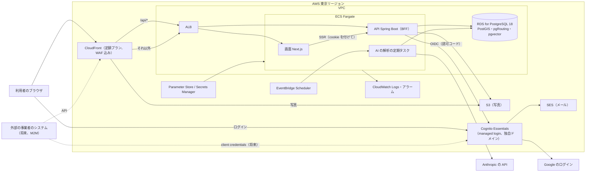

# AWS の構成（MVP）

最終更新：2026-11-01（#129）

ex-day を AWS で動かすときの、部品ごとの選び方と、手元の Docker との対応のまとめ。決定は [DEC-0017](../decisions/DEC-0017-aws-architecture-mvp.md)。認証は [DEC-0016](../decisions/DEC-0016-auth-cognito-and-user-identity.md)、費用は [cost-model.md](cost-model.md)。

## 方針

人の判断（2026-11-01）：

- **運営は1人。OS の更新や、サーバーのセキュリティの問題を抱えない**（サーバーを自分で持たない、管理型のサービスを使う）
- **常に動かす環境は本番だけ。開発・確かめは手元の Docker**（`docker compose up`）。開発者が増えたら常に動かす検証の環境を足す
- 手元で確かめられない AWS の部分は、**短命の検証環境**（必要なときだけ CDK で作り、確かめたら自動で消す）で確かめる（PR #131 のレビュー）
- **手元の Docker で試せる範囲が大きい構成にする**
- ログインの処理（BFF）は Spring（API）に置く。トークンなどの認証の情報をどこに置くかを、また考え直さずに済むように
- インフラは AWS CDK（TypeScript）で書く（Terraform にも関心はあるが、いったん CDK）

「手元の Docker で試せる範囲を大きくする」ために、次を守る。

- **アプリの中身は、標準のやり取りで外とつなぐ**：認証は OIDC、DB は PostgreSQL、ファイルは S3 の API、ログは標準出力。AWS 固有の部品は、入口（CloudFront・ALB）・置き場（ECS・RDS）・設定の渡し方の外側に限る
- **AWS にしかない仕組みを、アプリの処理の流れに入れない**：Lambda のトリガー、Step Functions、SQS などは、要るまで使わない。キューが要るときは、まず PostgreSQL の表で作る（`SELECT … FOR UPDATE SKIP LOCKED`）
- **同じコンテナイメージを、手元と本番で使う**。違いは環境変数（設定）だけにする

## 全体の図

## 部品ごとの選び方

| 部品 | 選んだもの | 理由・補足 | 外したもの |
|---|---|---|---|
| リージョン | 東京（ap-northeast-1） | 利用者の近く。データの置き場所 | ― |
| 入口・配信 | CloudFront（定額プランの Free・Pro から）→ ALB | パスで振り分け（`/api/*` は API、それ以外は画面）、同じドメインにまとめる（cookie が素直になる）。定額プランに WAF・DDoS 対策が入る。ALB は外に出さず、CloudFront の VPC オリジンで内側に置く（公式に対応している）。CDK・定額プラン・cookie と振り分けの構成は、短命の検証環境で確かめる | ― |
| 画面（Next.js） | ECS Fargate | SSR・OGP のため。API と同じ仕組みに載せ、部品を増やさない | Amplify Hosting・Vercel（入口とドメインが分かれる、仕組みが増える） |
| API（Spring Boot） | ECS Fargate | コンテナをそのまま動かす。ECS Express Mode で作りを簡単にできるかは作るときに見る | App Runner（新規の受け付けを終えた）、EC2（OS の更新を持つ） |
| ログインの処理（BFF） | API（Spring）。Spring Security の OAuth2 Client。セッションは DB に置く（Spring Session JDBC） | トークンはサーバー側だけ。タスクが複数になっても、入れ替えてもログインが切れない。画面の SSR は、ブラウザの cookie を付けて API を呼ぶ | Next.js に置く（Auth.js）：トークンの置き場を考え直すことになる |
| DB | RDS for PostgreSQL 18（db.t4g.small、Single-AZ から） | PostGIS 3.6.3・pgRouting 3.8.0・pgvector 0.8.2 が使える（#129 で確かめた）。**大きさは容量ではなく、経路の計算の CPU・メモリ・同時の接続で決める**（DEC-0017 決定7）。t4g.small と medium は同じ 2 vCPU・基準 20%（medium はメモリだけ2倍）。測った結果で T4g の上の大きさ、M 系・R 系を比べ、上げる条件と Multi-AZ にする条件を決める。CPU クレジットの追加料金を見る | Aurora（PostgreSQL 18 と拡張への対応が未確認、費用が高い） |
| AI の解析の定期処理（#127） | EventBridge Scheduler → ECS のタスク（RunTask） | API と同じコンテナイメージを、別の起動コマンドで使う。毎回起動して終わる（#127 の設定の読み込みと合う） | Lambda（仕組みとコードの置き場が増える、手元で同じに動かしにくい） |
| 写真 | S3 → CloudFront | アプリからは S3 の API で扱う | ― |
| 設定・秘密 | Systems Manager Parameter Store（無料）を基本に、ECS が環境変数として渡す。DB のパスワードは RDS と Secrets Manager の連携 | アプリは環境変数を読むだけ（手元と同じ） | ― |
| メール | SES（独自ドメイン、日本語） | Cognito のメールの OTP の送信元（DEC-0016） | Cognito の既定のメール送信（1日の通数の上限、英語） |
| 認証 | Cognito Essentials（独自ドメイン） | DEC-0016 | ― |
| ネットワーク | VPC。Fargate はパブリックのサブネット（セキュリティグループで ALB からだけ受ける）、RDS はプライベートのサブネット。**NAT ゲートウェイは置かない** | NAT は月 約$45 かかる。外への通信（Anthropic の API、Cognito など）は Fargate のパブリック IP で出す | NAT ゲートウェイ、VPC エンドポイント（要るまで） |
| ログ・監視 | アプリは標準出力に JSON で出し、CloudWatch Logs へ。CloudWatch のアラーム、AWS Budgets | メールアドレスをログに出さない・伏せる（DEC-0016 決定5） | 外の監視サービス（要るまで） |
| デプロイ | GitHub Actions → ECR → ECS。GitHub からは OIDC で AWS に入る | アクセスキーを GitHub に置かない | ― |
| インフラの定義 | AWS CDK（TypeScript） | AWS に特化し、書く量が少ない。AI に書かせてレビューで直す | Terraform（関心はある。今は CDK）、手作業（再現できない） |
| 環境 | 常に動かすのは本番だけ。必要なときだけ短命の検証環境 | 開発は手元の Docker。AWS 固有の部分は短命の検証環境（1回 約35〜50円） | 常に動かす検証の環境（開発者が増えたら足す） |
| デプロイの安全 | ECS の回路遮断と CloudWatch のアラームで自動で戻す、イメージは digest で固定、デプロイのあとのスモークテスト、後方互換の DB のマイグレーション | DEC-0017 決定8 | ― |

## 手元の Docker との対応

| 本番（AWS） | 手元（Docker） | 同じか |
|---|---|---|
| CloudFront → ALB（パスで振り分け） | リバースプロキシのコンテナ（例：Caddy・nginx）で同じ振り分け。1つのオリジン（例：`http://localhost:8000`）にまとめる | 振り分けと cookie の振る舞いは同じにする。WAF・キャッシュは手元にない |
| ECS（画面・API） | 同じコンテナイメージ | 同じ |
| AI の解析の定期タスク | 同じイメージを `docker compose run` で起動（手で、または手元の cron） | 起動のしかただけ違う |
| RDS for PostgreSQL 18＋拡張 | 今の `db`（PostgreSQL 18＋PostGIS。pgRouting・pgvector を足す） | 版をそろえる |
| ログインのセッション（Spring Session JDBC） | 同じ（DB の表） | 同じ |
| Cognito | 2通りを選べるようにする：(1) 手元の OIDC のモック（候補：navikt の mock-oauth2-server）で、ネットにつながずに動かす、(2) 開発用の Cognito のユーザープール（無料の範囲）につないで、本物の流れを確かめる | 標準の OIDC なので、ログインはどちらでも同じコードで動く。Cognito 専用の3か所（登録の `SignUp`、パスキーの登録への転送、ログアウト）は、モックのときは手元用の差し替えで動かす |
| S3 | S3 互換のコンテナ（候補：LocalStack、MinIO など。ライセンス・配布の状況は作るときに確かめる） | アプリは S3 の API で書くので同じ |
| Parameter Store・Secrets Manager | 環境変数（`.env`、git の管理外） | アプリは環境変数を読むだけ |
| SES | 手元では Cognito がメールを送る（開発用のユーザープールのとき）。アプリが自分でメールを送る機能は今はない | ― |
| CloudWatch Logs | 標準出力（`docker compose logs`） | 同じ書式 |
| Anthropic の API | 本物の API（キーは環境変数）、または記録した応答で差し替え | ― |

手元で確かめられないもの：CloudFront・WAF・ALB の細かい振る舞い（Host・cookie・CSRF の受け渡し、キャッシュの設定）、ECS の起動・入れ替え・失敗したときの戻し、RDS の拡張の導入・マイグレーション・性能、IAM の権限と秘密の注入、Cognito の独自ドメイン・SES。これらは**短命の検証環境**で確かめる（DEC-0017 決定3）。

## 費用

[cost-model.md](cost-model.md) の「構成のシナリオ」（税込み、AWS だけ）：

| シナリオ | 構成 | 月額 |
|---|---|---|
| 1 MVP の最低の稼働（低い負荷のときの床。予算の値ではない） | Fargate 2タスク・db.t4g.small（Single-AZ） | 約2.1万円 |
| 2 DB のメモリを増やした比較（実測前の仮置き。t4g.medium は CPU を増やさない） | API を 1 vCPU、db.t4g.medium | 約3.2万円 |
| 3 利用者・運営が増えたあと | Fargate 4タスク、db.t4g.large（Multi-AZ） | 約13万円 |

T4g は CPU を使い続けると CPU クレジットの追加料金が出る（平均 50% で 月 約5,800円）。

短命の検証環境は1回（2時間）約35〜50円。開発用の Cognito は無料の範囲。

## テストと確かめ方

人の考え（2026-11-01）：ログインの部分は人が確かめる。ログイン以外の画面・API のパターンを網羅するテストは、AI（Claude Code・Codex など）に書かせて回したい。

役割の分担（PR #131 のレビュー）：AI はテストを書き、保ち、失敗したときに原因を調べる。**合否は、再現できる CI の道具**（JUnit、Testcontainers、Playwright、CDK の assertions、cdk-nag、負荷・セキュリティの検査）で決める。

| 何を | どこで | 誰が | 中身 |
|---|---|---|---|
| API の単体・結合のテスト | 手元（Claude Code・Codex が手元の Mac で）と CI（GitHub Actions） | AI | 今の `api-build.yml`。DB は Testcontainers |
| 画面の通しのテスト（E2E） | 手元と CI。`docker compose up` した構成に対して Playwright | AI | ログイン以外のパターンを網羅する。ログインした状態は **OIDC のモック**で作る（別のユーザー、未ログインとの違いなども自動で試せる）。CI に E2E のジョブを足す |
| インフラの定義（CDK） | CI | AI | `cdk synth`、スナップショットのテスト、構成の点検（cdk-nag など）。AWS の鍵なしで回す。本番への反映は人が承認する |
| AWS 固有の部分（振り分け・cookie、IAM、ECS の入れ替え、RDS、Cognito の独自ドメイン） | 短命の検証環境（CDK で作り、確かめたら自動で消す） | 自動（GitHub Actions から。インフラを変えるとき・リリースの候補のとき） | 手元の構成と同じ Playwright のテストと、AWS 固有のスモークテスト |
| 経路の計算の負荷 | 代表の道路・施設のグラフで | AI が測り方を作り、人が結果で判断 | p95・p99、CPU、メモリ、同時の接続の数。DB を上げる条件を決める（DEC-0017 決定7） |
| 本番の見回り（スモークテスト） | 本番に対して、GitHub Actions から Playwright | 自動（デプロイのあと＋定期） | 読むだけの確かめ：主な画面が開く、エラーが出ない、API が応える、OGP が出る。**書き込み（投稿など）はしない** |
| 本物のログイン（Cognito） | 本番（と開発用の Cognito） | まず**人** | パスキー、メールのコード、Google の同意、ログアウト、パスキーの追加。手順は `cognito-trial.md` を元にした確かめの一覧にする。短命の検証環境で Playwright の仮想の認証器（WebAuthn）を使えば、パスキーの登録・ログイン・失敗の場合も自動にできる見込み（作るときに確かめる）。そうなれば、人は Google の同意の画面・実際の端末の使い勝手・探索的な確かめに絞れる |

- 同じ Playwright のテストを、CI（手元の構成）と本番の見回りで使い回せるようにする（本番では読むだけのものに絞る）
- 本番の見回りでは、**広告を読み込まない**（Playwright で広告のスクリプトへの通信を止める）。自動のアクセスで広告が表示・クリックされると、AdSense の無効なトラフィックになりうるため。アクセスの解析からも外す
- 本番でログインした状態の自動のテストは、MVP ではしない。要るようになったら、テスト用のアカウントとブラウザの仮想の認証器（パスキー）を使う形を検討する
- AWS のサービスの見回り（CloudWatch Synthetics）は、GitHub Actions の見回りで足りなくなったら比べる

## 作るときに確かめること

- 短命の検証環境の作り方（CDK のスタックを本番と共有し、名前と大きさだけ変える、作ってからの時間で自動で消す、GitHub Actions の権限を絞る）
- CloudFront の VPC オリジン・定額プラン・cookie と振り分けを CDK で組む（短命の検証環境で確かめる）
- ECS Express Mode で、ALB・自動の拡張・ネットワークの作りがどこまで簡単になるか（1つの ALB を画面と API で共有できるか）
- Spring Session JDBC と、画面の SSR からの API の呼び方（cookie の受け渡し、CSRF）
- 手元の OIDC のモックと、Cognito 専用の3か所の差し替えの作り
- RDS の pgRouting・pgvector の版と、手元の `db` の版をそろえる方法
- CDK のスタックの分け方（ネットワーク・DB・アプリ・認証）と、DB を消さない設定（削除の保護、スナップショット）
