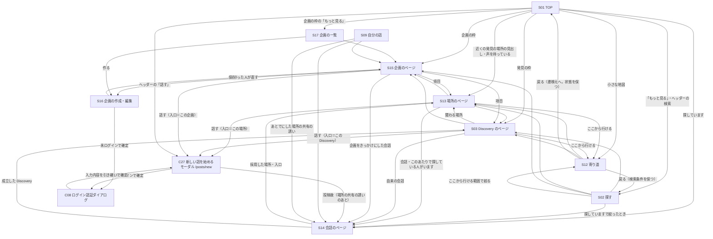

# 画面遷移

2026-11-14：[画面一覧](screen-list.md)の作り直し（Issue #135）に合わせて書き直した。新しい画面（S12〜S18）の ID は案。

- ヘッダー（C01）の「話す」「寄り道」「検索」は、どの画面からも同じ行き先になる。図では TOP からの線だけを描いた
- 新しい話を始めるのは、ヘッダーの「話す」や各ページの「話す」から開くモーダル[C27（新しい話を始める）](ui/components/C27-post-new.md)で行う。モーダルはどの画面からも開け、URL（`/posts/new`）を直接開いた場合も表示できる。場所・Discovery・企画のページから開いたときは、入口を引き継ぐ。入口から場所が決まる会話は、始まりの時点でその場所を採用する（論理設計 4.3節）
- 投稿の直後、会話に採用した場所がなければ、C27 の中で場所の共有を誘う（DEC-0023）。答えた・断った・あとでのどれでも、S14（会話のページ）へ進む
- 既存の会話への返信は、S14 の入力欄で行い、画面を遷移しない
- 入口は認証状態にかかわらず表示し、未ログインでも入力を始められる。投稿・企画の作成の確定時に C08（ログイン認証ダイアログ）でログインを求め、入力内容はログイン後に引き継ぐ（[DEC-0010](decisions/DEC-0010-duplicate-conversations-and-posting-auth.md) 決定2）
- S18（運営の管理）は、一般の画面からの遷移を持たない。S18 の一覧から、運営の権限で一般の画面（S03・S13・S14・S15）の詳細を開く（[画面一覧](screen-list.md)の「運営の権限」）
- S12（寄り道）から戻るときは、遷移元（TOP・S02・S03・S13）に戻り、遷移元の状態（TOP の表示位置、S02 の検索条件と結果の位置など）を保つ。図では TOP と S02 だけを描いた
- S02 は「探しています」で絞ったときだけ、場所が決まっていない会話・問いを結果に出し、S14 へ進める。それ以外の会話は検索の対象にしない
- v0.3 の「投稿直後に似た Discovery を案内し、器として作られた成立前の Discovery の S03 へ進む」流れは、DEC-0020（会話が器）により使わない。似た会話・Discovery の案内を投稿の直後に出すかは画面の設計で決める
